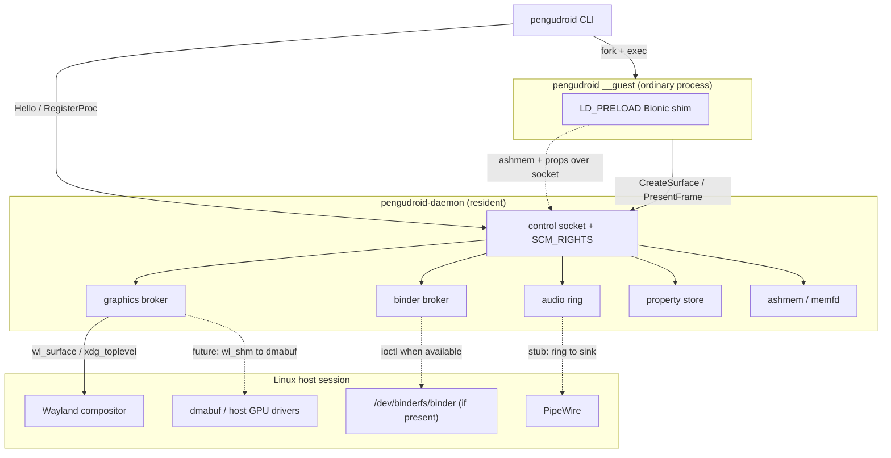

# PenguDroid architecture

This document explains how each translation layer works, and where the honest
boundaries of the MVP are.

## The shape of the system

## 1. The daemon (`pengudroid-daemon`)

A single resident process, in the spirit of `wineserver`. It owns everything
that is expensive or shared, so guests start with no boot phase:

* **control socket** — a Unix socket (`$XDG_RUNTIME_DIR/pengudroid/daemon.sock`,
  mode `0600`) speaking the length-prefixed protocol in `pengudroid-proto`.
  Where a sandbox refuses `bind(2)` with `EPERM`, the daemon falls back to an
  abstract socket derived from the uid and file name; clients connect to either
  form through `Connection::connect_endpoint`.
* **fd passing** — ashmem regions are handed to guests as real file descriptors
  over `SCM_RIGHTS` (`pengudroid-socket`), so pixels are never copied through
  the control channel.
* **lifecycle** — accepts connections on a non-blocking listener, one thread per
  client, and exits cleanly on `SIGTERM`/`SIGINT` or a `Shutdown` message.

It is deliberately dependency-light (`libc` plus the Wayland client crates) so it
stays small and cheap to keep resident.

## 2. Binder

Android's IPC is binder. PenguDroid has two backends behind one interface:

* **Kernel binder** — if a binder device answers the `BINDER_VERSION` ioctl
  (`/dev/binderfs/binder`, `/dev/binder`, ...), the daemon can drive real
  `BINDER_WRITE_READ` transactions. The ioctl numbers and the
  `struct binder_write_read` layout are asserted at compile time (48 bytes) so
  the ABI cannot silently drift.
* **Userspace broker** — on desktop Linux the kernel module is frequently absent
  (`CONFIG_ANDROID_BINDER_IPC` off, or not loadable without root), so the daemon
  runs a broker that preserves the *shape* of binder — named services get
  integer handles, and transactions carry `(handle, code, flags, data)` — routed
  over the control socket.

Guests address platform services by name (`activity`, `package`,
`SurfaceFlinger`, `media.camera`, `phone`, ...). Each has an implementation in
`pengudroid-daemon::stubs` that returns a well-formed, honest answer so probes do
not hang.

### 2.1 Parcels and the telephony service

A binder transaction's payload is an Android `Parcel`, and a reply must be
marshalled in exactly that format or the caller reads garbage. `pengudroid-daemon::parcel`
implements the subset the platform services need — little-endian `int32`/`int64`,
`boolean` as a 32-bit `0`/`1`, `String` as a UTF-16LE length-prefixed array with a
NUL terminator, `byte[]`, a nullable `Parcelable` presence flag, and `List`
counts.

`ITelephony` is the first service to use it for real. Its transaction codes are
not free choices: the AIDL compiler numbers methods in declaration order from
`FIRST_CALL_TRANSACTION` (1), so `stubs::telephony_transact` uses that numbering
for the methods a normal app reaches through `TelephonyManager` (`getCallState`
= 34, `hasIccCard` = 68, `getDeviceId` = 146, ...) and marshals each reply. The
modelled device is a no-SIM, radio-off phone, so every query answers the inert
value a device without a SIM reports — which is what lets apps that probe
telephony degrade gracefully instead of throwing. `pengudroid telephony`
transacts against the service and decodes the replies, so the marshalling is
observable end to end.

A **guest may also publish its own service**. `RegisterService` binds the name
to the connection that registered it; a transaction on that handle is forwarded
to the owner as a `GuestCall`, the owner answers with `GuestCallReply`, and the
daemon relays it to the caller as a normal `BinderReply`. Both directions run on
each connection's own serving thread, which selects between its socket and an
inbox channel, so nested calls (A calling B while B waits on C) make progress
instead of deadlocking. When the owning process disconnects, its services are
dropped and later calls fall through to the broker's `-EINVAL`.

## 3. Graphics: replacing SurfaceFlinger with Wayland

On real Android, pixels flow
`EGL/GLES -> gralloc GraphicBuffer -> BufferQueue -> SurfaceFlinger -> display`.
**PenguDroid does not run SurfaceFlinger.** It collapses the chain:

1. A guest asks the daemon to `CreateSurface { width, height, title }`.
2. The daemon allocates an ashmem region (memfd), creates `wl_surface` plus
   `xdg_toplevel` on the user's compositor, wraps the region in a `wl_shm`
   buffer, attaches it, and commits.
3. The daemon returns the surface id **and the region fd** to the guest.
4. The guest `mmap`s the fd and writes pixels; `PresentFrame` asks the daemon to
   commit the same buffer to Wayland.

Because the guest and the compositor share one buffer, there is no copy through
a display server. `wl_shm` is the zero-GPU path; the upgrade to
`zwp_linux_dmabuf_v1` with host-Vulkan-allocated buffers (a Lepton-style driver
pass-through, but without a container) is a localized change in
`graphics.rs::finalize_surface`, since the daemon already owns the allocation and
its fd.

`xdg_wm_base` pings are answered (or the compositor drops us), `configure` is
acked before the first attach, and window-close events are tracked.

## 4. Audio

`AudioBroker` owns a 48 kHz / stereo / S16_LE ring buffer as an ashmem region and
reports the available sink. Output is a genuine PipeWire stream: rather than bind
`libpipewire` (whose C ABI needs many structs and headers), PenguDroid drives the
session's own **`pw-cat`** over a pipe — `pw-cat -p -a --rate 48000 --channels 2
--format s16 -` reads raw PCM on stdin — with `aplay` as a fallback. The
`AudioSink` type and `pengudroid audio-test` exercise it (silence by default,
`--tone` for a quiet 440 Hz sine).

On top of that, the Bionic shim implements the **OpenSL ES** buffer-queue player:
`slCreateEngine`, `SLObjectItf_`, `SLEngineItf` (output mix + audio player),
`SLPlayItf`, and `SLAndroidSimpleBufferQueueItf`. `Enqueue` forwards the buffer
to a lazily-started per-player `pw-cat`. `fixtures/opensl-app` compiles against
the canonical OpenSL ES headers, so the hand-written vtables are checked against
the real ABI. Recorders, prefetch, effects and the remaining interfaces return
`SL_RESULT_FEATURE_UNSUPPORTED`.

The daemon half is implemented: a client asks for the ring (`GetAudioRing`, fd
attached), writes PCM into it, and sends `AudioWrite { offset, len }`; the daemon
maps the ring and forwards that slice to the sink, starting `pw-cat` on first
use. `AudioBroker::write_ring` validates the range against the ring size.

The OpenSL ES layer is implemented on top: `slCreateEngine`, the object model
(`SLObjectItf_`), the engine/output-mix/player interfaces, and the Android simple
buffer queue (`Enqueue` forwards each buffer to the player's `pw-cat`).
`fixtures/opensl-app` compiles against the canonical headers, so the vtables are
verified against the real ABI.

Remaining: recorders, prefetch status, effects, and the rest of the OpenSL ES
interface surface (currently `SL_RESULT_FEATURE_UNSUPPORTED`).

## 5. ashmem

Modern Android implements ashmem on top of memfd internally, and so does
PenguDroid: `memfd_create(MFD_CLOEXEC | MFD_ALLOW_SEALING)` plus `ftruncate`.
Pinning is emulated with `F_ADD_SEALS` of `F_SEAL_SHRINK | F_SEAL_GROW`, which —
as the tests confirm — makes a later `ftruncate` fail with `EPERM`. This is what
lets a guest safely map a region `PROT_EXEC` and rely on it not moving.

## 6. The Bionic to glibc shim

`pengudroid-shim` is an `LD_PRELOAD` shared object that exports Android's Bionic
symbol names so they interpose over the real ones in a guest process:

* logging — `__android_log_print`, `__android_log_write`, `__android_log_assert`
  (the variadic entry points are C shims generated by `build.rs`; they format
  with the host `vsnprintf`, so `"x=%d"` logs `x=42`)
* `ashmem_create_region` and friends, mapped to memfd
* `android_get_device_api_level`, reporting 36
* the `__system_property_*` family, backed by an in-process store seeded with
  Android 16 defaults

It carries a `.init_array` constructor so its load is visible.

## 7. The guest and the CLI

`pengudroid run app.apk`:

1. parses the APK's binary manifest (ZIP + AXML) for the package, SDK levels, and
   the MAIN/LAUNCHER activity;
2. ensures the daemon is running (starting it if needed);
3. `fork + exec`s itself as `pengudroid __guest ...` — a normal Linux process;
4. the guest asks for a surface, maps it, registers with the daemon for `ps`,
   and animates until interrupted.

Ctrl-C on the CLI propagates to the guest. `pengudroid ps` lists guests by
querying the daemon's process table, which is checked against `/proc` for
liveness.

`pengudroid start app.apk` takes the other route: the CLI sends `RunApk` and the
*daemon* forks `pengudroid __guest --apk ...`, so the guest is owned by the
daemon rather than the terminal. The daemon reaps the child, remembers its exit
status, and `pengudroid start --wait` (or any client via `QueryRun`) polls it.
Closing a guest's window on the compositor side sends `SIGTERM` to the guest's
pid, so the process tree stays clean in both modes.

## 8. Native libraries: measure, then load

An Android `.so` cannot be `dlopen`ed on glibc unless three independent
obstacles are cleared. All three were found empirically on real APK libraries.

### 8.1 Measure coverage (`pengudroid deps`)

`pengudroid-elf` reads a library's **undefined dynamic symbols** (imports) and
its **defined exports** from `.dynsym` (ELF32 and ELF64). `pengudroid deps`
compares those imports against the shim's *actual* exported symbols — read from
the built `libpengudroid_shim.so`, so the report cannot drift — and prints the
Bionic coverage and any gaps. On DroidFish's libraries the only Bionic imports
are `__errno` and `android_set_abort_message`, both covered.

### 8.2 Make symbol references unversioned (`de-bionic`)

Bionic versions every libc symbol against a single node per library — `libc.so`
→ `LIBC`, `libm.so` → `LIBM`, `libdl.so` → `LD` — while glibc exports granular
`GLIBC_2.x`. A Bionic object therefore both demands `version 'LIBC' not found`
and requires `free@LIBC`, `__cxa_finalize@LIBC`, ... which glibc's versioned
`free` cannot satisfy.

`pengudroid_elf::strip_android_versions` fixes the *per-symbol* half: it rewrites
every non-zero `.gnu.version` entry to *global* (`1`), so references become
unversioned and resolve normally against glibc (or the shim if it defines them).

Two plausible-looking alternatives were tried and rejected:

* **Zeroing the `VERNEED` record** does nothing useful — glibc walks the
  `vn_aux` chain unconditionally (ignoring `vn_cnt`), so it still finds `LIBC`.
* **Retagging `DT_VERNEED`** to an “unused” value is *dangerous*: some values are
  real tags (`0x7fffffff` is `DT_FILTER`, which made the loader try to load the
  library's own entry-point name as an auxiliary object; other values crashed in
  relocation). The requirement is instead satisfied honestly (see 8.3).

### 8.3 Satisfy the version requirement and map sonames (`libpath`)

The *file-level* requirement remains: the object's `VERNEED` says its `libc.so`
must provide `LIBC`. So the provider must actually carry that node. Rather than
ship a separate stub, the **shim itself** is given the nodes: its build script
(`crates/pengudroid-shim/build.rs`) links a version script assigning three
anchor symbols to `LIBC`, `LIBM` and `LD`, leaving the rest of its exports
global and unversioned.

`pengudroid libpath` then materialises a cache directory where every Bionic
soname — `libc.so`, `libm.so`, `libdl.so`, `liblog.so`, `libandroid.so`, ... —
is a symlink to the shim. That satisfies the requirement *and* supplies the
Bionic symbols; glibc's `libc.so.6` is already loaded in the process, so
unversioned references like `free` resolve from there. `libz`/`libstdc++` map to
the host libraries. The directory is used as `LD_LIBRARY_PATH`.

### 8.4 Put it together (`nativelib`)

`pengudroid nativelib <lib.so> [--call SYM]` runs both and then **actually
attempts the load**: it patches a copy, sets up the compat directory, and
re-execs itself as the hidden `__dlopen` command under `LD_PRELOAD=<shim>` +
`LD_LIBRARY_PATH=<compat>`. With `--call` it resolves the named export and
invokes it as a nullary `int`-returning function, printing the result. Verified
on real APK libraries (`librtb.so`, `libgtb.so`, `libnativeutil.so`, x86-64),
all of which `dlopen`, and on `fixtures/native-demo`, whose entry point returns
`500500` through the shim.

`nativelib --apk <app.apk> [--abi <abi>]` extends this from one file to a whole
application: it extracts an APK's `lib/<abi>/*.so` entries, strips each into a
shared scratch directory, and loads them as a set, so dependencies *between* an
app's own libraries (`DT_NEEDED libc++_shared.so`) resolve inside that directory.
Entries for other ABIs are reported as skipped, with the reason.

**What this does not mean:** loading is not running. Teardown
(`dlclose`/`atexit`) can crash because C++ static destructors assume Bionic
runtime state (observed on `librtb.so`, hence `__dlopen` exits via `_exit`
without running destructors). The `__sF` stdio array satisfies linkage but is
not ABI-compatible with glibc's `FILE`.

### 8.5 Running, not just loading

Three things separate *loading* a Bionic library from *running* it.

**Teardown.** C++ libraries register static destructors via `__cxa_atexit`; those
destructors assume Bionic runtime state and fault on glibc (this is what
segfaulted `librtb.so` on `dlclose`). The shim interposes `__cxa_atexit`,
`atexit`, `__cxa_thread_atexit_impl` and `__cxa_finalize`. When
`PENGUDROID_SUPPRESS_DESTRUCTORS` is set, registration is skipped and finalisation
is a no-op; otherwise the calls are forwarded to glibc via `dlsym(RTLD_NEXT)`.
`pengudroid nativelib --dlclose` sets it for guests and exercises the teardown
path, so the difference is observable (faulting destructor: 139 → 0).

**`__sF`.** Bionic exposes `FILE __sF[3]` with `stdout`/`stderr` as
`&__sF[1..2]`. glibc has no such symbol and a different `FILE` layout, so the
shim interposes the common stdio calls and rewrites an `__sF`-resident `FILE*`
to glibc's real stream before forwarding (the index comes from
`offset / 152`, Bionic's LP64 `sizeof(FILE)`). `fprintf` cannot build a
`va_list` in stable Rust, so it writes its format string literally; `vfprintf`
receives a real `va_list` and is fully forwarded. `fclose` on a standard stream
is a no-op so guest code cannot close the host's streams.

**Library sets.** An app that ships `libc++_shared.so` needs it loaded *with* its
dependents. `nativelib --apk` extracts and strips the whole `lib/<abi>` set into
one directory, so `DT_NEEDED` entries resolve inside it rather than against the
host. `fixtures/cpp-cascade` exercises exactly this: a consumer library depends
on the bundled runtime and returns `42` through it.

A build detail worth recording: the variadic log entry points are written in C
(stable Rust cannot define `...`), and Rust's cdylib export list hides
C-defined symbols while a static-archive member is dropped if unreferenced. The
build therefore links them with `--undefined` and lists them in the `LIBC` node
of the version script (a symbol in *no* version node is hidden by rustc's export
list); without that, `__android_log_print` was silently absent from the `.so`.

### 8.6 Android's packed relocations (`APS2`)

A modern Android `.so` does not carry a plain `.rela.dyn`. It carries an
`APS2`-compressed stream tagged `DT_ANDROID_RELA` (and relative relocations
tagged `DT_ANDROID_RELR`), neither of which glibc recognises. The failure mode
is nasty: the library *loads* — every symbol resolves — but **no relocations are
applied**, so the first constructor dereferences a null GOT slot and the process
segfaults with no diagnostic.

`pengudroid_elf::unpack_android_relocations` (called from `de-bionic`) decodes
the `APS2` group stream into ordinary `RELA` entries. The unpacked table is
larger than the packed one, so it cannot be written in place: the function
appends it at the end of the file under a **new `PT_LOAD`**, moves the
program-header table there (with one extra entry), and retags
`DT_ANDROID_RELA`/`DT_ANDROID_RELASZ`/`DT_ANDROID_RELR`/... as the standard tags.
A new segment is used rather than extending the last one because that segment
usually carries `.bss`, and growing its file size would overwrite the
zero-filled tail. This is what makes `libc++.so` — and therefore ART — load at
all.

## 9. GPU path: host EGL/GLES and dma-buf presentation

`pengudroid-hostgpu` binds the **host's** graphics stack with `dlopen` — no
build-time EGL/GLES/GBM headers or link libraries. It resolves EGL and GLES
entry points (`eglGetProcAddress` first, then `dlsym`) and provides:

* [`info`](crate::GpuInfo) — EGL/GL vendor and version, GL renderer/version,
  and whether `libgbm`, dma-buf export/import, and the GBM/surfaceless
  platforms are available.
* `Offscreen` — an EGL context created on the **surfaceless** platform (Mesa's
  `EGL_MESA_platform_surfaceless`), with an RGBA8 FBO. `render` clears and
draws a triangle with a tiny GLES2 program; `read_pixels` reads the FBO back
  (used for verification); `export_dmabuf` turns the FBO's texture into an
  `EGLImage` and exports it with `EGL_MESA_image_dma_buf_export`, yielding an fd,
  stride, fourcc and DRM modifier.

Presentation is the zero-copy counterpart of the `wl_shm` path. The daemon
binds `zwp_linux_dmabuf_v1` (v3+, for modifiers); a guest renders on the GPU,
exports a dma-buf, and sends `PresentDmabuf` with the fd over `SCM_RIGHTS`. The
daemon builds a `zwp_linux_buffer_params_v1`, calls `create_immed`, attaches the
resulting `wl_buffer` to the **existing** surface, commits, and keeps the fd
alive. Nothing is copied through the CPU and no shared-memory pool is involved.

The guest runtime prefers this path when `Offscreen::new` succeeds and the
compositor supports the protocol, falling back to `wl_shm` otherwise. The
`--dmabuf-selftest` command exercises the whole chain and includes a negative
check (a plain memfd must be rejected) so a silent pass cannot mask a broken
acceptance verdict.

### 9.1 An app's own EGL calls (`pengudroid-gleshim`)

`crates/pengudroid-gleshim` is a Bionic-compatible **`libEGL`** (plus a small
`libGLESv2` surface). It resolves the **host's** EGL/GLES with `dlopen` and
implements EGL on a surfaceless host context:

* `eglGetDisplay` uses `EGL_MESA_platform_surfaceless`; `eglInitialize`,
  `eglChooseConfig`, `eglCreateContext`, `eglBindAPI` and the query/attribute
  calls forward to the host.
* `eglCreateWindowSurface` ignores the opaque `ANativeWindow` and allocates a
  virtual surface (`PENGUDROID_SURFACE_W`/`_H`, default 720×1280).
* `eglMakeCurrent` makes the host context current and binds an RGBA8 FBO for that
  surface, so the app's GL draws land there.
* `eglSwapBuffers` exports the FBO texture as a dma-buf
  (`EGL_MESA_image_dma_buf_export`, passing the **current context** to
  `eglCreateImageKHR` — `EGL_NO_CONTEXT` segfaults on iris) and sends
  `PresentDmabuf` to the daemon. The shim creates a surface on demand (or uses
  `PENGUDROID_SURFACE_ID`) and expects an `Ack`; if the daemon is absent it
  returns `EGL_FALSE` instead of hanging.

`EGL_GL_TEXTURE_2D_KHR` → dma-buf → `zwp_linux_dmabuf_v1` is the app-facing form
of the zero-copy path. `fixtures/egl-app` is a native program that loads the
shim, creates a context and window surface, clears 5 frames and swaps: it reports
`5 frames swapped (GPU -> dma-buf -> Wayland)`.

Still missing on this front: `gralloc`/`AHardwareBuffer` compatibility, hardware
composition, and Vulkan (the host Vulkan ICDs can be loaded, but no translation
layer drives them yet).

One deliberate shortcut: the compat directory maps `libEGL.so` to our shim but
`libGLESv2.so` to the **host driver**. Our shim makes the host context current
and binds its FBO, so direct `gl*` calls land in the right place — and the app
gets the *full* GLES entry-point surface rather than the handful the shim
exports. (Apps that resolve GL through `eglGetProcAddress` get host pointers
anyway.)
`libOpenSLES.so` resolves to the Bionic shim, which implements the buffer-queue
player (engine, output mix, audio player, `Enqueue` → `pw-cat`) in addition to
exporting `slCreateEngine` and the `SL_IID_*` identifiers.

With those mappings and the fortify/NDK stubs, real application libraries load:
Dolphin's `libmain.so` (15 MB) and PPSSPP's `libppsspp_jni.so` (27 MB) both
`dlopen` under `pengudroid nativelib --apk`.

## 10. The ART attempt

The end goal is to host Google's ART rather than reimplement it. The ART APEX
(`/system/apex/com.android.art/lib64`) is extracted with `debugfs` and its whole
dependency closure is `de-bionic`'d, then loaded. Three things had to be solved
before `libart.so` would even `dlopen`:

* **Packed relocations** (§8.6) — without them every constructor faults.
* **The linker API.** `libart.so` `DT_NEEDED`s `libdl_android.so`, which needs
  `ld-android.so`. The shim exports the whole linker surface
  (`android_dlopen_ext`, `android_create_namespace`, `android_link_namespaces`,
  `android_get_exported_namespace`, the `__loader_*` entry points) and maps
  Android's per-app namespaces onto glibc's single flat namespace; the compat
directory points `libdl_android.so` and `ld-android.so` at the shim. The shim
  also gained a `SONAME`, so those aliases resolve to the already-loaded shim
  instead of mapping it again.
* **The Bionic runtime surface.** CFI (`__cfi_slowpath`), fdsan, the full
  `_FORTIFY_SOURCE` set, `_ctype_`, `getprogname`, `__gnu_strerror_r`, the
  `*64` signal calls, `__system_properties_init`, the `liblog` event API, and the
  `liblog` logger API (`__android_log_set_logger` and friends).

Two traps are worth recording because they cost real debugging time:

* **Weak-undefined symbols resolve to `null` silently.** libbase references
  `__android_log_set_logger` as a *weak* undefined symbol; with no definition it
  resolves to address zero, and the first call jumps to `null` — a crash with no
  diagnostic. Auditing the closure for weak-undefined symbols that neither the
  shim nor glibc provides is what surfaced it (and the rest of the liblog logger
  API).
* **Bionic and glibc number `sysconf` differently.** ART checks
  `sysconf(_SC_PAGESIZE)`, which is Bionic 39 but glibc 30; glibc reads 39 as
  `_SC_BC_STRING_MAX` and answers 99, so the check fails. The shim translates the
  names Android uses and passes the rest through — which keeps a *glibc* caller
  correct, because glibc's `_SC_PAGESIZE` (30) and `_SC_NPROCESSORS_ONLN` (84)
  are not Bionic names the table translates. The translation must reach the real
  `sysconf` through `dlsym(RTLD_NEXT)`: naming it directly resolves to the shim's
  own definition and recurses forever.
* **Structs that look compatible are not.** `sigset_t` and `struct sigaction`
  are the ones that bit us. Bionic (LP64) has an 8-byte `sigset_t` and a 32-byte
  `struct sigaction`; glibc has 128 and 152. `libart`'s `fault_handler.cc`
  static initialiser stores the *current* `SIGSEGV` action into a 32-byte field
  at offset `0x30` of the 88-byte `gFaultManager` — glibc's 152-byte write ran
  120 bytes past it and cleared `initialized_` (offset `0x50`), so
  `FaultManager::Init()` always tripped `CHECK(!initialized_)`. The shim now
  interposes the signal API and converts: the bit numbering is shared (signal
  `n` is bit `n-1`), so a `sigset_t` is a widening of one 64-bit word, and a
  `sigaction` is a field-by-field copy.

With those in place `libart.so` (9 MB) and its closure load, and
`JNI_CreateJavaVM` returns **`JNI_OK`** with a live `JavaVM`. `GetVersion()`
confirms `JNI_VERSION_1_6`, so the JNI table layout is right; the JNI wrapper in
`crates/pengudroid-cli/src/jni.rs` indexes the table by the standard slot
numbers and `--dump-jni` prints the resolved table for debugging (field
accessors have no `V`/`A` variants, which makes a hand-written table easy to get
wrong by exactly 44 slots — the VM's own symbol table settles it).

Java then executes: a real APK's `classes.dex` is put on `-Djava.class.path` and
resolved through the system class loader (`FindClass` alone only sees the boot
class path), and `android.app.ActivityThread.main` can be invoked.

### 10.1 Framework natives

`libandroid_runtime.so` exports ~150 `register_android_*` functions but has **no
`JNI_OnLoad`**: on a device `app_process` holds them in a static array (`gRegJNI`)
and calls each with the `JNIEnv`. `--register-natives <lib>` does the same thing
generically — it reads the library's exported `register_*` symbols and calls them
— but the *order* matters: `gRegJNI` registers the logging natives first and
`Binder` last, because `register_android_os_Binder` triggers `StrictMode.<clinit>`,
whose natives must already exist. Symbol-table order is arbitrary, so the shim
imposes that shape explicitly. With all 150 registered, `android.os.Trace`,
`android.util.Log` and Binder have their natives and `ActivityThread.main` runs
until it needs `system_server`.

### 10.2 Launching apps (`pengudroid launch`)

`launch` is the Proton-shaped front end. It creates a per-application *prefix*
(`$XDG_DATA_HOME/pengudroid/prefixes/<package>`) holding `files`, `cache`,
`code_cache`, `shared_prefs`, and a `pengudroid.env` file of `KEY=VALUE`
overrides, and picks a backend from the APK itself: an x86_64 `NativeActivity`
payload means `native` (no Java at all), otherwise the presence of `classes.dex`
means `art`. `--backend` overrides the choice, and `--sysroot` (or
`PENGUDROID_ART_SYSROOT`) points the ART backend at an extracted system tree.
Nothing in the choice depends on the GPU vendor.

## 11. NativeActivity apps without ART

A meaningful class of Android games is `android.app.NativeActivity`: the
framework loads `libmain.so` and calls `ANativeActivity_onCreate`. That lifecycle
is small enough to host directly, so `pengudroid native` runs those apps with no
Android runtime at all.

1. The CLI extracts the APK's `lib/<abi>/*.so`, strips Android versioning, and
   picks the library that exports `ANativeActivity_onCreate`.
2. It re-execs itself as `__native` under `LD_PRELOAD=<shim>:<gleshim>` and
   `LD_LIBRARY_PATH=<compat>:<libdir>`.
3. `__native` builds the `ANativeActivity` structure (callbacks table, data
   paths, asset manager, SDK level), calls `onCreate`, then `onStart`,
   `onResume`, `onWindowFocusChanged` and `onNativeWindowCreated`, and keeps the
   process alive until the app calls `ANativeActivity_finish`, the window closes,
   or `--seconds` elapses.
4. The app's EGL/GLES calls go to `pengudroid-gleshim`; every `eglSwapBuffers`
   exports the FBO as a dma-buf and the daemon commits it to the Wayland
   surface.

The NDK surface the app needs is implemented in the shim:

* **`AAssetManager`** reads entries straight out of the APK (a small ZIP reader
  in `pengudroid-shim/src/zip.rs`), including `AAssetDir` enumeration.
* **`ALooper`** is a real `poll(2)` loop (`addFd`/`removeFd`/`pollOnce`/
  `pollAll`/`wake`), so an app's main thread blocks instead of spinning.
* **`ANativeWindow`** reports the surface geometry from
  `PENGUDROID_SURFACE_W`/`_H`; the pointer itself is opaque to the EGL shim.
* **`ANativeActivity_finish`** sets a flag the host polls.

`fixtures/native-game` is a playable game built this way: 1280×720 at ~56 fps on
an RTX 3080, with one dma-buf per frame.

## 12. Vulkan

Vulkan's ABI is identical on Android and Linux, and Android's `libvulkan.so` is
a loader. PenguDroid therefore does not translate Vulkan: `pengudroid libpath`
maps the Bionic soname `libvulkan.so` onto the **host** loader
(`libvulkan.so.1`), which finds the real ICDs (NVIDIA/AMD/Intel). An app's
`vkCreateInstance`/`vkEnumeratePhysicalDevices`/`vkCreateDevice` reach the
driver directly; `fixtures/native-vulkan` verifies this against an RTX 3080.

## 13. Optional isolation

`--isolate` applies `PR_SET_NO_NEW_PRIVS` and a seccomp BPF filter that refuses
33 syscalls an app never needs and that are the usual escape hatches (`ptrace`,
`process_vm_*`, `mount`, `pivot_root`, `chroot`, `unshare`/`setns`, module
loading, `bpf`, `perf_event_open`, `keyctl`, `reboot`, `kexec_*`, ...). It is a
hardening filter, not a sandbox: the filesystem and network are still shared.

## Why this is faster than a container

Waydroid/Anbox boot an Android userspace inside an LXC container (or a VM):
`init`, zygote, `system_server`, SurfaceFlinger, and namespace setup, all before
the first app frame. PenguDroid has none of that. The daemon is already resident,
so launching an app is a `fork + exec` plus a socket round-trip: no Android boot,
no zygote, no namespace overhead, and no second display server.
