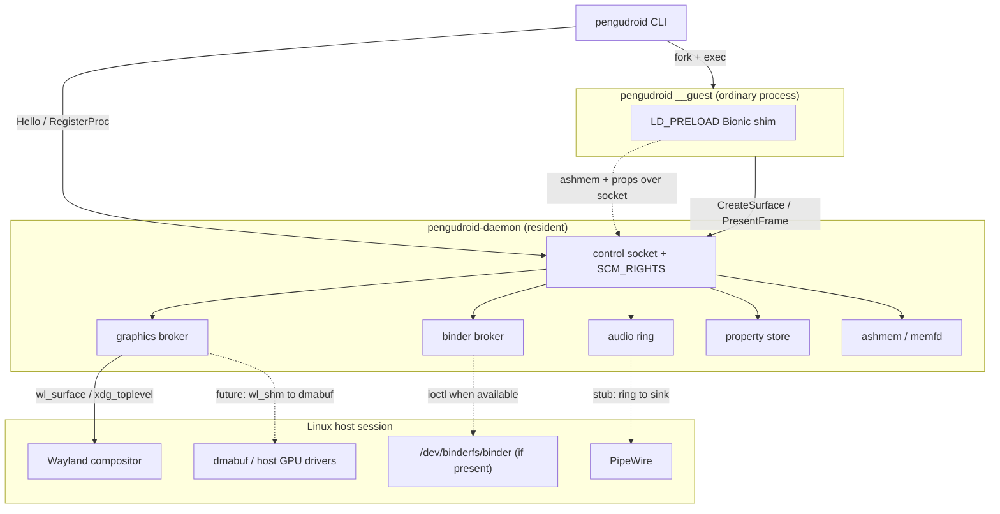

# PenguDroid architecture

This document explains how each translation layer works, and where the honest
boundaries of the MVP are.

## The shape of the system

## 1. The daemon (`pengudroid-daemon`)

A single resident process, in the spirit of `wineserver`. It owns everything
that is expensive or shared, so guests start with no boot phase:

* **control socket** — a Unix socket (`$XDG_RUNTIME_DIR/pengudroid/daemon.sock`,
  mode `0600`) speaking the length-prefixed protocol in `pengudroid-proto`.
* **fd passing** — ashmem regions are handed to guests as real file descriptors
  over `SCM_RIGHTS` (`pengudroid-socket`), so pixels are never copied through
  the control channel.
* **lifecycle** — accepts connections on a non-blocking listener, one thread per
  client, and exits cleanly on `SIGTERM`/`SIGINT` or a `Shutdown` message.

It is deliberately dependency-light (`libc` plus the Wayland client crates) so it
stays small and cheap to keep resident.

## 2. Binder

Android's IPC is binder. PenguDroid has two backends behind one interface:

* **Kernel binder** — if a binder device answers the `BINDER_VERSION` ioctl
  (`/dev/binderfs/binder`, `/dev/binder`, ...), the daemon can drive real
  `BINDER_WRITE_READ` transactions. The ioctl numbers and the
  `struct binder_write_read` layout are asserted at compile time (48 bytes) so
  the ABI cannot silently drift.
* **Userspace broker** — on desktop Linux the kernel module is frequently absent
  (`CONFIG_ANDROID_BINDER_IPC` off, or not loadable without root), so the daemon
  runs a broker that preserves the *shape* of binder — named services get
  integer handles, and transactions carry `(handle, code, flags, data)` — routed
  over the control socket.

Guests address platform services by name (`activity`, `package`,
`SurfaceFlinger`, `media.camera`, `phone`, ...). Each has a stub implementation
in `pengudroid-daemon::stubs` that returns a well-formed, honest answer (for
example "zero cameras" or "radio off") so probes do not hang.

## 3. Graphics: replacing SurfaceFlinger with Wayland

On real Android, pixels flow
`EGL/GLES -> gralloc GraphicBuffer -> BufferQueue -> SurfaceFlinger -> display`.
**PenguDroid does not run SurfaceFlinger.** It collapses the chain:

1. A guest asks the daemon to `CreateSurface { width, height, title }`.
2. The daemon allocates an ashmem region (memfd), creates `wl_surface` plus
   `xdg_toplevel` on the user's compositor, wraps the region in a `wl_shm`
   buffer, attaches it, and commits.
3. The daemon returns the surface id **and the region fd** to the guest.
4. The guest `mmap`s the fd and writes pixels; `PresentFrame` asks the daemon to
   commit the same buffer to Wayland.

Because the guest and the compositor share one buffer, there is no copy through
a display server. `wl_shm` is the zero-GPU path; the upgrade to
`zwp_linux_dmabuf_v1` with host-Vulkan-allocated buffers (a Lepton-style driver
pass-through, but without a container) is a localized change in
`graphics.rs::finalize_surface`, since the daemon already owns the allocation and
its fd.

`xdg_wm_base` pings are answered (or the compositor drops us), `configure` is
acked before the first attach, and window-close events are tracked.

## 4. Audio

`AudioBroker` probes for `libpipewire-0.3.so.0` at runtime with `dlopen` (no
build-time headers) and allocates a PCM ring buffer as an ashmem region. The
transport and the availability probe are real; the thread that drains the ring
into a PipeWire virtual sink is the next milestone.

## 5. ashmem

Modern Android implements ashmem on top of memfd internally, and so does
PenguDroid: `memfd_create(MFD_CLOEXEC | MFD_ALLOW_SEALING)` plus `ftruncate`.
Pinning is emulated with `F_ADD_SEALS` of `F_SEAL_SHRINK | F_SEAL_GROW`, which —
as the tests confirm — makes a later `ftruncate` fail with `EPERM`. This is what
lets a guest safely map a region `PROT_EXEC` and rely on it not moving.

## 6. The Bionic to glibc shim

`pengudroid-shim` is an `LD_PRELOAD` shared object that exports Android's Bionic
symbol names so they interpose over the real ones in a guest process:

* logging — `__android_log_print`, `__android_log_write`, `__android_log_assert`
* `ashmem_create_region` and friends, mapped to memfd
* `android_get_device_api_level`, reporting 36
* the `__system_property_*` family, backed by an in-process store seeded with
  Android 16 defaults

It carries a `.init_array` constructor so its load is visible. Full `printf`
formatting of the variadic log functions is intentionally out of scope for the
MVP and documented in the code.

## 7. The guest and the CLI

`pengudroid run app.apk`:

1. parses the APK's binary manifest (ZIP + AXML) for the package, SDK levels, and
   the MAIN/LAUNCHER activity;
2. ensures the daemon is running (starting it if needed);
3. `fork + exec`s itself as `pengudroid __guest ...` — a normal Linux process;
4. the guest asks for a surface, maps it, registers with the daemon for `ps`,
   and animates until interrupted.

Ctrl-C on the CLI propagates to the guest. `pengudroid ps` lists guests by
querying the daemon's process table, which is checked against `/proc` for
liveness.

## 8. Native libraries: measure, then load

An Android `.so` cannot be `dlopen`ed on glibc unless three independent
obstacles are cleared. All three were found empirically on real APK libraries.

### 8.1 Measure coverage (`pengudroid deps`)

`pengudroid-elf` reads a library's **undefined dynamic symbols** (imports) and
its **defined exports** from `.dynsym` (ELF32 and ELF64). `pengudroid deps`
compares those imports against the shim's *actual* exported symbols — read from
the built `libpengudroid_shim.so`, so the report cannot drift — and prints the
Bionic coverage and any gaps. On DroidFish's libraries the only Bionic imports
are `__errno` and `android_set_abort_message`, both covered.

### 8.2 Make symbol references unversioned (`de-bionic`)

Bionic versions every libc symbol against a single node per library — `libc.so`
→ `LIBC`, `libm.so` → `LIBM`, `libdl.so` → `LD` — while glibc exports granular
`GLIBC_2.x`. A Bionic object therefore both demands `version 'LIBC' not found`
and requires `free@LIBC`, `__cxa_finalize@LIBC`, ... which glibc's versioned
`free` cannot satisfy.

`pengudroid_elf::strip_android_versions` fixes the *per-symbol* half: it rewrites
every non-zero `.gnu.version` entry to *global* (`1`), so references become
unversioned and resolve normally against glibc (or the shim if it defines them).

Two plausible-looking alternatives were tried and rejected:

* **Zeroing the `VERNEED` record** does nothing useful — glibc walks the
  `vn_aux` chain unconditionally (ignoring `vn_cnt`), so it still finds `LIBC`.
* **Retagging `DT_VERNEED`** to an “unused” value is *dangerous*: some values are
  real tags (`0x7fffffff` is `DT_FILTER`, which made the loader try to load the
  library's own entry-point name as an auxiliary object; other values crashed in
  relocation). The requirement is instead satisfied honestly (see 8.3).

### 8.3 Satisfy the version requirement and map sonames (`libpath`)

The *file-level* requirement remains: the object's `VERNEED` says its `libc.so`
must provide `LIBC`. So the provider must actually carry that node. Rather than
ship a separate stub, the **shim itself** is given the nodes: its build script
(`crates/pengudroid-shim/build.rs`) links a version script assigning three
anchor symbols to `LIBC`, `LIBM` and `LD`, leaving the rest of its exports
global and unversioned.

`pengudroid libpath` then materialises a cache directory where every Bionic
soname — `libc.so`, `libm.so`, `libdl.so`, `liblog.so`, `libandroid.so`, ... —
is a symlink to the shim. That satisfies the requirement *and* supplies the
Bionic symbols; glibc's `libc.so.6` is already loaded in the process, so
unversioned references like `free` resolve from there. `libz`/`libstdc++` map to
the host libraries. The directory is used as `LD_LIBRARY_PATH`.

### 8.4 Put it together (`nativelib`)

`pengudroid nativelib <lib.so> [--call SYM]` runs both and then **actually
attempts the load**: it patches a copy, sets up the compat directory, and
re-execs itself as the hidden `__dlopen` command under `LD_PRELOAD=<shim>` +
`LD_LIBRARY_PATH=<compat>`. With `--call` it resolves the named export and
invokes it as a nullary `int`-returning function, printing the result. Verified
on real APK libraries (`librtb.so`, `libgtb.so`, `libnativeutil.so`, x86-64),
all of which `dlopen`, and on `fixtures/native-demo`, whose entry point returns
`500500` through the shim.

`nativelib --apk <app.apk> [--abi <abi>]` extends this from one file to a whole
application: it extracts an APK's `lib/<abi>/*.so` entries, strips each into a
shared scratch directory, and loads them as a set, so dependencies *between* an
app's own libraries (`DT_NEEDED libc++_shared.so`) resolve inside that directory.
Entries for other ABIs are reported as skipped, with the reason.

**What this does not mean:** loading is not running. Teardown
(`dlclose`/`atexit`) can crash because C++ static destructors assume Bionic
runtime state (observed on `librtb.so`, hence `__dlopen` exits via `_exit`
without running destructors). The `__sF` stdio array satisfies linkage but is
not ABI-compatible with glibc's `FILE`.

## Why this is faster than a container

Waydroid/Anbox boot an Android userspace inside an LXC container (or a VM):
`init`, zygote, `system_server`, SurfaceFlinger, and namespace setup, all before
the first app frame. PenguDroid has none of that. The daemon is already resident,
so launching an app is a `fork + exec` plus a socket round-trip: no Android boot,
no zygote, no namespace overhead, and no second display server.
