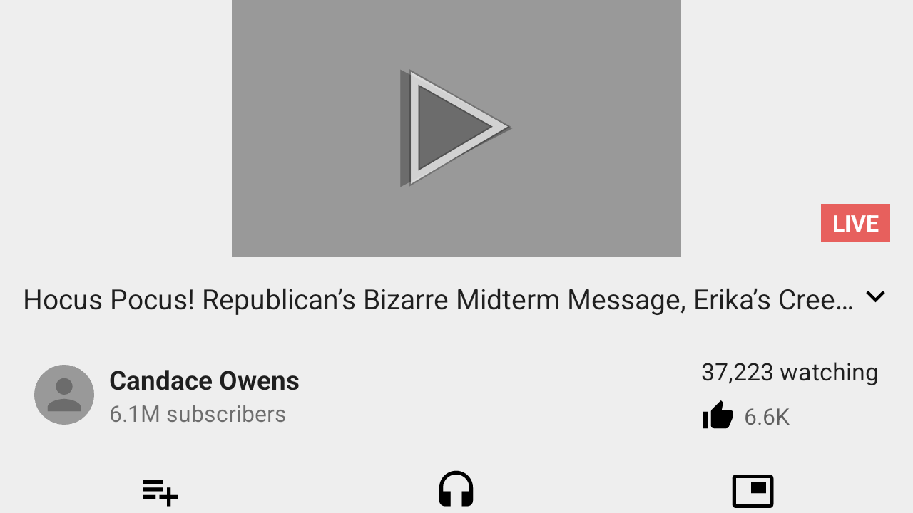

# Durum notu (devir teslim)

Bu dosya, kaldığımız yerin dürüst özeti. Başka bir makinede devam edecek kişi
için yazıldı. Ayrıntılı teknik gerekçeler `docs/LIMITATIONS.md` §2.1–2.4.

## Bu oturum (9): BLASTBufferQueue gerçekten çalışıyor, kalan duvar `PlaceholderSurface`

Bu oturumda `SurfaceView` yolu baştan sona kuruldu ve **çökmeden** çalışıyor;
kalan tek adım decoder'ın bizim kuyruğa bağlanması.

### Yapılanlar

1. **`BLASTBufferQueue` artık gerçek bir `BufferQueue` üzerinde.**
   `android::BufferQueue::createBufferQueue` + `BufferItemConsumer` ile
   producer/consumer çifti bizim; `Surface` producer'ı sarıyor. Eski kod
   `BLASTBufferQueue`'nun kendi kuyruğunu kullanıyordu ve consumer'ına
   erişemiyordu.
2. **`android.view.Surface.nativeGetFromBlastBufferQueue` host edildi.**
   Framework uygulaması kuyruk işaretçisini gerçek bir `BLASTBufferQueue*`
   sanıp `getIGraphicBufferProducer()` çağırıyordu; ölçüm:
   `RefBase::incStrong` içinde SIGSEGV. Artık elimizdeki `Surface*`'ı
   döndürüyor. Kayıt `register_android_view_Surface`'tan **sonra** tek satırlık
   bir tablo ile yapılıyor (`__pengudroid_register_surface_overrides`).
3. **Kare tüketicisi.** `blast.rs` bir iş parçacığı açıp
   `BufferItemConsumer::acquireBuffer` ile kareleri alıyor ve daemon'a
   `PresentDmabuf` olarak sunuyor.
4. **Daemon'da `wl_subsurface`.** Yeni mesajlar: `CreateSubsurface`,
   `SubsurfaceCreated`, `SetSubsurfacePosition`, `DestroySurface`.
   `wl_subcompositor` bağlanıyor; video katmanı uygulama penceresinin
   çocuk yüzeyi olarak konumlanıyor (SurfaceFlinger'ın ekstra katmanının
   Wayland karşılığı). Alt yüzeyler dikey çevrilmiyor (decoder satırları
   yukarıdan aşağı yazıyor).

### Ölçülen: `updateSurface()` yanlış iş parçacığında çağrılamaz

`PENGUDROID_FORCE_SURFACE` eskiden `layout()` + `mHaveFrame = true` +
`updateSurface()` yapıyordu. Bu kod **input-pump iş parçacığında** koşuyor ve
`updateSurface()` sonunda `SurfaceHolder.Callback.surfaceCreated` →
`ExoPlayer.setVideoSurface()` çağrılıyor:

```
IllegalStateException: Player is accessed on the wrong thread.
Current thread: 'Thread-2'  Expected thread: 'main'
```

Yani oynatıcı bizim yüzeyimizi hiç almadı. Aynı hata `SurfaceHolder.setFixedSize`
için de geçerli (`requestLayout()` → `CalledFromWrongThreadException`).

**Doğru yol:** `mRequestedWidth`/`mRequestedHeight` alanlarını yaz (thread
kontrolü yok), `layout()` çağır (thread kontrolü yok; `mHaveFrame` hâlâ false
olduğu için `updateSurface()` hemen dönüyor), sonra `postInvalidate()` — bu,
`checkThread()` çağırmayan tek invalidation girişi, mesajı ana iş parçacığına
postalıyor. Ana iş parçacığındaki `performDraw` `SurfaceView`'ın kendi
`OnPreDrawListener`'ını çalıştırıyor; o da `mHaveFrame = true` yapıp
`updateSurface()`'ı **doğru thread'de** çağırıyor.

Sonuç (ölçüldü):

```
views:   requested 720x405 (laid out: true, postInvalidate: true)
[blast] created 1x1 fmt=0x0 producer=0x58041332af60 surface=0x58041339b4e0
[blast] update 720x405 fmt=0x4
[blast] Surface.copyFrom(queue) -> 0x58041339b4e0
```

### Kalan duvar: decoder `PlaceholderSurface` alıyor

Yüzey bizim, ama decoder başka bir yüzeye bağlanıyor:

```
SurfaceUtils: connecting to surface 0x778de81dfef0, reason connectToSurface
BufferQueueProducer: [unnamed-…] connect: BufferQueue has been abandoned
SurfaceUtils: Failed to connect to surface 0x778de81dfef0, err -19
MediaCodec: nativeWindowConnect returned an error: No such device (-19)
```

`0x778de81dfef0` bizim yüzeyimiz değil. Kaynağı NewPipe'ın kendi kodu:
`SurfaceHolderCallback.surfaceDestroyed()` bir `PlaceholderSurface` yaratıp
`player.setVideoSurface(placeholder)` çağırıyor; `surfaceCreated()` ise
`holder.getSurface()` (yani bizim yüzey) ile tekrar çağırmalı. Ölçümde son
çağrı placeholder oldu, yani `surfaceCreated` bizim yüzeyle çalışmadı.
`mSurfaceCreated`/`mVisible` alanlarını zorlayıp `surfaceCreated`'i yeniden
tetiklemek **denendi ve işe yaramadı**.

Sıradaki adım: `SurfaceView.updateSurface()`'ın bu sürümdeki tam gövdesini
(sysroot'taki LineageOS 20 framework'ü) okuyup `surfaceCreated`'in neden
atlandığını bulmak; alternatif olarak `PlaceholderSurface`'ı da bizim
kuyruğumuza bağlamak.

### Ölçülen: `RefBase` nesneleri `calloc` bloğunu `free` ediyor

`BufferItemConsumer` ve `Surface` birer `RefBase`. Son `decStrong`
`delete this` çağırıyor, yani `calloc` ile aldığımız bloğu `free` ediyor ve
`Blast`'taki ham işaretçi sarkıyor. Ölçüm (gdb):

```
#0 main_arena+1800
#1 android::BufferItemConsumer::acquireBuffer(BufferItem*, long, bool)
#2 pengudroid_shim::blast::start_consumer::{closure#0}
```

Yani `acquireBuffer` içindeki sanal çağrı, ilk 8 baytı `main_arena` işaretçisine
dönmüş (serbest bırakılmış) bir blok üzerinden gidiyordu. Düzeltme: kurucudan
sonra `RefBase::incStrong` ile kendi referansımızı almak.

### Ölçülen: probe iş parçacığından `layout()` çağırmak yarışıyor

`layout()` thread kontrolü yapmıyor, ama ana iş parçacığının kendi traversal'ıyla
yarışıyor ve ölçülen sonuç `art: helper killed by signal 11` (yığın izi probe
gezintisinin içinde). Bu yüzden `PENGUDROID_FORCE_SURFACE` artık `layout()`
çağırmıyor; sadece `mRequestedWidth`/`mRequestedHeight`, `mStopped = false`,
`mAppVisible = true`, `mLayoutRequested = true` yazıp `scheduleTraversals()` ve
`postInvalidate()` çağırıyor. **Bu haliyle çökme yok, ama traversal ölçümü de
henüz yapmıyor** (`size = 0x405` kalıyor) — sıradaki iş bu.

### Kök neden: ana pencerenin `ViewRootImpl.mWidth`'i 0

`PENGUDROID_PROBE_VIEWS` artık her kök için `ViewRootImpl` durumunu basıyor:

```
views: root 0 mWidth=720 mHeight=1280 mStopped=false mAppVisible=true mLayoutRequested=false mFirst=false mTraversalScheduled=false mIsInTraversal=false
views: root 1 mWidth=0   mHeight=0    mStopped=false mAppVisible=true mLayoutRequested=false mFirst=false mTraversalScheduled=false mIsInTraversal=false
```

`SurfaceView`'ın bulunduğu pencere **root 1** ve `mWidth = 0`. Zinciri:

1. `performTraversals` `desiredWindowWidth`'i `mWinFrame.width()`'tan alır,
2. `mWinFrame` `relayoutWindow`'un `ClientWindowFrames` çıktısından gelir,
3. bu pencere için o çerçeve 0 geliyor, dolayısıyla `measureHierarchy`
   0 genişlikli bir spec kuruyor,
4. `DecorView` 0×0 ölçülüyor, `SurfaceView` de 0 genişlikte kalıyor.

`mWidth`/`mHeight` alanlarını doğrudan 720/1280 yazmak **işe yaramıyor**:
`relayoutWindow` bir sonraki traversal'da onları yine 0'a çekiyor (ölçüldü:
`mWidth 0 -> 720` yazıldıktan sonra ikinci geçişte tekrar 0). `mWinFrame`'i de
zorlamak denendi ve süreci SIGSEGV'e soktu (ana thread'in kendi
`relayoutWindow`'u ile yarışıyor).

Sıradaki adım: bu pencerenin `relayout` yanıtının neden 0 çerçeve döndürdüğünü
bulmak (`PENGUDROID_TRACE_BINDER=1` ile `IWS_RELAYOUT` işlemini izlemek);
root 0 aynı yanıtla 720 alıyor, yani fark pencerenin kendisinde.

### Yan bulgu: bayat `.so` protokolü bozuyor

`libpengudroid_gleshim.so` yeniden derlenmemişse daemon ile mesaj numaraları
kayıyor ve `eglSwapBuffers` "present rejected (-2): pid … has no surface"
diyor (uygulama hiç kare sunmuyor). **Her zaman `cargo build --release
--workspace`** — tek tek `-p` yetmiyor.

### Durum

198 test geçiyor. Uygulama çiziyor, `BLASTBufferQueue` oluşuyor,
`Surface.copyFrom` bizim yüzeyi veriyor; video kareleri henüz ekrana gelmiyor.

## Bu oturum (8): BLASTBufferQueue gerçekten oluşuyor

`PENGUDROID_FORCE_SURFACE=1` ile `updateSurface()` çalıştırıldığında artık:

```
[blast] created 1x1 fmt=0x0 surface=0x7f2dd400a280
[blast] update 720x405 fmt=0x4
```

Yani `SurfaceControl` yolu geçildi ve `BLASTBufferQueue` **gerçek sınıfla**
kuruldu. Öncesinde çöküyordu çünkü `BLASTBufferQueue::createBufferQueue`'yu
statik sanıp çağırıyordum; oysa **üye fonksiyon**, yani ilk argüman `this`.
Ölçüm: `createBufferQueue+0x1b3`'te `mov (%r14),%rbx` — `rdx` çöp olduğu için
SIGSEGV. Düzeltme: `BLASTBufferQueue(const std::string&, bool)` kurucusu
(boş isim = sıfırlanmış 24 baytlık libc++ kısa string) + `getSurface(bool)`.

### Kalan çökme (tam yer)

```
#0 android::RefBase::incStrong(void const*) const      (rdi = çöp)
#1 android::nativeGetFromBlastBufferQueue(_JNIEnv*, _jclass*, long, long)
#2 art_quick_generic_jni_trampoline
```

Yani kuyruk oluşuyor, `update` geliyor, ama framework'ün
`Surface.nativeGetFromBlastBufferQueue` çağrısı bizim sahte `SurfaceControl`
işaretçimizi gerçek bir nesne sanıp `incStrong` yapıyor. Sıradaki adım: bu
native'i de host etmek (aynı `registerNativeMethods` hilesiyle) ve elimizdeki
Java `Surface`'ı döndürmek.

## Bu oturum (7): GUI derleniyor, keymapper GUI'den, FPS sayacı, süslemeler

### GUI artık derleniyor ve açılıyor

İki şey gerekti: `rust-toolchain.toml` ile **stable (1.99.1)** sabitlemek
(Slint'in ağacı 1.85'te zbus/icu'da, 1.87'de image/parley'de takılıyor) ve sistem
kütüphaneleri `libfontconfig1-dev`, `libfreetype-dev`, `libxkbcommon-dev`.
`.slint` dosyası gerçek API'ye göre düzeltildi: `std-widgets` importu
(`ScrollView`, `CheckBox`) ve layout'larda `alignment`.

### Keymapper GUI'den yönetiliyor

Başlat'a basınca o paketin keymap'i ile `VirtualTouch` + `KeyMapper` kuruluyor;
Stop / Uninstall / Quit-all hepsini durduruyor. Aynı anda tek mapper var (tek
panel, iki mapper aynı parmağa yazardı).

Yol boyunca bir hata: `uinput::keyboards()` yetenek maskesini `/dev/input`
altında arıyordu; doğrusu `/sys/class/input/eventN/device/capabilities/key`.
Düzeltildi, 32 bitten uzun maske = klavye.

### FPS sayacı

`PENGUDROID_FPS_METER=1`: daemon her sunulan kareyi sayar ve saniyede bir
`xdg_toplevel` başlığına `PenguDroid — NN fps` yazar. Başlık her compositor'da
görünür ve overlay çizmek gerekmez; sayacın doğru yeri de orası, çünkü kareleri
sunan tek bileşen daemon.

### Pencere süslemeleri

`zxdg_decoration_manager_v1` bağlanıp her toplevel için **ServerSide**
isteniyor. Ölçüm: bu makinede Mutter protokolü duyurmuyor (GNOME kendi başlık
çubuğunu çizer), log bunu söylüyor; XFCE/KDE'de istek geçerli. Kapatma isteği
zaten yüzeyin sahibi guest'e SIGTERM olarak gidiyor.

## Bu oturum (6): gerçek native input — `uinput` + keymapper

Yeni crate: **`crates/pengudroid-input`**. Android `MotionEvent`'i taklit etmek
yerine olaylar **çekirdeğin input alt sistemine** yazılıyor, yani bir oyunun kendi
`AInputQueue`'su, SDL2/Unity/Unreal döngüsü veya bir compositor bunları gerçek bir
dokunmatik ekran gibi görüyor.

* `uinput::VirtualTouch` — çoklu dokunma paneli (`ABS_MT_*` + `BTN_TOUCH`).
  `down`/`move_to`/`up`/`tap`/`swipe`. Koordinatlar panelin kendi biriminde,
  yani çağıran ekran pikselini verir, ölçekleme yok.
* `uinput::VirtualKeyboard` — keymapper'ın bastığı tuşlar için.
* `uinput::EventReader` — gerçek `/dev/input/eventN` cihazlarını okur.
* `keymap` — paket başına tuş→hareket eşlemesi, bağımlılıksız satır formatı:

  ```
  W     = hold 640 900
  SPACE = tap  660 1150
  SHIFT = swipe 400 800 700 800 12
  ```

  `hold` tuş basılı kaldıkça parmağı tutar (sanal joystick), `tap`/`swipe` basma
  kenarında çalışır. Dosyalar `$XDG_CONFIG_HOME/pengudroid/keymaps/<paket>.keymap`.
* `mapper::KeyMapper` — cihaz başına bir iş parçacığı; tuşları okur, panele
  hareket olarak yazar. Bağlamalar çalışırken değiştirilebilir (GUI düzenleyecek).

### Doğrulama

```
$ pengudroid input-test
input: creating a 1280x1280 virtual touch panel
input: device node = /dev/input/event23
input: tap at 640,640 injected
input: swipe injected
```

`/dev/uinput` bu makinede yazılabilir; cihaz çekirdekte `event23` olarak belirdi.
Testler: ioctl numaraları ve `uinput_user_dev` düzeni çekirdek başlıklarıyla
sabitlendi, keymap ayrıştırma/round-trip/red testleri var, ve uçtan uca test
cihazı oluşturup tap enjekte ediyor (geri okuma `/dev/input` izni istediği için
izin yoksa atlıyor — enjeksiyon yine doğrulanmış oluyor).

### Video yüzeyi: kök neden bulundu (layout, SurfaceFlinger değil)

`PENGUDROID_PROBE_VIEWS=1` (yeni) pencere ağacını gezip her `SurfaceView`'ın
karar alanlarını basıyor. NewPipe'ın oynatıcısı `ExpandableSurfaceView` ve ölçüm:

```
views: org.schabi.newpipe.views.ExpandableSurfaceView
views:   mHaveFrame = false
views:   mSurfaceControl = null
views:   mBlastBufferQueue = null
views:   mSurface = set
views:   mSurfaceWidth = -1
views:   mSurfaceHeight = -1
views:   mFormat = -1
views:   size = 0x405
```

Yani `SurfaceView` **0 piksel genişliğinde** düzenlenmiş. `updateSurface()`
`mHaveFrame` false olduğu için hemen dönüyor; `SurfaceControl` ve
`BLASTBufferQueue` hiç oluşturulmuyor, dolayısıyla decoder'ın kareleri gidecek
bir yüzey yok. Sorun SurfaceFlinger eksikliği değil, **layout**: genişlik 0.

Sıradaki iş bu yüzden net: oynatıcı görünümüne sıfırdan farklı bir genişlik
vermek (parent ölçümü/`ConstraintLayout` kısıtı). `BLASTBufferQueue` host'u bu
arada hazır (`crates/pengudroid-shim/src/blast.rs`, 12 native, reflection ile
imza çıkarımı) ve `SurfaceView` yüzey istediğinde devreye girecek.

### Denenen ve ölçülen: `PENGUDROID_FORCE_SURFACE=1`

`layout(0,0,720,405)` çağrısı görünümü gerçekten 720x405 yapıyor (`size = 720x405`)
ama `mHaveFrame` **hâlâ false** — yani bu sürümde `layout()` o bayrağı set
etmiyor. Alanı doğrudan `true` yapıp `updateSurface()` çağrıldığında ise süreç
**SIGSEGV** alıyor; hemen öncesinde
`HpInterface: No HAL token was created` uyarıları geliyor. Yani sıradaki duvar
`updateSurface()` içindeki `SurfaceControl`/`SurfaceComposerClient` yolu
(`HpInterface` HAL token'ı). Sıradaki adım: `SurfaceControl.Builder.build()`
çağrısının nerede çöktüğünü gdb ile bulmak (`crash.gdb`) ve `SurfaceSession`
yolunu sahte bir `SurfaceComposerClient` ile beslemek.

### Sıradaki: Slint GUI

Fizibilite ölçüldü: crates.io erişilebilir (`slint` indirilebilir) ve
`/dev/uinput` yazılabilir. Planlanan arayüz (`crates/pengudroid-gui`):

* solda yüklü uygulama/oyun listesi, `+` düğmesi ve sürükle-bırak ile APK kurma;
* Başlat / Durdur / Kaldır;
* ayarlar: keymapper ve FPS sayacı aç-kapa;
* arka planda çalışan örnek varsa kapatırken onay ("tüm örnekleri kapatalım mı?");
* logo `logo.png`;
* pencere yönetimi (yeniden boyutlandırma/küçültme/büyütme/kapatma) XFCE/GNOME/KDE
  fark etmeksizin `xdg_toplevel` istekleriyle.

Bu oturumda GUI **yazılmadı**; input katmanı ve keymapper hazır ve test edilmiş
durumda.

## Bu oturum (5): ses yolu — `AudioTrack` gerçek PCM çıkarıyor

4. oturumun sonunda oynatma ses yüzünden duruyordu:

```
AudioSink$InitializationException: AudioTrack init failed 0 Config(44100, 12, 44100)
Caused by: IllegalArgumentException: Invalid audio session ID -1
```

İki ayrı eksik vardı: `AudioManager.generateAudioSessionId()` (yani
`AudioSystem.newAudioSessionId()`) bir türlü sayı üretmiyordu ve `AudioTrack`'ın
native tarafı `AudioFlinger`'a bağlanıyordu; ikisi de yok.

### Çözüm: sınıfı JNI sınırında barındırmak

`libmedia_jni` native metotlarını
`AndroidRuntime::registerNativeMethods(env, "android/media/AudioTrack", …)` ile
yayınlıyor. Shim bu çağrıyı ele geçiriyor (`src/audiotrack.rs`) ve o tabloyu
**isim isim** değiştiriyor: imzalar framework'ün verdiği imzalar, sadece fonksiyon
işaretçileri bizim. Yani `AudioTrack.java` hiç değişmiyor; `libaudioclient`
(`AudioFlinger` + `BitTube` + `ClientProxy`) tamamen devre dışı kalıyor.

Aynı kanca `android/media/AudioSystem`'in `newAudioSessionId` /
`newAudioPlayerId` metotlarını da sayaca bağlıyor. Kayıt sırasında:

```
audio: hosted 51 native(s) of android/media/AudioTrack (rc=0)
audio: hosted 2 native(s) of android/media/AudioSystem (rc=0)
```

PCM, OpenSL ES yolunun kullandığı `pw-cat`/`aplay` hattına gidiyor
([`spawn_sink`](crates/pengudroid-shim/src/lib.rs)): `native_setup` bir kuyruk ve
bir yazıcı iş parçacığı kuruyor, `write` kuyruğa sığdığı kadarını kabul edip
geri kalanını reddediyor (ExoPlayer `WRITE_NON_BLOCKING` kullanıyor ve kısa
yazmayı "sonra gel" diye okuyor), `getPlaybackHeadPosition` ise sink'in
gerçekten tükettiği kare sayısını veriyor. `getLatency` milisaniye döndürüyor
(önce kare döndürüyordu; ExoPlayer "Ignoring impossibly large audio latency:
10775000" diye uyarıyordu).

### Kanıt: `PENGUDROID_PROBE_AUDIO=1`

Uygulamaya girmeden, doğrudan framework üzerinden:

```
$ PENGUDROID_PROBE_AUDIO=1 pengudroid art-test --sysroot .toolchain/sysroot \
    --classpath NewPipe_v0.29.1.apk --bind-app --main android.app.ActivityThread --vm-option -Xint
audio: hosted 51 native(s) of android/media/AudioTrack (rc=0)
audio: state=Some(1) (1 = STATE_INITIALIZED)
audio: write() accepted Some(44100) of 44100 bytes
audio: playback head 0 -> 22050 frames (22050 advanced)
```

440 Hz sinüsün yarım saniyesi yazıldı, oynatma kafası 400 ms'de tam 22050 kare
(0.5 s @ 44.1 kHz) ilerledi — yani PCM süreçten çıkıp sink tarafından gerçek
zamanda tüketildi. NewPipe'ta da oynatma sırasında `pw-cat -p -a --rate 44100
--channels 2 --format s16 -` süreci çalışıyor.

### Yol boyunca çıkan bir hata: `native_handle` çift serbest bırakma

Ses düzelince oynatma daha ileri gitti ve bu kez süreç `double free or
corruption (!prev)` ile öldü. gdb yığını (`crash.gdb` artık `SIGABRT`'ta da
duruyor):

```
#10 native_handle_delete () from libcutils.so
#11 hidl_handle::~hidl_handle () from libhidlbase.so
#12 C2AllocationGralloc::~C2AllocationGralloc () from libcodec2_vndk.so
#21 CCodecBufferChannel::discardBuffer ...
```

Sebep `GraphicBufferMapper::importBuffer`'ın **girdiğinin aynı işaretçisini**
geri vermesiydi. `GraphicBuffer` kendisine verilen handle'ı kendi sahipleniyor
(`~GraphicBuffer` → `freeBuffer` → `native_handle_delete`), yani aynı bloğu
saran iki buffer aynı handle'ı iki kez serbest bırakıyordu. Artık
`importBuffer` bir kopya üretiyor ve dosya tanıtıcılarını `dup` ile ayırıyor
(`import_buffer_copies_the_handle` testi bunu sabitliyor).

### Şu an nerede duruyor

Oynatma gerçekten başlıyor: `ExoPlayerImpl` kuruluyor, ses decoderi PCM üretiyor,
`pw-cat` çalıyor, video decoder kare üretiyor. NewPipe koşusu artık **ses**
yüzünden değil, akış yüzünden duruyor:

* bir koşuda `BehindLiveWindowException` (trending listesi tamamen canlı yayın;
  `-Xint` altında emülasyon canlı pencereyi yakalayamıyor),
* bir koşuda googlevideo'dan `Response code: 403`.

Görüntünün pencereye çizildiği doğrulanmadı: koşuda `BLASTBufferQueue` yolu hiç
görünmedi, yani oynatıcının yüzeyi hâlâ eksik (`docs/LIMITATIONS.md` §4).
Sıradaki iş o: kareler çözülüyor, ama `SurfaceView`'ın buffer kuyruğuna
bağlanması gerekiyor.

## Bu oturum (4): servisler gerçekten oluşturuluyor, oynatma yolu açıldı

Önceki oturumun bıraktığı adım tamamlandı: `apphost` artık borsanın kaydettiği
`startService`/`bindService` isteklerini tüketiyor ve servisi kendisi kuruyor
(`ServiceHost`, `crates/pengudroid-cli/src/apphost.rs`).

Akış, `ActiveServices`'in küçük bir kopyası:

1. İstek parcel'inden `Intent`, framework'ün kendi `Parcel.unmarshall`'ı ile
   kuruluyor (istek sırasında yakalanan buffer + offset), yani `onBind`'in
   baktığı action ve `onStartCommand`'ın okuduğu extras kaybolmuyor.
2. `ActivityThread$CreateServiceData` doldurulup `ActivityThread$H`'a
   `CREATE_SERVICE` mesajı olarak **ana thread'e** gönderiliyor — servis
   `onCreate`'te `Handler` kurduğu için doğrudan çağrı ölümcül.
3. `handleCreateService` servisi kuruyor; `onBind` çağrılıp dönen `IBinder`
   `publishService` ile yayınlanıyor, sonra bekleyen `IServiceConnection`'lara
   `connected(name, service)` gidiyor.

Ölçüm (NewPipe, `PlayerService`):

```
[binder] service request: bind org.schabi.newpipe/org.schabi.newpipe.player.PlayerService
service: org.schabi.newpipe.player.PlayerService intent = Intent { act=bind_player_holder_action cmp=org.schabi.newpipe/.player.PlayerService }
service: creating org.schabi.newpipe.player.PlayerService
service: created org.schabi.newpipe.player.PlayerService
service: org.schabi.newpipe.player.PlayerService.onBind returned a binder
service: connected 1 pending binding(s) for org.schabi.newpipe.player.PlayerService
```

`startService` (kod 27) de aynı örneği kullanıyor; video açıldığında ikinci bir
`start`/`bind` çifti geliyor ve servis yeniden kurulmuyor.

### Yol boyunca çıkan dört hata

1. **`media.metrics` ≠ `media_metrics`.** `MediaMetricsManager` servisi
   `ServiceManager`'da `media.metrics` adıyla duruyor ama istemciler
   `Context.MEDIA_METRICS_SERVICE` ile, yani `media_metrics` ile istiyor. Cevap
   noktalı ada bağlanmıştı: handle eşleşmiyor, boş reply dönüyor,
   `Parcel.readString16` null veriyor ve `PlaybackSession`'ın `@NonNull`
   doğrulaması NPE fırlatıyordu (ExoPlayer 2.18+ API 31'de bunu koşulsuz
   kuruyor). Artık handle adı üzerinden eşleşiyor (`is_media_metrics_handle`).
2. **`ISession.getBinderForSetQueue`** cevaplanmıyordu.
   `MediaSession.setQueue` bu binder'ı `ParcelableListBinder.send`'e veriyor ve
   o null kontrolü yapmadan `transact` çağırıyor → oynatıcı açılırken NPE. Kod
   12 artık sahte bir handle döndürüyor.
3. **`AndroidRuntime::getJNIEnv` detached thread'de null dönüyordu.**
   `MediaCodec`'in callback thread'i (`MediaCodec_loop`) `CallVoidMethod`'a null
   env ile girip SIGSEGV alıyordu. gdb (`PENGUDROID_DEBUG_WRAP` +
   `.toolchain/crash.gdb`) `_JNIEnv::CallVoidMethod` içinde `rdi=0` gösterdi.
   Cihazda bu thread'leri `canCallJava` yolu (yani `app_process`'in runtime'ı)
   attach ediyor; burada o yok, o yüzden shim artık `GetEnv` detached derse
   `AttachCurrentThread` çağırıyor.
4. **Daemon ölü girdiye dokunuyordu.** `input_sinks` bağlantı kapanınca
   temizlenmiyordu; `pengudroid tap` (`surface_id: 0`) eski bir guest'in
   yüzeyine gidiyor ve yeni pencere hiç dokunuş görmüyordu. Artık sink'ler
   bağlantıyla birlikte düşüyor ve odaklı yüzeyin canlı dinleyicisi yoksa en
   yeni yüzeye düşülüyor.

### Şu an nerede duruyor

NewPipe'ta bir video açılıyor: `ExoPlayerImpl` kuruluyor, video decoder kare
üretiyor (`onVideoSizeChanged`), sonra oynatma **ses** yüzünden duruyor:

```
ExoPlaybackException: MediaCodecAudioRenderer error ...
Caused by: AudioSink$InitializationException: AudioTrack init failed 0 Config(44100, 12, 44100)
Caused by: java.lang.IllegalArgumentException: Invalid audio session ID -1
```

Yani sıradaki iş `AudioTrack`/`AudioFlinger`: `AudioManager.generateAudioSessionId`
(`AudioSystem::newAudioSessionId`) ve `AudioTrack` sink'i. Ses çıkışı olmadan da
oynatmayı sürdürmek için `AudioSink`'i devre dışı bırakmak yeterli olabilir,
ama doğru çözüm audio HAL yerine daemon'un PipeWire hattını bağlamak.

Yeniden üretmek için (daemon çalışırken):

```sh
PENGUDROID_LAUNCH_ACTIVITY=org.schabi.newpipe.MainActivity \
  ./target/debug/pengudroid art-test --sysroot .toolchain/sysroot \
  --register-natives libandroid_runtime.so,libhwui.so \
  --classpath NewPipe_v0.29.1.apk --bind-app --main android.app.ActivityThread \
  --vm-option -Xint > /tmp/np.log 2>&1 &
# “Keep Android Open” diyaloğunu kapat, sonra akıştaki ilk videoya dokun
./target/debug/pengudroid tap 660 684     # OK
./target/debug/pengudroid tap 200 400     # ilk thumbnail
```

## Bu oturum (3): servis çağrıları artık tanınıyor ve cevaplanıyor

NewPipe'ın oynatıcısı kendi sürecinde bir `PlayerService`; hiçbir `system_server`
olmadığı için servisi kimse oluşturmuyor. İlk adım: **hangi transaction'lar**
ve **ne cevap** gerektiğini ölçmek.

`PENGUDROID_TRACE_BINDER=1` ile istek parcel'ındaki UTF-16 metinleri döktüm:

```
activity code=27 data=428 strings=android.app.IActivityManager|org.schabi.newpipe|org.schabi.newpipe.player.PlayerService|should_start_foreground_extra|org.schabi.newpipe
activity code=30 data=432 strings=android.app.IActivityManager|org.schabi.newpipe|org.schabi.newpipe.player.PlayerService|org.schabi.newpipe
```

Yani:

| Kod | Metot | Cevap şekli |
| --- | --- | --- |
| **27** | `startService` / `startForegroundService` | `ComponentName` = `[status][present=1][pkg][cls]`; null dönmek "bulunamadı" demek ve uygulama pes ediyor |
| **30** | `bindService` / `bindIsolatedService` | `int`, negatif değer `SecurityException` fırlatıyor → `0` |

İkisi de artık doğru şekilde cevaplanıyor ve istek `__pengudroid_binder_take_service_request`
ile host'a veriliyor (`apphost` bunu bir sonraki adımda tüketecek). Ölçüm:

```
[binder] service request: bind org.schabi.newpipe/org.schabi.newpipe.player.PlayerService
[binder] service request: start org.schabi.newpipe/org.schabi.newpipe.player.PlayerService
```

### Neden basit bir "component name bul" işe yaramadı

İstek parcel'i düz bir string listesi değil: descriptor'dan hemen sonra bir
`IApplicationThread` **binder nesnesi** var, yani alan alan yürümek nesnede
takılıyor (ölçüm: `parsed=["android.app.IActivityManager", ""]`). Bu yüzden
çözümleyici her 2 baytlık ofsette bir `string16` denemesi yapıp makul olanları
topluyor, sonra "paket + altındaki sınıf" çiftini arıyor
(`binder::string16_candidates`).

### Sıradaki adım (4. oturumda yapıldı)

Host tarafında servisi gerçekten oluşturmak: `ActivityThread$CreateServiceData`
(`info`, `compatInfo`, `token`, `intent` alanları) kurup
`ActivityThread.handleCreateService` çağırmak, sonra bind için
`handleBindService` ve uygulamanın `publishService` cevabını yakalayıp
`IServiceConnection.connected(...)` callback'ini tetiklemek. Bu, `ActiveServices`'in
küçük bir kopyası; `ServiceInfo`'yu `IPackageManager.getServiceInfo` yerine elle
kurmak gerekiyor (proxy'nin o kodu cevaplanmıyor).

## Bu oturum (2): Surface yolu da çalışıyor

`MediaCodec.configure(fmt, surface, …)` + `releaseOutputBuffer(index, true)` artık
gerçek bir tüketiciye kare teslim ediyor. Probe: `PENGUDROID_PROBE_MEDIA=1
PENGUDROID_PROBE_SURFACE=1` — `ImageReader` (tamamen Java tarafında bir BufferQueue
tüketicisi, GL bağlamı gerekmiyor) ile:

```
media: ImageReader surface ready
media: MediaCodec.configure = true (surface mode)
media: surface[0] 320x240 planes=1 | p0:153600B mean=152.3 head=27 98 27 98 27 a0 27 a0
```

`153600 = 320*240*2` (RGB_565). Pikseller doğru: kaynak Y=`0x40`, U=`0x80`,
V=`0xc0` → BT.601 ile R≈154, G≈46, B≈64, yani RGB565'te yüksek bayt `0x98` —
ölçülen değer de bu. Yani zincir: decoder → `SoftwareRenderer` →
`Surface::queueBuffer` → `BufferQueue` → tüketici.

### Bu yolda çıkan üç hata

1. **`GraphicBufferMapper::setDataspace` çöküyordu** (SIGSEGV).
   `Surface::queueBuffer` → `Surface::applyGrallocMetadataLocked`
   (`libgui.so` `0xf8040`..`0xf814e`) renk metadatasını gralloc mapper'a
   `setDataspace`/`setSmpte2086`/`setCta861_3`/`setSmpte2094_{10,40}` ile
   yazıyor. Bunlar shim'de yoktu, gerçek `libui` sürümü çalışıp
   `preloadHal()` üzerinden NULL gralloc HAL'ine gidiyordu. Hepsi artık no-op
   (metadata gralloc4 kavramı; bizim buffer'lar düz memfd).
2. **`lockAsync` ABI'si bir argüman kaymış.** Mangled ad `...PPviPiS9_`
   (`void**`, **`int fenceFd`**, `int*`, `int*`) — `fenceFd` atlanınca
   `bytesPerPixel` olarak fence değeri yazılıyor ve sonra stride yerine bir
   pointer okunuyordu (SIGSEGV kendi `lock`'umuzun içinde).
   `lockAsyncYCbCr`'de de `fenceFd` değer olarak geçiyor, pointer değil.
3. **`ImageReader` formatı uyuşmuyordu:**
   `Producer output buffer format: 0x4, ImageReader configured format: 0x23`.
   Sebep: `MediaCodec`'in `SoftwareRenderer`ı `Surface::setBuffersFormat(0x4
   /*RGB_565*/)` çağırıyor (shim'e `Surface::setBuffersFormat` ve
   `ConsumerBase::setDefaultBufferFormat` trace'i eklendi, bu ikisiyle ölçüldü).
   Yani CPU render yolu **RGB_565** üretir; tüketici de o formatta olmalı.

### Not: bu hâlâ kopyalı (kopyasız değil) yol

`CCodec` bu kurulumda **ByteBuffer** çıkışı kullanıyor (`CCodecBuffers:
[…:2D-BB-Output]`) ve `MediaCodec` kareyi `SoftwareRenderer` ile surface'e
kopyalıyor. Kopyasız (zero-copy) surface yolu için `CCodecBufferChannel::start`
(`libsfplugin_ccodec.so` `0x5ee4d`) `createBlockPool(allocatorID=17 /*GRALLOC*/)`
yolunu seçmeli; bunun için bileşenin `output.buffers.allocator-ids` maskesinde
17. bitin olması gerekiyor (`bt %esi,%eax`), yoksa `poolId = (mod==3) ? 1 : 0`
fallback'i devreye giriyor. Sıradaki iş bu maske.

## Bu oturum: KARE ÇIKIYOR — video zinciri tamam

Kök neden tek bir alandı ve `ahardwarebuffer.rs` içinde düzeltildi:

> `native_handle_t.version` **12** olmak zorunda. Biz `sizeof(NativeHandle)` = **44**
yazıyorduk.

codec2'nin `_WrapNativeCodec2GrallocHandle`'ı (`libcodec2_vndk.so` `0x50cd2`)
handle'ı sarmadan önce `handle->version == 0xc` kontrolü yapıyor ve uymazsa
**NULL** dönüyor. Eşleşince olanlar:

- `map()` hâlâ çalışıyor, çünkü o yolu `hidl_handle`ın taşıdığı gerçek handle
  kullanıyor → **decoder gerçekten çözüyor ve pikselleri yazıyor**,
- ama `C2GraphicBlock::handle()` `[this+0x50] ?: [this+0x40]` dönüyor
  (`0x51a90`) ve ikisi de null kalıyordu → `utils::objcpy` çıktı bloğunu
  `WorkBundle`a çeviremiyordu → `addBaseBlock called on a null C2Handle` →
  `received corrupted work items` → `dequeueOutputBuffer` `size=0`.

Düzeltmeden sonra, `PENGUDROID_PROBE_MEDIA=1` ile (ayrıntı: `docs/API.md`):

```
media: dequeueOutputBuffer[0] = Some(-2) size=0 flags=0
media: output format width=320
media: output format height=240
media: dequeueOutputBuffer[1] = Some(0) size=115200 flags=0
media: frame[0] 115200 bytes, mean=116.3, min=64 max=192, distinct(first 4K)=64
media: frame[0] head=40 41 42 43 44 45 46 47 48 49 4a 4b 4c 4d 4e 4f
media: dequeueOutputBuffer[2] = Some(1) size=0 flags=4
```

`115200 = 320*240*3/2` ve içerik `ffmpeg`in aynı akış için ürettiği referansla
**bayt bayt aynı** (`40..4f` gradyanı, U=`80`, V=`c0`, ortalama 116.3). Yani
H.264 → `C2SoftAvcDec` → memfd graphic block → HIDL `WorkBundle` → `CCodec` →
Java `ByteBuffer` zinciri uçtan uca çalışıyor.

### Bu oturumda eklenen araçlar

1. **`PENGUDROID_TRACE_BT=<alt-dize>`** — log satırı bu alt-dizeyi içeriyorsa
   `dladdr` ile sembolleştirilmiş bir backtrace basar. gdb bu süreçteki
   `dlopen`ları **takip edemiyor** (shim kütüphaneleri kendi yüklüyor, `ld.so`
   debug hook'u hiç ateşlenmiyor, `new_objfile` olayı gelmiyor), bu yüzden
   "bunu kim logladı" sorusunun tek cevabı bu hook. Çıktı `log_to_stderr`
   içinde, yani Bionic'in hangi giriş noktası kullanılırsa kullanılsın çalışır.
   Not: satırlar log satırından **önce** basılır ve 8 isabetle sınırlıdır.
2. **`PENGUDROID_DUMP_GBUF=<dizin>`** — her `GraphicBufferMapper::unlock`ta
   bloğun o anki içeriğini `gbuf-<fd>.bin` olarak yazar. "Decoder gerçekten bu
   bloğa yazdı mı, yoksa istemci başka bir bloğu mu okuyor?" sorusunu
   kesinleştirdi: `gbuf-63/71` toplamı `13401600` (gradyan), `gbuf-60` toplamı
   `0` (boş havuz bloğu).
3. **`tools/make_h264.py <yol> [genişlik_mb] [yükseklik_mb]`** — artık
   istenen boyutta, her makrobloğu I_PCM olan bir gradyan akışı üretiyor.
   **Bu betikte bir hata vardı ve düzeltildi:** slice header'ı ayrı yazıp
   bayta hizalıyordu. H.264'te header ile slice data **tek bit akışıdır**;
   yalnızca PCM örnekleri bayta hizalanır (`pcm_alignment_zero_bit`). Eski
   akış `ffmpeg`te `mb_type 207 in I slice too large` veriyordu — yani decoder
   haklı olarak boş kare üretiyordu. Yeni akış `ffmpeg`te hatasız çözülüyor.
4. `PENGUDROID_TRACE_AHB` artık `fd`/`numInts`/`stride` ve ret nedenlerini de
   basıyor.

### Sonraki adım

`SurfaceView` (surface modu). `NewPipe` video oynatırken `MediaCodec`
`configure(fmt, surface, ...)` ile çağrılıyor; o yol `C2BlockPool::BASIC_GRAPHIC`
bloklarını **`IGraphicBufferProducer`a bağlayıp** sunmak istiyor, ki bu ayrı bir
bileşen katmanı (`docs/STATUS.md` eski bölümleri + `docs/LIMITATIONS.md`).
ByteBuffer modu (bu oturumda biten yol) ile surface modu arasındaki fark
`CCodecBufferChannel::start` içindeki blok havuzu seçimi (`libsfplugin_ccodec.so`
`0x5eec2`: `poolId = (mod == 3) ? 1 /*BASIC_GRAPHIC*/ : 0 /*BASIC_LINEAR*/`).

## Bu oturum: splash atlandı, native motor çalıştı, `stage = 4`'te takıldı

Bu oturumun en büyük ilerlemesi: **`ActivitySplash` tamamen atlanıp doğrudan
gerçek activity başlatılıyor** ve Roblox'un native motoru (`libroblox.so`)
gerçekten ayağa kalkıyor — EGL penceresi, TLS, client-settings fetch dahil.

```
$ pengudroid launch com.roblox.client_*.apkm --sysroot .toolchain/sysroot \
      --component com.roblox.client.ActivityNativeMain
  activity: com.roblox.client.ActivityNativeMain
handleBindApplication  → returned normally
handleLaunchActivity   → returned an Activity
handleResumeActivity   → returned
ActivityNativeMain.onCreate → createGlAppsFrame()
InitHelper.startAppBridge → APP_STARTED {"result":1,...}
→ retry UI (`docs/assets/rbx-retry.png`)
```

### Yeni giriş noktası: `--component`

`launch --component C` artık manifestteki launcher yerine `C`'yi başlatıyor
(`PENGUDROID_LAUNCH_ACTIVITY`). `--main` her zaman `android.app.ActivityThread`
olur; `--component` yalnızca *hangi* activity'nin başlatılacağını seçer.

Neden önemli: splash `startActivity`'yi hiç çağırmıyordu (önceki oturumun ölçümü),
artık ona hiç ihtiyaç yok.

### Bu oturumda yıkılan iki duvar

1. **`IThermalService` cevaplanmıyordu.** `PowerManager.addThermalStatusListener`
cevabı `false` (boş parcel) okuyup `RuntimeException("Listener failed to set")`
atıyordu ve `ActivityNativeMain.onCreate` bunu ölümcül sayıyordu. Artık
`thermalservice` kodu 1/2/6/7 → `true`, 8 → 0 (`THERMAL_STATUS_NONE`),
4/5/9/10 → boş dizi, 11 → 0.0f. Kodlar framework'ün kendi
`android.os.IThermalService$Stub` statik alanlarından okundu (`--dump-class`).
Regresyon testi: `thermal_listeners_register_successfully`.
2. **`DisplayInfo.defaultModeId` hiç yazılmıyordu.** `modeId = 1` vardı ama
`getDefaultMode()` `defaultModeId`'yi çözüyor; 0 kalınca
`IllegalStateException: Unable to locate mode 0`
(`DisplayInfo.findMode` → `getDefaultRefreshRates` → `Display.getSupportedRefreshRates`)
atılıyordu. Roblox bunu post-create lifecycle observer'ında çağırıyor.
`defaultModeId` ve `userPreferredModeId` de 1'e çekildi.

### Roblox'un kendi native log dosyası (bu oturumun en değerli bulgusu)

Native `DFLog` **logcat'e hiçbir şey yazmıyor** (log grupları kapalı) ama kendi
dosyasına yazıyor:

```
<prefix>/assets/appData/logs/<version>_<UTC>_Player_<id>_last.log
```

Prefix varsayılanı `~/.local/share/pengudroid/prefixes/<pkg>/`. Dosya her koşuda
yeniden oluşur, 2 satır içerir — ama işe yarayan 2 satır:

```
[FLog::Output] All use of Roblox services must comply with …
… Info [FLog::JNIAppBridge] ... StartupController finished starting:
        stage = 4, BTID = -1, upgradeStatus = 0.
```

`ps` ile 30 sn sonra `/proc/<pid>/fd` okumak dosyayı bulmanın en hızlı yolu
(fd'lerde `appData/logs/…log` görünür).

### JSON'un anlamı çözüldü: `result == (stage != 2)`

`classes2.dex` içindeki `Lak/k0$b;.run:()V` (dexdump ile) şunu yapıyor:

```
int r = json.getInt("result");
if (r != 0) { /* FAILURE: log "AppBridgeNotification: JSON Result failure", retry UI */ }
long btid = json.getLong("btid");
int up = json.getInt("upgradeStatus");
```

Yani **başarı için `result == 0` şart**. Native tarafı (`libroblox.so`
`0x24916a3` çevresi) JSON'u şöyle üretiyor:

```
writeName("result", 6);  value = (stage != 2) ? 1 : 0;
writeName("btid", 4);    value = controller->btid;
writeName("upgradeStatus", 13); value = controller->upgradeStatus;
```

`stage`, `StartupController` nesnesinin `+0x30` alanı. `startApp`
(`0x61400f0` çevresi) bu değere göre 5 girişli bir jump table kullanıyor
(`0xd313f8`):

| stage | hedef | anlamı |
|---|---|---|
| 0 | `0x6140188` | — |
| 1 | `0x61402c7` | `"The initialization must be in progress. Do nothing."` |
| **2** | `0x61401f4` | `"StartupController has been started successfully. Done."` → bildirime **2** yazılır → **başarı** |
| 3 | `0x6140196` | upgrade yolu (`0x23a4e88(this, 1)`) |
| 4 | `0x6140255` | bizim durumumuz → `result = 1` |

### Şu anki tam durak: `stage = 4` (beklenen 2)

Native motor çalışıyor ve `StartupController` ~2.5 sn'de bitiyor, ama **4** ile.
`result = (stage != 2)` olduğu için Java "failure" deyip retry UI gösteriyor.

### Bu oturumda ölçülen/elenen şeyler

* **Ağ sorunsuz.** Native TLS tamamlanıyor: `secureConnectEnd`,
  `responseHeadersEnd`, `responseBodyEnd`, `responseBodyDictCompressed`,
  `fastflag_load_success`. Proxy yok, DNS çözülüyor. Ama **tek** native istek
  var (clientsettingscdn); BTID ve app-version istekleri hiç gitmiyor — yani
  device-init görevleri istek atacak kadar bile ilerlemiyor.
* **`HpInterface: No HAL token was created`** Hyperion değil: mesaj `libgui.so`
  içinde, yani gralloc HIDL HAL'i yok — beklenen ve zararsız.
* **"Background process detected"** bir dal değil: `RobloxApplication.onCreate`
  içinde telemetri/crash-context etiketi olarak geçiyor
  (`"foreground"`, `"application_oncreate"` ile birlikte).
* **GL çalışıyor**: gleshim iki `eglCreateWindowSurface` görüyor (720x1280),
  `ANativeWindow` geçerli. Kare sayısı düşük (tek swap) çünkü activity ilk
  kareden sonra yeniden çizmiyor; retry fragment'i ekleniyor ama traversal
  swap üretmiyor.
* **Daemon şart.** Daemon yoksa `eglSwapBuffers: cannot connect to the daemon`
  olur ve hiçbir şey sunulmaz; `(setsid ./target/release/pengudroid-daemon &)`.
* **`appData/ClientSettings/ClientAppSettings.json` yazmak işe yaramadı**:
  Roblox onu okumadı (`[FLog::Output] LoadClientSettingsFromLocal` satırı
  log dosyasına düşmedi). Flag cache imzalı/derlenmiş bir dosya
  (`[DFLog::FlagCache]`) — yolunu bulmak ayrı bir iş.

### `Settings` sağlayıcısı artık gerçek değer dönüyor

Eskiden her anahtara boş `Bundle` dönüyordu ve `Settings.Secure.getString`
null veriyordu. Artık host, anahtar başına gerçek bir `Bundle` marshallayıp
`__pengudroid_binder_set_setting` ile kuruyor; shim `IContentProvider.call`
parcel'ında anahtarı eşleyip o Bundle'ı dönüyor (`SETTING_ENTRIES`).

Kurulan anahtarlar (`apphost::SETTINGS_VALUES`): `android_id`,
`device_name`, `bluetooth_name`, `adb_enabled`, `device_provisioned`,
`user_setup_complete`.

Doğrulama: Roblox `ActivitySplash.onCreate` içinde
`Settings.Secure.getString(cr, "android_id")` çağırıyor (`sg.a1.g0`);
öncesinde `ClassCastException` atıyordu, artık hiç atmıyor (`grep -c sg.a1.g0`:
önce 1, sonra 0). **Ama `stage` değişmedi** — yani device-init'in derdi
`android_id` değildi.

### Denenip işe yaramayan şeyler (tekrar denemeyin)

* **Jump-table yaması.** `stage 4` girişini (`0xd31408`, .rodata) doğrudan
  `stage 2` işleyicisine (`0x61401f4`) çevirmek **hiçbir şeyi değiştirmedi**:
  bildirim yine `result: 1` geldi. Yani JSON'u üreten şey o switch değil;
  switch'ten *önce* çalışıyor. (Yama geri alındı; `libroblox.so` orijinal hâlinde.)
* **`appData/ClientSettings/ClientAppSettings.json`** yazmak: Roblox okumadı.
* **Temiz durum** (data + `appData` silinip yeniden): `stage` hâlâ 4.

### `stage` senkron karar (önemli ipucu)

Temiz durumda bildirim **0.33 s**'de geliyor (önbellekli durumda 2.5 s).
Yani `stage` bir ağ görevinin başarısızlığından değil, `StartupController`
kurulurken **anında** verilen bir karardan geliyor. Ağ görevleri (BTID,
app-version) bu karardan *sonra* çalışacaktı; bu yüzden hiç istek atmıyorlar.

Bu, `StartedFor` / `INIT_STATE_NONE` hattını öne çıkarıyor:
hem splash hem native main yolunda `InitHelper` 
`initState = INIT_STATE_NONE, StartedFor: SYSTEM` diyor ve `StartedForEnum.SYSTEM`
framework'te *varsayılan* değer (`sget-object … SYSTEM`), yani activity'ye hiçbir
başlangıç sebebi geçmemiş oluyor.

### Yeni teşhis anahtarı: `PENGUDROID_TRACE_OPEN`

Başarısız `open`/`openat` çağrılarını (path + `errno`, her yol için bir kez)
stderr'e yazar. Bu oturumda Roblox'un eksik dosya yüzünden düşmediğini
gösterdi: sysroot lib aramaları, `primary.prof`, `tzdata` dışında kayda değer
bir `ENOENT` yok.

### Sıradaki adım (öncelik sırasıyla)

1. **`stage = 4`'ü 2 yapan koşulu bulmak.** En kısa yol: `ptrace` tabanlı küçük
   bir araç (depoda `tools/art/findclass_bp.c` örneği var) ile `0x614016b`
   (switch) adresine breakpoint koyup `StartupController` nesnesini
   (`rbx`) yakalamak, sonra `*(int*)(rbx+0x30)` üzerine watchpoint kurup
   değeri **4 yazan** yeri bulmak. ASLR yüzünden `libroblox.so` tabanını
   `/proc/<pid>/maps`'ten okumak gerekir.
2. **Native log gruplarını açmak** (dolaylı ama çok işe yarar). `DFLog`
   grupları client-settings flag'leriyle açılıyor; flag cache dosyasının yolunu
   bulmak `[DFLog::FlagCache]` kodundan çıkarılabilir.
3. **`Settings` sağlayıcısına gerçek değerler** (`android_id`, `device_name`,
   `device_provisioned`, `user_setup_complete`). Şu an her anahtara boş
   `Bundle` dönüyor; device-init bir kimlik okuyorsa bu yüzden düşüyor olabilir.
   Kalıp: `PROVIDER_ENTRIES` + `__pengudroid_binder_set_*`.

### Beach Buggy Racing 2

Depoda **yok**; `find` ile tüm sistemde arandı. APK eklenmeden açılamaz.

## Bu oturum: Roblox AÇILIYOR (splash'ı çiziyor)

```
$ pengudroid launch com.roblox.client_*.apkm --sysroot .toolchain/sysroot
  bundle  : apkm (2 members)
  splits  : 1
  activity: com.roblox.client.startup.ActivitySplash
  assets  : 87777660 byte(s)
handleBindApplication  → returned normally
handleLaunchActivity   → returned an Activity
handleResumeActivity   → returned
Looper.loop()          → ayakta, çökme yok
```

90 saniyelik koşuda **4429 kare sunuldu**, RSS ~380 MB, CPU ~%22. Ekran
görüntüsü: `docs/assets/rbx-frame120.png` — Roblox'un kendi splash ekranı
(logosu + "Loading..."), doğru yönde, 720x1280.

### Bu oturumu açan düzeltme: CWD = asset kökü

Roblox `content/guac/defaultConfigs/GuacDefaultPolicy-GlobalDist.json` yolunu
**göreli** açıyor, yani süreç çalışma dizinine göre. Açma başarısız olunca
config haritası boş kalıyor, sonraki lookup null dönüyor ve
`libroblox.so + 0x224e4af` onu dereference ediyor (iki oturumdur bu duraktaydı).
`launch` artık APK'nın `assets/` ağacını prefix altına bir kez çıkarıp misafiri
o dizinde çalıştırıyor; misafire verilen tüm yollar da mutlaklaştırılıyor.

### Yol boyunca yıkılan diğer duvarlar

1. **`ApplicationInfo.splitSourceDirs` hiç set edilmiyordu** — `PathClassLoader`
   yalnızca `base.apk`'ı görüyordu, split'teki sınıflar "not found" idi.
2. **`installContentProviders` eksik sınıfta ölümcül** — manifest'te adı geçen
   ama APK'da olmayan provider artık `apk::contains_class` ile atlanıyor.
3. **`<activity-alias>` parse edilmiyordu** — Roblox launcher'ı yalnızca alias ile
   işaretliyor; `launch` "no launcher activity" diyordu.
4. **Split ABI seçimi tersti** — ART backend `arm64-v8a`'yı tercih ediyordu, yani
   x86_64 host'ta yanlış split açılıyor, `libroblox.so` (136 MB) hiç
   çıkarılmıyordu ve her native metod `UnsatisfiedLinkError` oluyordu.
   Artık host ABI tercih ediliyor.

### Şu anki tam durak noktası

Splash'ta kalıyor: ~75 saniye sonra bile aynı "Loading..." karesi (frame 900 de
aynı).

**CPU yanıltıcı:** `ps` %22-24 gösteriyor ama bu *başlangıçtan beri ortalama*.
Thread bazında 6 saniyelik örnekleme ( `/proc/<pid>/task/*/stat` alan 14+15 ):
`Main` 20 tick, `RenderThread` 16 tick — yani saniyede ~%3. Roblox dönmüyor.

**Asıl durum boşta bekleme:** `Main` `do_epoll_wait` içinde (Looper boş),
`RenderThread`/`AsyncTask #5`/OkHttp havuzu futex'te, `m.roblox.client`
`nanosleep`'te.

Java tarafında ilerleme kaydedilmiş:

```
AppManager: initialize: Start...
AppManager: initialize: Completed OK. elapsedTime(ms) = 44
ActivitySplash.onCreate: startedForResult=false, appRestarted=false
rbx.splash: startup:
→ (config dökümü) → HTTPS/2 stream 5 cevabı geldi → DNS pre-warm'lar → SESSİZLİK
```

Yani splash kendi startup görevlerini bitirmiş, bir **callback** bekliyor ama o
callback hiç gelmiyor: `ActivityNativeMain`/`startActivity` izi yok. En güçlü
aday `AsyncTask #5` (futex'te asılı) — `doInBackground` bitmiş, `onPostExecute`
yayınlanmamış olabilir; bir diğer aday bir Service/BroadcastReceiver cevabı.

Sıradaki adım: `AsyncTask #5`'in hangi işi yaptığını bulmak (Java yığını yok,
ama `--dump-class` + `AsyncTask` alanlarıyla veya `PENGUDROID_DEBUG_WRAP` ile o
thread'in futex'ini kimin tuttuğunu görmek).

### Java yığın dökümü: Roblox gerçekten hiçbir şey beklemiyor

`kill -QUIT <pid>` ART'de tüm Java thread yığınlarını döktü (315 satır) — bu
oturumun en işe yarar teşhis aracı. Sonuç:

* `main`: `MessageQueue.nativePollOnce` → `Looper.loopOnce` → **Looper'da tek bir
  mesaj bile yok.**
* 38 thread'in tamamı normal idle: `DefaultDispatcher-worker-*` `parkNanos`,
  `HeapTaskDaemon`/`FinalizerDaemon` `Object.wait`, OkHttp
  `clientsettingscdn.roblox.com` keep-alive soketinde `socketRead0`.
* Roblox'a ait tek ilginç thread `m.roblox.client` ve **"not attached"** (yani
  Java thread'i değil, native bir thread; `nanosleep` döngüsünde).
* Yığınlarda `ActivitySplash`/`ActivityNativeMain`/`startActivity` **yok**.

Yani Java tarafı startup'ı bitirmiş ve `startActivity(ActivityNativeMain)`'ı
hiç çağırmamış. Bir callback hiç yayınlanmıyor.

Ölçülen diğer şeyler:

* `PlayCore: SplitInstallInfoProvider: No splits are found` ve
  `SplitInstallService: onError(-14)`: APKMirror bundle'ı yalnızca `base` +
  üç `split_config.<abi>` içeriyor, **feature split yok**. Manifest'te
  `uses-split` de yok, ama `gmasdk` provider'ı da yok — yani bu APK bir feature
  modülü olmadan üretilmiş. Roblox dinamik modül kurmaya çalışıp başaramıyor.
* `Settings` provider'ımız her anahtara boş `Bundle` dönüyor; Roblox
  `Settings.Secure.getString` çağırıyor ve `ClassCastException` alıp yutuyor
  (ölümcül değil, `AppManager.initialize` sonrası `Completed OK` diyor).
  Sorgulanan anahtarlar (parcel'dan okundu — `tools/art/parcelstr.py`):
  `roblox_channel_override`, `sqlite_compatibility_wal_flags`,
  `render_shadows_in_compositor`. Üçü de zararsız; varsayılana düşüyor.

### Elenenler (bu oturumda ölçüldü)

* **`startActivity` hiç çağrılmıyor.** `PENGUDROID_TRACE_BINDER=1` ile bir koşuda
  `activity_task`'a **tek bir** transaction bile gitmiyor; en yoğun trafik
  `display_event_connection` (1728), `display` (30), `user` (11),
  `package` (11). Yani splash `ActivityNativeMain`'ı başlatmayı denemiyor
  bile — bekleyen kişi o değil.
* **Ayar (`Settings`) sorguları** yukarıdaki üç anahtar, hepsi opsiyonel.
* **Ağ** çalışıyor: HTTPS/2 istek+cevap, DNS pre-warm'lar tamam.
* **Kilit/soket beklemesi yok**: 38 thread'in tamamı normal idle.

### Bu oturumdaki girdi düzeltmesi (önceki başlık)

### Girdi (tıklama / gezinme) — ÇÖZÜLDÜ

Belirti: pencere görünüyor ama tıklamak hiçbir şey yapmıyordu.

Kök neden: **daemon Wayland soketini hiç okumuyordu.** `poll_input` yalnızca
`dispatch_pending` çağırıyordu; o da yalnızca *daha önce okunmuş* olayları
tekrar oynatır. Soketi okuyan bir kod yoktu, yani hiçbir `wl_pointer` olayı
state machine'e ulaşmıyordu → `pointer_focus` hep `None` → `push_input` her
şeyi düşürüyordu.

Düzeltme: `drain_wayland()` önce `poll(2)` ile fd'yi kontrol ediyor, sonra
`prepare_read()` + `read()` yapıyor; böylece daemon istemci soketinde asla
bloklanmıyor. Hem `poll_input` hem `poll` bunu kullanıyor. Ayrıca accept
loop'unun boşta beklemesi 50 ms → **8 ms**: o döngü aynı zamanda Wayland
kuyruğunu sürdüğü için gecikmenin kendisi.

Doğrulama (fiziksel işaretçi olmadan): yeni `pengudroid tap <x> <y>` komutu
compositor'ın ürettiği `InputEvent` mesajlarının aynısını yollar.

```
$ pengudroid tap 400 500
[pengudroid-daemon I] injected PointerButton { button: 272, pressed: true } on surface 2
→ NewPipe: Op #0: REPLACE VideoDetailFragment
```

Yani daemon → gleshim kuyruğu → input pump → `dispatchInputEvent` →
`View.onClick` zincirinin tamamı çalışıyor. Test edilemeyen tek halka
compositor'ın kendi hit-testing'i (oturumda işaretçi cihazı yok).

Ek olarak: tekerlek kaydırma (`PointerAxis` → `ACTION_SCROLL`) ve klavye
(`Key` → `KeyEvent`, harf/rakam/boşluk/enter/backspace/tab/ok tuşları) eklendi;
şimdiye kadar ikisi de tamamen yok sayılıyordu.

### Roblox — bu oturumda iki duvar daha yıkıldı

Öncesi: `handleBindApplication` hiç çalışmıyordu. Artık:

```
handleBindApplication  → returned normally
handleLaunchActivity   → returned an Activity
handleResumeActivity   → returned
Looper.loop()
→ SIGSEGV (libroblox.so, "Setting default app policy file" sonrası)
```

Düzeltilenler:

1. **`ApplicationInfo.splitSourceDirs` hiç set edilmiyordu.** `LoadedApk`'ın
   `PathClassLoader`'ı yalnızca `base.apk`'ı görüyordu; split'ler native
   kütüphane sanılıyordu. Artık ilk `--classpath` dışındakiler oraya da yazılıyor.
2. **`installContentProviders` eksik sınıfta ölümcül.** 3arch bundle, manifestte
   adı geçen `GmaWebViewInitializerProvider`'ı (GMA feature split) içermiyor ve
   bu, tüm bind'ı düşürüyordu. `apk::contains_class` dex type descriptor'ını
   arıyor; bulunamayan provider uyarıyla atlanıyor.

Kalan durak değişmedi: `libroblox.so` içinde `AppConfiguration` haritası boş
olduğu için null deref. Önceki oturumun notu hâlâ geçerli — asset'leri elle
`<data>/content/` altına çıkarmak çöküşü değiştirmiyor, yani sorun dosya erişimi
değil.

### Beach Buggy Racing 2

Depoda **yok**. `find` ile tüm sistemde arandı (`*buggy*`, `*cobalt*`,
`*vectorunit*`) — hiçbir sonuç yok, sadece `NewPipe_v0.29.1.apk` ve
`com.roblox.client_*.apkm` var. BBR2 açılamaz çünkü APK mevcut değil.


## Bu oturum: kare neden dusuyor (kesin)

`ERROR Codec2-Component: Component::Listener::onWorkDone_nb -- received corrupted work items.`

Cozulen kare istemciye ulasmadan `WorkBundle` -> `C2Work` donusumunde "bozuk"
sayilip atiliyor. `dequeueOutputBuffer`'in `size=0` donmesinin dogrudan nedeni
bu.

Onceki iki iz:
- `Ignoring stale input buffer done callback: last flush index = 0, frameIndex = 0`
  **zararsiz**: `CCodecBufferChannel::queueInputBuffer` frameIndex'i kendisi 0
  veriyor (`libsfplugin_ccodec.so` `0x55344: xor %ecx,%ecx`).
- `C2AllocatorGralloc: failed transaction: freeBuffer` **cozuldu**: interposition
  `void` donuyordu, `status_t` olmasi gerekiyordu.

Olculenler:
- `CCodecBufferChannel` `libsfplugin_ccodec.so` icinde (libstagefright'da degil).
- `CCodec::onWorkDone` ve `CCodecBufferChannel::onWorkDone` **vuruluyor**, yani
  kare CCodec'e kadar geliyor.
- `_C2BlockFactory::CreateGraphicBlock(const native_handle*)` **hic cagrilmiyor**.

Siradaki adim (guncel): `utils::Component` (`libcodec2_hidl@1.0.so`, string
`0x11e3b`) `C2Work`'u `WorkBundle`'a `utils::objcpy` ile cevirmeye calisip
basarisiz olunca bu hatayi basiyor; yani **cikti blogu** WorkBundle'a
cevrilemiyor. Blok `C2AllocatorGralloc`'dan geliyor (graphic, 320x240x4) ve
`_C2BlockFactory::CreateGraphicBlock(const native_handle*)` hic cagrilmiyor,
yani blok bizim tahsisimizdan `CreateGraphicBlock(shared_ptr<C2GraphicAllocation>)`
ile kuruluyor ve handle'i `objcpy`'nin bekledigi plane/metadata bilgisini
tasimiyor olabilir.

**Denendi ve ise yaramadi:** `debug.stagefright.c2-poolmask` (`PENGUDROID_POOL_MASK`)
ile allocator'i degistirmek. Cikti blogu hala graphic (368640 bayt) ve
`objcpy` hala basarisiz. Prop muhtemelen `GetCodec2PoolMask`'a ulasmiyor
(o da `android::base::GetUintProperty` ile onbellekli property alanini
okuyor, bizim `__system_property_get` interposition'imizi degil). Deney
`PENGUDROID_POOL_MASK` ile opt-in birakildi.

En umut verici cozum: cikti icin **yazilim/lineer** allocator kullanmak. O
zaman decoder `C2LinearBlock`a yazar, `objcpy` cok daha basit bir donusum
yapar ve `CCodec`'in ByteBuffer modu ile de ortusur (`size=0` sorunu da
kalkar). `CCodec` allocator secimini `GetCodec2PoolMask()`
(`debug.stagefright.c2-poolmask`, `libcodec2_vndk.so`) uzerinden yapiyor;
props shim'e bu anahtari ekleyip maskeyi denemek ilk adim.

Eski not: `"corrupted work items" dogrulamasini bulmak` (`libcodec2_client.so`
veya `libcodec2_hidl_client@1.0.so`; `libcodec2_client.so` `0x8987`'de yakin bir
metin var) ve `output.numBuffers != output.buffers.size()` karsilastirmasini
okumak. Decoder cikti blogunu haritaladigi halde `output.buffers` bos geliyorsa
sorun `hidl_handle` -> `C2GraphicBlock` donusumunde; handle baska bir yoldan
geliyor olmali.

## Bu oturum: hwui çiziyor ve Wayland'a sunuyor

Grafik zinciri bu oturumda dört duvardan geçti ve `eglSwapBuffers` → daemon →
`wl_surface` hattı artık çalışıyor. Düzeltilenler (commit `d80a76f`, `e8fd6aa`):

1. **`ADisplay_acquirePhysicalDisplays`** (`libnativedisplay.so`). hwui'nin
   `EglManager::initialize`'ı WCG config'i için fiziksel display listesi
   istiyor ve sayı pozitif değilse
   `__android_log_assert("Failed to acquire physical displays for WCG
   support!")` ile ölüyordu. Semboller C++ mangled (`android::ADisplay_*`), bu
yüzden `#[export_name]` ile interpose edildi. Shim tek bir fiziksel display
bildiriyor; `ADisplay_getPreferredWideColorFormat` `AHARDWAREBUFFER_FORMAT_R8G8B8A8_UNORM`
döndürüyor (hwui başka bir değerde assert ediyor).

2. **gralloc** (`crates/pengudroid-shim/src/gralloc.rs`, yeni).
   `AHardwareBuffer` bir `GraphicBuffer`'dır; `libui`'nin
   `GraphicBufferAllocator`/`GraphicBufferMapper` constructor'ları HIDL
   `IMapper` bulamayınca `LOG_ALWAYS_FATAL("gralloc-mapper is missing")`
   yapıyordu. `GraphicBuffer::initWithSize` ve `free_handle` bu ikisine **PLT
   üzerinden** erişiyor, bu yüzden interposition tutuyor: iki constructor
   no-op'a çevrildi, `allocate`/`free`/`importBuffer`/`freeBuffer`/
   `getTransportSize`/`lock`/`unlock` ve metadata getter'ları `memfd` üzerinde
   yeniden yazıldı. `native_handle_t` düzeni bizim (tek üretici biziz):
   `numFds=1` (memfd), `numInts=8` = stride/format/width/height/layers/
   usage_lo/usage_hi/magic.

3. **`eglSurfaceAttrib`**. hwui her surface'te `EGL_SWAP_BEHAVIOR` ayarlıyor ve
   `EGL_FALSE` görürse "Unable to match the desired swap behavior" diyor.
   Surface offscreen FBO olduğu için her attribute kabul ediliyor; ayrıca
   `eglQuerySurface` `EGL_SWAP_BEHAVIOR`/`EGL_RENDER_BUFFER` cevaplıyor.

4. **`IWindowSession.relayout`**. `--dump-class` artık metod **imzalarını** da
   basıyor (`Method.getParameterTypes()`), ve bu, out parametrelerinin sırasını
   kesinleştirdi: `ClientWindowFrames`, `MergedConfiguration`, `SurfaceControl`,
   `InsetsState`, `InsetsSourceControl[]`, `Bundle`. İlk ikisi host tarafında
   framework'ün kendi `Parcel.writeTypedObject`'i ile marshallanıyor
   (`ClientWindowFrames` içindeki alan sırası framework detayı; bir kelime
   kayarsa client `MergedConfiguration`'ı `SurfaceControl` baytlarından okuyor).
   Ayrıca `ViewRootImpl`'in frame'i JNI ile doğrudan 720x1280'e ayarlanıyor
   (`force_window_frame`), yoksa ağaç 0x0 ölçülüyor ve `performDraw` boş dirty
   rect görüp hwui'yi hiç çağırmıyor.

### Şu anki durum: NewPipe çiziyor ve sunuyor — DOĞRULANDI

`eglSwapBuffers` saniyede ~60 kez çağrılıyor ve her kare daemon'a sorunsuz
sunuluyor. Daemon tarafında her sunum gerçek bir `wl_surface` +
`xdg_toplevel` üzerine `attach` + `damage` + `commit` yapıyor
(`crates/pengudroid-daemon/src/graphics.rs`).

Kanıt: `PENGUDROID_DUMP_FRAME=/tmp/f` ile 200. kare PPM olarak alınıp PNG'ye
çevrildi — `docs/assets/newpipe-frame.png`. Karede NewPipe'ın kırmızı
(#e53935) uygulama çubuğu, dört sekme ikonu, sekme göstergesi ve **ağdan
çekilmiş gerçek "Live" akışı** var (TheBurntPeanut 49K, The Rubin Report 4.8K,
Jynxzi 19K, TimTheTatman 12K izleyici). Yani layout, text shaping, tema,
renkler ve Ağ/HTTP2 yolu birlikte çalışıyor.

Kareyi yeniden üretmek için:

```sh
setsid target/release/pengudroid daemon > /tmp/d.log 2>&1 < /dev/null &
PENGUDROID_DUMP_FRAME=/tmp/f PENGUDROID_LAUNCH_ACTIVITY=org.schabi.newpipe.MainActivity \
  timeout 25 target/release/pengudroid art-test --sysroot .toolchain/sysroot \
  --register-natives libandroid_runtime.so,libhwui.so \
  --classpath NewPipe_v0.29.1.apk --bind-app --main android.app.ActivityThread \
  --vm-option -Xint
python3 tools/art/ppm2png.py /tmp/f.frame201.ppm /tmp/frame.png
python3 tools/art/ppmstat.py /tmp/f.frame201.ppm   # renk dağılımı
```

`ppmstat.py` çıktısı: 601 farklı renk, en sık `#eeeeee` (arka plan),
`#999999` (thumbnail/ikincil), `#e53935` (NewPipe kırmızısı).

### Kare zamanlaması (vsync) düzeltildi

`Choreographer` artık hiç uyarı basmıyor. Üç ayrı hata vardı:

1. **Zaman tabanı.** `send_vsync` her çağrıda zaman damgasını bir kare
   aralığı kadar *artırıyordu*. Ama `send_vsync` hem 60 Hz iş parçacığından hem
   de her `requestNextVsync`'te çağrılıyor, yani taban duvar saatinden hızlı
   kayıyordu ve `Choreographer`
   `Frame time is 29787 ms in the future!  Check that graphics HAL is generating
   vsync timestamps using the correct timebase.` basıyordu. Artık gerçek
   `CLOCK_MONOTONIC` okunuyor (zaten monotonik).
2. **`VsyncEventData.frameTimelines` boştu.** Sıfır timeline, her kareyi
   "zaten geç" gösteriyor; artık ilk girdi dolduruluyor
   (`vsyncId`, `expectedPresentationTime`, `deadline`) ve
   `preferredFrameTimelineIndex = 0`.
3. **Çift darbe.** 60 Hz saat + istek üzerine gönderim, bir kare aralığında iki
   vsync üretiyordu ve `DisplayEventDispatcher: ~ last event processed while
   scheduling was for …` uyarısı çıkıyordu (25 sn'de 41 kez). `send_vsync`
   artık yarım kare aralığında kendini sınırlıyor → uyarı 2'ye düştü, çizim
   aynı.

### `pengudroid launch` doğrulandı

Kullanıcıya dönük komut uçtan uca çalışıyor:

```
$ pengudroid launch NewPipe_v0.29.1.apk --sysroot .toolchain/sysroot
PenguDroid launch
  package : org.schabi.newpipe
  version : 0.29.1
  backend : art (x86_64 libraries but no NativeActivity entry point)
  activity: org.schabi.newpipe.MainActivity
```

`--sysroot` verilmezse uygulamanın ART'a ihtiyacı olduğunu söyleyip yol
öneriyor. Bu yoldan alınan kare `docs/screenshots/newpipe-dialog.png`:
NewPipe'ın **"Keep Android Open"** AlertDialog'u, doğru metin ve
`SOLUTION`/`DETAILS` düğmeleriyle, arkası karartılmış halde — yani birden fazla
pencere (activity + dialog) aynı anda çiziliyor.

`PENGUDROID_DUMP_FRAME_AT=<n>` kare numarasını seçmeyi sağlıyor; statik bir
ekran 200 kareye ulaşmadığı için `launch` yolunda varsayılan çok yüksekti.

### Görüntü ters dönmesi düzeltildi

Belirti: pencere açılıyor, içerik doğru, ama **baş aşağı**. Uygulama çubuğu
altta, metin 180° dönmüş.

Kök neden: misafir bir GL framebuffer'ına çiziyor ve GL'in ilk satırı
görüntünün **alt** satırıdır. `zwp_linux_dmabuf_v1` ise `wl_shm` gibi
**üst satır önce** tanımlıdır. Yani dma-buf'un içeriği baş aşağı gidiyordu.

Kanıt: `PENGUDROID_DUMP_FRAME_NOFLIP=1` kareyi okuma sırasında (yani dma-buf'un
kendi düzeninde) yazıyor — `docs/screenshots/diagnostic-noflip.png`. O karede
uygulama çubuğu altta ve metin ters; `PENGUDROID_DUMP_FRAME` ise aynı kareyi
çevirerek yazdığı için normal görünüyordu. Yani hata sunumda, çizimde değil.

Düzeltme: daemon `present_dmabuf` içinde
`wl_surface.set_buffer_transform(WL_OUTPUT_TRANSFORM_FLIPPED_180)` çağırıyor.
Protokol tanımına göre (wayland.xml) "flipped" değerleri önce **dikey eksen
etrafında** aynalama, sonra döndürme demek:

```
flipped_180 = (x, y) -> (w-1-x, y) -> (w-1-x, h-1-y) = (x, h-1-y)
```

Yani tam olarak yukarı-aşağı çevirme — ihtiyacımız olan şey. Bedava: bileşitirici
örneklerken uyguluyor, kopyalama yok.

### Yoğunluk (density) düzeltildi — diyaloglar kırpılmıyordu

`screenWidthDp`/`screenHeightDp` **eski yatay geometriden** kalma 487x274 idi,
`densityDpi` ise 420. Yani uygulama kendini 487x274 dp'lik bir ekran sanıyordu
(720/2.625 = 274 dp). Material `AlertDialog`'un minimum genişliği 280 dp olduğu
 için diyalog ekrandan taşıyor, sağdaki `OK` düğmesi tamamen kesiliyordu
(`docs/screenshots/newpipe-dialog.png` düzeltmeden sonra: üç düğme de görünüyor).

Artık tek kaynak var: `apphost::DENSITY_DPI = 320`, ve
`SURFACE_W/H`'den türetilen `SURFACE_W_DP/U_H_DP` (360x640 dp). Değerler dört
ayrı yerde elle yazılmıyor, dolayısıyla bir daha kayamazlar.

Kalan ufak kusur: diyalog penceresi hâlâ 720'den biraz geniş konumlanıyor
(sol kenar x=96, sağ kenar 720'de bitiyor), yani tam ortalı değil. İçerik ve
düğmeler görünür durumda.

### İki pencere artık birbirini ezmiyor

Belirti: NewPipe'ın `AlertDialog`'u ile arkasındaki aktivite aynı anda
görünmüyordu; hangisi son çizdiyse o kalıyordu.

Kök neden: gleshim süreç başına **tek** bir Wayland surface id tutuyordu
(`State::surface_id`, sadece ilk pencerenin boyutuyla bir kez yaratılıyordu).
Framework her pencereye ayrı bir EGL surface veriyor (aktivite + dialog, aynı
render thread üzerinde), ama ikisi de aynı daemon surface'ine sunum yapıyordu.

Ölçüm: sunum günlüğünde tek bir id görünüyordu (`presented surface 3`) — yani
ikinci pencere hiç ayrı bir surface'e çıkmıyordu.

Düzeltme: surface id artık `SurfaceRec` içinde, yani her pencere için ayrı.
Aynı koşuda günlük:

```
19 presented surface 1 720x1280
23 presented surface 2 720x1280
```

`PENGUDROID_DUMP_FRAME` dosya adına surface id'sini de koyuyor
(`s<id>frame<n>.ppm`), çünkü kare sayacı global.

Kalan kusur: dialog kendi penceresi içinde hâlâ (96,96) noktasından başlıyor ve
sağdan 96 px taşıyor (`content x: 96..719`), yani tam ortalı değil. İçerik ve
üç düğme görünür.

`PENGUDROID_DUMP_ROOTS=<ms>` ile pencere çerçeveleri ölçüldü — **ikisi de
doğru**:

```
apphost: root 0 settled w=Some(720) h=Some(1280) mWinFrame=Rect(0, 0 - 720, 1280)
apphost: root 1 settled w=Some(720) h=Some(1280) mWinFrame=Rect(0, 0 - 720, 1280)
```

Yani `mWinFrame` doğru, sorun **layout/render offset'inde**: dialog kutusu 720
px genişliğinde ama +96 px ötelenmiş çiziliyor (96..816, 720'de kırpılıyor).
Sonraki adım: `Surface`/`BLASTBufferQueue` yolunda bir `position`/`transform`
uygulanıp uygulanmadığına bakmak — `relayout` ile verdiğimiz `SurfaceControl`
`layerId=1, transformHint=0` ve (0,0) konumunda.

### Bilinen artıklar

1. **`EGL_BAD_DISPLAY` seli — ÇÖZÜLDÜ (`26ce279`).** Sebep `eglBeginFrame`.
   hwui her karede `eglBeginFrame(EGLDisplay, EGLSurface)` çağırıyor ve bu
   sembol Bionic `libEGL.so`'ya düşüyordu; o da ilk iş olarak display'i kendi
   kayıt defterinde arıyor, bizimki host'un surfaceless display'i olduğu için
   her karede `validate_display:567 error 3008 (EGL_BAD_DISPLAY)` basıyordu
   (koşu başına ~250 satır). gleshim bu sembolü artık kendi cevaplıyor (FBO
   senkron olduğu için yapacak iş yok) → sel **sıfır**, çizim aynı.

   Teşhisi mümkün kılan: `LD_DEBUG=bindings` çıktısını "hangi kütüphaneye
   bağlanıyor" diye ayrıştırmak. `libhwui`'nin egl sembollerinin 29'u gleshim'e,
   kalan 2'si (`eglBeginFrame`, `egl_set_cache_filename`) Bionic libEGL'ye
   gidiyordu. Ayrıca `PENGUDROID_TRACE_GLESHIM=1` artık süreçte map'li
   `libEGL`/`libGLESv2` imajlarını da yazıyor (`trace_mapped_gl`).

   Not: GL işi hiç o çiftten geçmiyor — `gl*` bağlamaları host'un
   `libGLESv2.so.2`'sine gidiyor. Bionic `libGLESv1_CM`/`v2`/`v3` sadece
   trampolin; onların libEGL'den istediği 3 sembol de artık gleshim'de
   (`android::egl_get_connection`, `egl_get_init_count`,
   `egl_get_string_for_current_context`), ayrıca `eglPresentationTimeANDROID`.
2. **`eglGetDisplay` her çağrıda yeni handle döndürüyor.** Cache'lenmeli;
   ikinci `EglManager` (AlertDialog) için ikinci bir display açılıyor.
3. **Kare hızı.** Ölçüm için animasyonlu bir ekran gerekiyor; statik feed'de
   `Choreographer` yalnızca iş olduğunda kare istiyor.

### Geometri tek kaynağa indirildi

Önceden dört ayrı yerde varsayılan vardı: `android_native` 1280x720,
`gleshim` 1280x720, `binder` 720x1280, `apphost` 720x1280. Sonuç: hwui
1280x720'lik bir FBO'ya çiziyor, pencere frame'i 720x1280 diyordu. Artık
`apphost::SURFACE_W/H` tek kaynak, `art-test` da
`PENGUDROID_SURFACE_W/H`'yi açıkça set ediyor, geri kalan her şey onu okuyor.

- `PENGUDROID_DUMP_ROOTS=<ms>`: gecikmeden sonra her pencerenin gerçek
  `mWinFrame`/`mWidth`/`mHeight` değerlerini basar (`force_visible` içindeki
  `dump_draw_state` ilk traversal'dan *önce* çalıştığı için sadece `-1`/`GONE`
  görüyordu).
- `tools/art/ppmbbox.py`: bir PPM karesinde içeriğin sınır kutusunu verir.

### Bu oturumda eklenen teşhis araçları

- `--dump-class` artık **metod imzalarını** basıyor: AIDL parcel düzeni
  tahminine son verir.
- `PENGUDROID_TRACE_GLES=1`: `eglCreateWindowSurface` ve her 60. `eglSwapBuffers`.
- `tools/art/elfjump.py`, `tools/art/elfword.py`, `tools/art/elfstr.py`: bir
  ELF'teki jump table / u32 sabit / string okumak için. `BnSurfaceComposer`,
  `BnGraphicBufferProducer` gibi `onTransact` dispatch tablolarını çözmek için
  yazıldı.

### Doğrulanan wire detayları (bu oturum)

- `android::gui::ISurfaceComposer` (AIDL) kodları: `bootFinished=1`,
  `createConnection=2`, **`getPhysicalDisplayIds=3`** (`[Status][int64 vector]`),
  `getPhysicalDisplayId=4`, `createDisplayEventConnection=5`.
- `android.gui.IGraphicBufferProducer::sGetHalTokenTransactionCode` = `0x5f4e5547`
  (`HpInterface::getHalToken`). Boş cevap `tokenCreated=false` demek; client
  doğrudan binder'a düşüyor ve "HpInterface: No HAL token was created" uyarısı
  zararsız.
- `android::IGraphicBufferProducer::sGetHalTokenTransactionCode` = `0x5f474854`.

## Bu oturum: decoder gerçekten çözüyor

Video zinciri bu oturumda codec listesinden **çözmenin içine** kadar geldi:

```
media: MediaCodecList.getCodecCount() = 53          (video/avc dahil)
media: createDecoderByType(video/avc) ok
media: MediaCodec.configure = true
media: MediaCodec.start = true
media: queueInputBuffer(412 bytes) = true
[ahb] lock mapped 368640 bytes                      (320x240x4 cikti blogu)
media: dequeueOutputBuffer[0] = Some(-2)            (INFO_OUTPUT_FORMAT_CHANGED)
media: output format width=320 height=240
media: dequeueOutputBuffer[1] = Some(0) size=0 flags=4   (EOS, kare yok)
```

Yani `libcodec2_soft_avcdec.so` H.264'u **gercekten cozuyor** ve sonucu
`memfd` tabanli cikti bloguna yaziyor. Eksik olan tek sey `CCodec`'in kareyi
`dequeueOutputBuffer`'a teslim etmesi.

Bu oturumda cozulen engeller:

1. **`media.resource_manager`.** `MediaCodec::init`
   `ResourceManagerServiceProxy::init()`'in hatasini aynen donduruyor
   (`libstagefright.so` `0x12d348: mov %r14d,%eax; ret`), bu yuzden servis
   olmadan her `createDecoderByType` `UNKNOWN_ERROR` aliyordu. Broker artik
   `INTERFACE_TRANSACTION`'a `android.media.IResourceManagerService`
   descriptor'i ile cevap veriyor - **durum kelimesi olmadan**, cunku
   `BpBinder::getInterfaceDescriptor` (`libbinder.so` `0x5ef60`) `transact`'tan
   hemen sonra `Parcel::readString16()` cagiriyor.
2. **`acquire_binder_object`.** Surucu her yerel binder icin `incStrong`
   yapar, `Parcel::~Parcel` de `release_object` ile dengeler. Broker bunu
   yapmadigi icin `_hidl_createComponent` cokuyordu (`RefBase::decStrong`).
   Istek parcel'inde 1, yanit parcel'inde 2 referans aliniyor.
3. **`/dev/dma_heap`.** `libdmabufheap` `/dev/dma_heap/system` acip
   `DMA_HEAP_IOCTL_ALLOC` yapiyor; yoksa `CCodecBufferChannel::start`
   "cannot allocate memory at all" diyor. Shim bu yolda bir memfd veriyor ve
   alloc ioctl'unu boyutlu bir memfd'e ceviriyor.
4. **`GraphicBufferMapper::importBuffer`/`lock`/`unlock`.** Decoder cikti
   blogunu haritalamak icin bunlari kullaniyor; interpose edilmedikleri icin
   gercek gralloc HAL'ina gidip cokuyordu. Artik `importBuffer` handle'i
   oldugu gibi donduruyor, `lock` memfd'i `mmap` edip kayitli stride'i
   bildiriyor.

Test akisi `tools/make_h264.py` ile uretiliyor (SPS + PPS + tek I_PCM
makroblok, 16x16; `rbsp_trailing_bits` dahil - eksikligi decoder'in kareyi
dusurmesine yetiyordu).

### Siradaki engel: `CCodec` kareyi teslim etmiyor

Iki somut iz, ikisi de log'da:

```
CCodecBufferChannel: Ignoring stale input buffer done callback:
    last flush index = 0, frameIndex = 0
C2AllocatorGralloc: failed transaction: freeBuffer
```

1. Birincisi **kesinlesti**. `CCodecBufferChannel`
   `libsfplugin_ccodec.so` icinde (libstagefright'da degil!).
   `CCodecBufferChannel::onInputBufferDone` (~`0x63c70`) su kontrolu yapiyor:

   ```
   63d0e: mov 0x248(%rbx),%r8      ; mFlushIndex
   63d15: cmp %r15,%r8             ; frameIndex (arguman)
   63d18: js 0x63d40               ; mFlushIndex < frameIndex -> normal yol
   63d21: ... "Ignoring stale input buffer done callback" logu
   ```

   Yani log, `frameIndex <= mFlushIndex` iken basiliyor; ikisi de 0 oldugu icin
   kare bayat sayiliyor. `frameIndex` geri cagriyla **0** geliyor, `CCodec` ise
   bunun `mFlushIndex`'ten buyuk olmasini bekliyor.

   Siradaki adim: `Codec2Client::Component::queue` ile
   `CCodecBufferChannel::queueInputBuffer`'a kinkilama koyup `C2Work`'un
   `workChain.ordinal.frameIndex` degerinin `utils::objcpy` sirasinda kayip
   kaybetmedigini karsilastirmak. `queue` yerel `BnHwComponent` uzerinden
   gittigi icin broker devrede degil; kayip `WorkBundle` <-> `C2Work`
   donusumunde olmali. `queue` ve `onWorkDone` yerel `BnHwComponent`/`BnHwComponentListener`
   uzerinden gittigi icin marshalling gercek; `WorkBundle`'daki
   `C2WorkOrdinalStruct`/`frameIndex` alanlarinin kaymadigi dogrulanmali.
2. Ikincisi **cozuldu**: `GraphicBufferMapper::freeBuffer` interposition'i
   `void` donuyordu, oysa `status_t` donmesi gerekiyor; cagiran cop deger
   okuyup `C2AllocatorGralloc: failed transaction: freeBuffer` basiyordu.
   Donus tipi `i32` yapildi, hata kayboldu. (Bu, `size=0`'i tek basina
   duzeltmedi.) Blok
   havuzunun yasam dongusu bozulursa cikti tamponu istemciye hic ulasmaz.
   Cozum: `IMapper` (`android.hardware.graphics.mapper@4.0`) icin broker'da
   `importBuffer`/`freeBuffer`/`getMetadata` yanitlari, ya da
   `C2AllocatorGralloc::free`/`CheckHandle` interposition'i.

**Denendi ve ise yaramadi:** `MediaFormat`'a `color-format = 21`
(`COLOR_FormatYUV420Flexible`) eklemek `size=0`'i degistirmedi; cikti blogu
hala 368640 bayt (320x240x**4**, RGBA graphic), yani 115200 baytlik lineer
YUV blok degil. Allocator secimi `C2PlatformAllocatorStoreImpl` icinde,
`color-format`'tan bagimsiz. Dolayisiyla asil soru su: ByteBuffer modunda
`CCodec` lineer bir blok havuzu istemeli; bunu saglamak icin ya allocator
store'a yazilim allocator'ini tercih ettirmek, ya da `CCodec`'in `size=0`
hesabini `GraphicBufferMapper::getMetadata`/`getPlaneLayout` ile duzeltmek
gerekir.

Bundan sonra sirada `SurfaceView` icin ikinci compositor katmani, ses
(`AudioTrack`/`AudioFlinger`) ve girdi var. Beach Buggy Racing 2 ayri bir dag:
oyun arm64/armv7, yani once ARM ceviri katmani gerekiyor.

## Bu oturum: gerçek codec2 servisi çalışıyor (53 codec)

`MediaCodecList` artık **gerçek** servisten besleniyor:

```
media: MediaCodecList.getCodecCount() = 53
media: getCodecInfos() returned 53
media:   codec 0: c2.android.aac.decoder
media:   codec 1: OMX.google.aac.decoder
...
Codec2InfoBuilder: adding type 'video/avc'
```

### Nasıl çözüldü

`crates/pengudroid-shim/src/codec2.rs` gerçek servisi süreç içinde kuruyor
(`C2PlatformComponentStore` → `utils::ComponentStore` → `BnHwComponentStore`).
Üç ayrı engel vardı ve üçü de ölçümle çözüldü:

1. **Yanıt tamponlarının ömrü.** `listComponents` yanıtı senkron yazıyor, yani
   `hidl_vec` `onTransact` dönünce ölü. Çözüm: `code 3` için binder stub'ını
   atlayıp `utils::ComponentStore::listComponents`'ı **doğrudan** çağırmak ve
   trait'leri geri çağrı içinde canlıyken kopyalamak (`build_traits_reply`).
2. **`std::function` ABI'si.** Rust'tan libc++ `std::function` kurmak için:
   nesne 48 bayt `{__buf_@0..0x20, __f_@0x20}`; `__f_` 48 baytlık bir `__func`
   nesnesi `{vtable@0, yakalananlar@8..}`; vtable adres noktasında
   **slot 0 = `__clone(void*)`** (argüman sırası `(hedef, kaynak)`),
   **slot 2 = `__clone()`**, **slot 6 = `operator()`**.
3. **`Return<void>` sret.** `listComponents` bir 16 baytlık `Return<void>`
   döndürüyor, yani çağrı `(sret, this, &cb)` — ilk argümanı `this` sanmak
   `0x28(%rsi)`'yi callback sanmaya ve SIGSEGV'e yol açıyordu.

Ayrıca yanıtlardaki yerel binder nesneleri için `RefBase::incStrong`
uygulanıyor (`acquire_binder`); gerçek sürücü bunu işlem sırasında yapıyor,
aksi halde istemcinin `unflatten_binder`'ı ölü nesnede `incStrong` çağırıyor.

Servis varsayılan; `PENGUDROID_NO_CODEC2_SERVICE=1` eski stub yanıtlarına
döner.

### Sıradaki adım: `createComponent`

Probe artık `MediaCodec.createDecoderByType("video/avc")` de çağırıyor ve şu
an başarısız:

```
MediaCodec: Allocating component 'c2.android.avc.decoder' failed (-2147483648)
java.io.IOException: Failed to find matching codec video/avc, error 0x80000000
```

Trace'te `code 1` (createComponent) **hiç görünmüyor**. İz sürüldü:

* `CreateComponentByName` (`0x2b610` → `0x21880`) `ForAllServices` ile
  servisleri geziyor ve lambda içinde `Codec2Client::createComponent`
  (`0x17820`) çağırıyor; hata yolu (`0x21933`, "Failed to create component")
  **loglanmıyor**, yani lambda OK dönüyor.
* Her `createInterface` (kod 2) çağrısından hemen sonra istemci tarafında
  `C2Store: in init` / `C2Store: loading dll` görünüyor — yani istemci
  `libcodec2_client.so` içindeki `C2Store` ile bileşen arayüzünü kuruyor.
* `createComponent` HIDL'e hiç gitmiyor: `C2Store` bileşeni yerel olarak
  kurmaya çalışıp sessizce başarısız oluyor gibi görünüyor.

### `createDecoderByType` neden başarısız (ölçüldü)

gdb ile: `Codec2Client::ForAllServices` 30 kez vuruluyor (hepsi
`listComponents` sırasında), `Codec2Client::createComponent` **hiç**
vurulmuyor, `CreateComponentByName` hiç çağrılmıyor. Yani codec2'ye hiç
inilmiyor; hata `MediaCodec::init` (`libstagefright.so` `0x12d280`) içinde.

`MediaCodec::init` `ResourceManagerServiceProxy::init()`'in döndürdüğü hatayı
**aynen** döndürüyor:

```
12d2c4: call ResourceManagerServiceProxy::init()
12d2c9: test %eax,%eax ; je 12d35d      ; başarılıysa devam
12d2d1: mov %eax,%r14d                  ; hata saklanıyor
...
12d348: mov %r14d,%eax ; ret            ; hata dönülüyor
```

Sahte `media.resource_manager` servisi eklendi (`binder.rs`), ama istemcinin
`BpBinder::getInterfaceDescriptor`'ı yanıtı **durum kelimesi olmadan** okuyor
(`[String16]`), bizim broker ise her yanıta durum kelimesi koyuyor. Durum
kelimesini bu işlem için kaldırmayı denedim: codec listesi hâlâ 53 çıkıyor ama
süreç `getCodecInfos()` sonrasında deterministik olarak SIGSEGV veriyor, o
yüzden geri alındı.

Sıradaki adım: `BpBinder::getInterfaceDescriptor`'ı (`libbinder.so`)
disassemble edip yanıt biçimini kesinleştirmek; sonra `reply_has_status`'u o
işlem için doğru ayarlamak. Durum kelimesi kaldırıldığında oluşan SIGSEGV de
ayrıca izlenmeli (codec listesi kurulduktan hemen sonra).

Bundan sonra `IComponent` (`configure`, `start`, `queue`, `dequeue`,
`setOutputSurface`) ve `IComponentListener` geri çağrıları aynı yöntemle
(doğrudan çağrı + kendi marshalling) yazılacak.

## Önceki oturum: codec listesi (stub ile)

`MediaCodecList` artık iki codec görüyor ve `MediaCodecInfo` nesnelerini
dolduruyor:

```
media: MediaCodecList.getCodecCount() = 2
media: getCodecInfos() returned 2
media:   codec 0: c2.android.avc.decoder
media:   codec 1: OMX.google.h264.decoder
```

Bunu mümkün kılan üç ölçüm:

1. **`createComponent` (kod 1) yanıtı `[status][flat_binder_object]`**, nesne
   offset 4'te. Daha önce bir padding kelimesi eklenmişti; istemci o zaman
   "read object at offset 4" diyordu — yani padding *yanlıştı*.
2. **`listComponents` (kod 3) yanıtı `[hidl status][codec2 status][vec struct]
   [eleman dizisi]…`** — yani **iki** durum kelimesi var. İkinci kelime
   `V1_0::Status` ve doğrudan geri çağrıya geçiyor; sıfır olmazsa
   `Codec2Client::_listComponents` "call failed: BAD_STATE" diyor. Vektörün
   eleman sayısı bu kelimeden değil, 16 baytlık vec yapısının `+8` alanından
   okunuyor (gdb ile doğrulandı: `Status&&` = 1, `vec` = `{ptr, 1}`).
3. **`ComponentTraits` yerleşimi**: `name`@0x00, `mediaType`@0x20,
   `aliases`@0x30 (eleman boyu 16, `hidl_vec` boyu 16). `domain/kind/rank`
   `0x10`'da ama parcel'den okunmuyor, tampondan geliyor.

`getCodecInfos()` bir **örnek** metodu (`new MediaCodecList(ALL_CODECS)`),
statik değil — sonda bunu statik çağırdığımız için `NoSuchMethodError`
alıyorduk.

### Sıradaki duvar: gerçek codec2 servisini barındırmak

`crates/pengudroid-shim/src/codec2.rs` gerçek servisi süreç içinde kuruyor
(`C2PlatformComponentStore` → `utils::ComponentStore` → `BnHwComponentStore`).
`PENGUDROID_CODEC2_SERVICE=1` ile ölçülen durum:

```
[codec2] code 8 -> rc=0 28 bytes, 1 objects      (getConfigurable)
[codec2] code 7 -> rc=0 28 bytes, 1 objects      (getPoolClientManager)
[codec2] code 3 -> rc=0 3688 bytes, 92 objects   (listComponents, 30 codec)
```

Yani servis gerçekten çalışıyor ve 30 codec döndürüyor. Kalan sorun **gömülü
tamponların ömrü**: yanıt parcel'i `hidl_vec`/`hidl_string` yapılarına işaret
ediyor ve bunlar servisin yığınında; gerçek sürücü bu tamponları işlem
sırasında kopyalar, bizim broker'ımız kopyalamıyor.

Bu oturumda çözülen iki parça:

1. **`std::function<void(Parcel&)>` elle kuruldu.** libc++ yerleşimi ölçüldü:
   `std::function` 40 bayt `{__f_@0, allocator@8, __buf_@0x10}`; `__f_` 48
   baytlık bir `__func` nesnesine işaret ediyor `{vtable@0, yakalananlar@8..}`;
   vtable adres noktasında `__clone()` +0x10'da (`onTransact` `call *0x10(%rax)`
   yapıyor), `operator()` +0x30'da (`_hidl_listComponents` `call *0x30(%rax)`).
   Böylece yanıt geri çağrı içinde yakalanabiliyor.
2. **Yerel binder nesneleri için `incStrong`.** Servis `getConfigurable`
   yanıtında yerel bir `BnHwConfigurable` döndürüyor; yanıt parcel'i yok
   edilince nesne ölüyor ve istemcinin `unflatten_binder`'ı ölü nesnede
   `incStrong` çağırıp çöküyordu. `stabilize` artık `BINDER_TYPE_BINDER`
   nesnelerinin cookie'sine `RefBase::incStrong` uyguluyor.

Kalan hata:

```
hw-Parcel: Buffer length 1920 does not match expected size 57894563072
```

`listComponents` **geri çağrıyı hiç kullanmıyor**: üretilen kod yanıt
parcel'ini senkron yazıyor (`code 3` için trace'te "callback parcel" satırı
yok), dolayısıyla `hidl_vec` `onTransact` dönene kadar bozuluyor. Gerçek
sürücü tamponları `BC_REPLY` anında kopyalıyor.

Bu yüzden `codec2.rs` artık `code 3` için `BnHwComponentStore::onTransact`'i
atlayıp **`utils::ComponentStore::listComponents`'ı doğrudan** kendi geri
çağrımızla çağırıyor ve trait'leri canlıyken kopyalayıp yanıtı kendisi yazıyor
(`build_traits_reply`). Bu yol henüz çalışmıyor: `listComponents`
`0x28(%rsi)`'yi `__f_` olarak okuyor ve bizim kurduğumuz `std::function`
yerleşimi orada tutmuyor (`listComponents+0x38`'de SIGSEGV). Sıradaki adım
`_hidl_listComponents`'ın (istemci tarafı) bu imza için `std::function`'ı nasıl
kurduğunu disassemble etmek — `__f_`'nin hangi offsette olduğu oradan kesin
çıkar.

Bu yüzden barındırma `PENGUDROID_CODEC2_SERVICE=1` ile **opt-in**; varsayılan
yol eski stub (codec listesi çalışıyor).

Çözüm yolları, kolaydan zora:

1. `listComponents`'ın vektörünü geri çağrı anında kopyalamak (yukarıdaki iz).
2. Gerçek bir binder **sunucusu** yaz (daemon'da), servisi ayrı süreçte
   çalıştır; o zaman sürücünün tampon kopyalama işini de biz yaparız.
3. `IComponent` tarafını elle yazıp yalnızca `C2Component` API'sini kullan.

### Parcel yerleşimi (ölçüldü, `libhidlbase`)

```
0x28  u8*  mData        0x30  size_t mDataSize    0x38  size_t mDataCapacity
0x40  size_t mDataPos   0x48  size_t* mObjects   0x50  size_t mObjectsSize
0x58  size_t mObjectsCapacity   0x60  size_t mNextObjectHint
```

`setData` (`0xb9d80`) tamponu 0x28'e, boyu 0x30'a yazar; `readObject<T>`
(`0xb8ca0`) 0x40/0x48/0x50'yi okur. Bir istek parcel'ini yeniden kurmak için
`Parcel()` + `setData` + bu alanları elle doldurmak yetiyor.

## Önceki oturum: MediaCodec — HIDL yolu açıldı

Hedef: `MediaCodecList` codec görsün, `MediaCodec` kare üretsin. Bu oturumda
zincirin **taşıma katmanı** tamamen çalışır hale geldi; codec2 istemcisi
kuruluyor, `listComponents` yanıtı kaldı.

Ölçülen son durum:

```
Codec2Client: Available Codec2 services: "default"
Codec2Client: Client to Codec2 service "default" created
[binder]   -> codec2 call code 8      (getConfigurable)
[binder]   -> codec2 call code 2      (getPoolClientManager)
[binder]   -> codec2 call code 256067662  (interfaceChain)
[binder]   -> codec2 call code 3      (listComponents)
media: MediaCodecList.getCodecCount() = 0
```

### Sıradaki somut adım: `ComponentTraits` yerleşimi

`Codec2InfoBuilder::buildMediaCodecList` (`frameworks/av/media/codec2/sfplugin/
Codec2InfoBuilder.cpp`) şunları yapıyor:

```cpp
std::vector<Traits> traits = Codec2Client::ListComponents();
for (const Traits& trait : traits) {
    std::vector<std::string> nameAndAliases = trait.aliases;   // ← vec<string>
    nameAndAliases.insert(nameAndAliases.begin(), trait.name);
    for (name : nameAndAliases) {
        auto intf = Codec2Client::CreateInterfaceByName(name, &client);  // ← createInterface
        if (!intf) { ALOGD("could not create interface for %s"); continue; }
        if (parser.getCodecMap().count(name) == 0) { ... }        // ← XML'de olmalı
    }
}
```

Yani `listComponents` yanıtındaki her trait'te `name`, **`aliases` (vektör)**,
`domain`, `kind`, `rank`, `mediaType` olmalı; ardından istemci
`createInterface(name)` çağırıyor ve codec'in `media_codecs.xml`'de bir kaydı
olması gerekiyor (`c2.android.avc.decoder` orada var).

Şu anki yanıt `aliases`'i tek string olarak yazıyor; doğru yerleşim
`android.hardware.media.c2@1.0.so`'daki
`_hidl_listComponents`'ın dönüş yazma kodundan çıkarılmalı.

**Ölçüldü** (`writeEmbeddedToParcel(ComponentTraits, ...)`, `0x5de70`):

```
0x00  hidl_string   (name)
0x10  hidl_string   (mediaType)
0x20  u32 domain, u32 kind, u32 rank, u32 pad
0x30  hidl_vec<hidl_string> aliases   (ptr @0x30, size @0x38)
0x40  hidl_string   (?)               ← üçüncü string
```

Yani struct **80 bayt** ve `aliases` 0x30'da bir vektör. Sıradaki iş bu
yerleşimi `push_buffer_object` çağrılarıyla yazmak: vec struct (16), eleman
dizisi (80), sonra her string/vektör için gömülü nesneler.

## Önceki oturum: NewPipe ekranda — çizim ve sunum çalışıyor

### Yol boyunca bulunan dört gerçek hata

1. **Binder komutları ioctl-kodlu.** `BC_TRANSACTION` = `0x40406300`,
   `BC_ACQUIRE` = `0x40046302`, … ve **yük boyutu komut sözcüğünün 16–30.
   bitlerinde**. Elle yazılmış bir tablo (`BC_ACQUIRE => 4` gibi) bir komut
   farklı bir argüman tipiyle gelince sessizce kayıyordu. Ayrıca libbinder
   `BC_TRANSACTION` değil **`BC_TRANSACTION_SG`** (`0x40486311`, 72 bayt)
   gönderiyor; bu tanınmadığı için HIDL transaction'ı hiç işlenmiyordu.
   Çözüm: `command_payload` artık boyutu komut sözcüğünden okuyor.
2. **`libhidlbase` HIDL'i `access("/dev/hwbinder")` ile kapılıyor.** Sanal
   cihaz host'ta olmadığı için `ENOENT` dönüyordu ve her HIDL araması
   "Hardware service manager is not running" ile ölüyordu. Shim artık
   `/dev/binder`, `/dev/hwbinder`, `/dev/vndbinder`, `/dev/ashmem` için 0 diyor.
3. **`hwservicemanager.ready` özelliği.** `libhidlbase` bu özellik "true"
   olana kadar bekliyor; varsayılan özellik tablosuna eklendi.
4. **HIDL servis yöneticisi yanıtları.** Broker artık handle 0'da `ping`,
   `interfaceChain`, `get`, `getTransport` ve `listByInterface` çağrılarını
   yanıtlıyor. Java `Parcel` ile HIDL parcel'ı, parcel'ın 8. baytındaki `TSYS`
   interface token'ından ayırt ediliyor.

### Codec kütüphanesi süreç içinde yükleniyor

`libcodec2_soft_avcdec.so` (APEX'teki yazılım H.264 çözücü) artık `dlopen`
ediliyor. Bunun için `AHardwareBuffer` shim'ine beş giriş noktası eklendi:
`getNativeHandle`, `createFromHandle`, `lock`, `unlock`, `lockPlanes`,
`isSupported`. Handle gerçek bir gralloc0 `native_handle_t` (fd + stride/format/
width/height/usage).

Denemek için (sysroot'un tüm kütüphane kümesini de-bionic'leyip yükler):

```sh
pengudroid nativelib .toolchain/sysroot/system/lib64/libcodec2_soft_avcdec.so \
  --sysroot .toolchain/sysroot
```

### Sıradaki adım: `ICodec2` servisi

`Codec2Client` önce VINTF manifest'ine bakıyor ("No Codec2 services declared in
the manifest"), sonra `listByInterface` ile servis arıyor. Yapılacaklar:

1. `listManifestByInterface("android.hardware.media.c2@1.0::IComponentStore")`
   → `["default"]`. Çağrı **kod 5** olarak geliyor (`Codec2Client::GetServiceNames`
   `IServiceManager1_2` üzerinden yapıyor) ve yanıt `vec<hidl_string>`
   (instance adları). Şu an `[status u32][count u64][40 baytlık struct + gömülü
   string]` yazılıyor; istemci hâlâ boş liste görüyor — **yanıtın yerleşimi hâlâ
   yanlış**.

   Ölçülen istek yerleşimi: parcel = `[interface token][40 baytlık hidl_string
   struct][gömülü string verisi]`; her argüman iki 40 baytlık blok.

   **Yanıt tarafı disassemble edildi** (`libhidlbase` `0x9a8f0`, `transact`'a
   verilen lambda):

   ```
   readFromParcel(Status)                     → 4 bayt
   readBuffer(0x10, &parentOffset, &ptr)      → 16 baytlık hidl_vec struct
   size = *(u32*)(ptr + 8)                    ← sayaç u32, offset 8
   readNullableEmbeddedBuffer(size * 16, 0, parentOffset, 0, &arr)
   for i in 0..size:
       readEmbeddedFromParcel(hidl_string, parcel, parentOffset, i * 16)
   ```

   **Asıl mekanizma bulundu:** HIDL parcel'ında string'ler düz bayt değil,
   **`binder_buffer_object`** kayıtlarıdır (`readEmbeddedBuffer`, `0xbc3f0`):

   ```cpp
   struct binder_buffer_object {   // 40 bayt
       uint32_t type;        // 0x70742a85
       uint32_t flags;       // 0 = normal, 1 = gömülü
       uintptr_t buffer;     // veri işaretçisi
       size_t length;
       size_t parent;        // üst nesnenin handle'ı
       size_t parentOffset;
   };
   ```

   `writeEmbeddedBuffer` (`0xbae20`) bu yapıyı parcel'ın **veri alanına** yazıp
   konumunu **offsets dizisine** ekliyor; okuyucu `readObject<T>(handle)` ile
   offsets dizisinden buluyor. Yani yanıt için broker'ın `Reply.objects`
   listesine bu nesnelerin offset'lerini eklemesi gerekiyor — şu an sadece
   Java `flat_binder_object` handle'ları yazılıyor, bu yüzden HIDL yanıtı
   okunmuyor.

   Sıradaki somut iş: `make_reply`'in HIDL dalında (a) vec struct'ı,
   (b) eleman dizisini, (c) her string verisini `binder_buffer_object` olarak
   yazmak ve `parent`/`parentOffset` alanlarını doğru doldurmak.
2. `get(...)` → `codec2` handle'ı (hazır).
3. `ICodec2::listComponents` → `ComponentInfo` listesi.
4. `ICodec2::createComponent` + `ICodec2Component` (`configure`, `start`,
   `queue`, `dequeue`, `setOutputSurface`) ve `ICodec2ComponentListener`
   geri çağrıları (broker'ın uygulamaya transaction göndermesi gerekir;
   `APP_THREAD` altyapısı bunun için var).

Not: sysroot'un `system/etc/vintf/manifest.xml` dosyasına elle
`@1.0::ICodec2/default` eklendi (yerel artefakt, git'te değil). Manifest'in
hiç açılmadığı `PENGUDROID_TRACE_ROOTFS=1` ile görüldü — yani sorun manifest
değil, `listManifestByInterface` yanıtı.

Çıktı tarafı ayrı bir iş: `SurfaceView` ayrı bir yüzey istiyor, bizim
compositor'ımızda katman yok. İlk hedef çözülen kareyi `PENGUDROID_DUMP_FRAME`
benzeri bir yolla diske yazıp doğrulamak.

## Önceki oturum: NewPipe ekranda — çizim ve sunum çalışıyor

**`pengudroid launch NewPipe_v0.29.1.apk` bir Wayland penceresi açıyor ve
NewPipe'ın canlı akışını gerçek verilerle çiziyor.** Kareler hwui tarafından
host GPU'da üretiliyor, dma-buf olarak ihraç ediliyor, daemon onu
`zwp_linux_dmabuf_v1` ile içe alıp commit ediyor. Ölçüm: 20 saniyede ~250 kare,
`FATAL`/`SIGSEGV` yok.


### Girdi (input) da çalışıyor

Daemon `wl_seat`'i bağlıyor, pointer/keyboard olaylarını yüzeyin sahibine
iletiyor; apphost bunları `MotionEvent`'e çevirip
`ViewRootImpl.dispatchInputEvent` ile uygulamaya veriyor. Bir tıklama NewPipe'ın
video sayfasını açıyor:



Videoyu *oynatmak* hâlâ mümkün değil: oynatıcı `MediaCodec` istiyor, bizde
`codec2` servisi yok (bkz. aşağıdaki sınırlar).

Ekran görüntüsü alınamayan oturumlarda girdiyi denemek için:
`PENGUDROID_SYNTH_CLICK=400,400` (8 saniye sonra bir dokunuş enjekte eder).

### Sıradaki durak: `MediaCodec` (video oynatma)

Oynatıcı açılıyor ama kare üretemiyor. Zincir şu:

1. `MediaCodecList` → `libmedia_jni` → `MediaCodecList::getInstance()` →
   `Codec2InfoBuilder` → `Codec2Client::CreateFromService("default")`.
2. Servis, swcodec APEX'indeki `android.hardware.media.c2@1.2-service`
   (Bionic bir binary; host'ta çalıştıramıyoruz).
3. Servis yoksa liste boş dönüyor ve ExoPlayer "no decoder" diyor.

İki yol var:

- **Doğru yol:** broker'a HIDL `ICodec2` servisini eklemek ve arkasında
  `libcodec2_soft_avcdec.so`'yu (APEX'te var, `createCodec2Factory` ihraç
  ediyor) süreç içinde yüklemek. HIDL parcel'ı, buffer queue'ları ve
  `C2Component` yaşam döngüsü yazılmalı.
- **Kısa yol:** boot class path'in *önüne* kendi `android.media.MediaCodec`
  sınıfımızı koyup host'un libavcodec'ine bağlamak. Daha az kod ama
  framework'ün geri kalanıyla (`MediaExtractor`, `MediaFormat`, surface
  çıkışı) uyum riski yüksek.

Ses tarafı da aynı şekilde eksik: `AudioTrack` → `AudioFlinger` yok, ama
daemon'ın PipeWire ring'i hazır (`audio-test --via-daemon`).

```sh
pengudroid daemon &
PENGUDROID_ART_SYSROOT=.toolchain/sysroot \
  pengudroid launch NewPipe_v0.29.1.apk
```

### Neydi tıkanıklık: `relayout` yanıtında pencere çerçevesi yoktu

Üç ayrı hata üst üste biniyordu. Sırayla:

1. **`IWindowSession.relayout` yanıtı `outFrames`'i "yok" olarak yazıyordu.**
   `ViewRootImpl.mTmpFrames` önceden ayrılmış 0×0 değerinde kalıyordu, yani
   `mWidth`/`mHeight` sıfırdı. `performDraw` **çağrılıyordu** ama `draw()`
   içindeki `dirty` dikdörtgeni boş olduğu için hwui'ye hiç inmiyordu.
   Çözüm: gerçek bir `ClientWindowFrames` yazmak. LineageOS 20'nin
   `readFromParcel`'ı `[frame][displayFrame][parentFrame][attachedFrame][bool]
   [float]` sırasını okuyor (AOSP 13.0.0_r1'de `attachedFrame`/`compatScale`
   yok — sürüm farkı burada ısırıyor).
2. **`eglSetDamageRegionKHR` shim'de yoktu.** hwui her swap öncesi çağırıyor ve
   başarısız olunca `LOG_ALWAYS_FATAL` ile ölüyordu. Eklendi; ayrıca
   `eglGetProcAddress` artık kendi uyguladığımız giriş noktalarını host'tan önce
   döndürüyor.
3. **hwui varsayılan framebuffer'a (id 0) çiziyor.** Surfaceless bir host
   context'te FBO 0 hiçbir yere gitmiyor. `glBindFramebuffer` interpose edildi:
   `0` bağlanınca o anki yüzeyin FBO'su bağlanıyor. Piksellerin görünmesini
   sağlayan asıl değişiklik bu.

Ek olarak `relayoutWindow`'un `mSurfaceControl.isValid()` false olduğunda
`destroySurface()` çağırıp bizim geçerli `mSurface`'ımızı da geçersiz kıldığı
görüldü; `mSurfaceControl` de framework'ün kendi `SurfaceControl.Builder`'ı ile
kuruluyor ve `mForceDisableBLAST` açılıyor (BLAST yolu gerçek bir consumer
istiyor).

### Yeni teşhis araçları

- `PENGUDROID_TRACE_DRAW=1` — ana thread `Looper.loop()` içindeyken ayrı bir host
  thread'i `ViewRootImpl` alanlarını yokluyor: `mAttachInfo.mDrawingTime`,
  `mDirty`, `mIsDrawing`, `mWidth/mHeight`, `mSurface.isValid()`.
  `mDrawingTime` sıfırdan farklıysa `draw()` gerçekten çalışmıştır.
- `PENGUDROID_DUMP_FRAME=/tmp/f.ppm` — 200/201/400. kareleri `glReadPixels` ile
  okuyup PPM yazar. Ekran görüntüsü alınamayan oturumlarda çizimin kanıtı budur.
- `PENGUDROID_TRACE_GLESHIM=1` artık `eglSurfaceAttrib`, `ANativeWindow` boyutu
  ve `eglCreateWindowSurface` sonucunu da yazıyor.

### Bilinen sınırlar (bu oturumda değişmedi)

- `-Xint` zorunlu: JIT `nterp_op_invoke_virtual` içinde çöküyor.
- Yüzey boyutu 1280×720 (yatay) sabit; `ANativeWindow_getWidth/Height` shim'den
  geliyor, ekran modu da 1280×720.
- **Video oynatma yok**: `MediaCodec`/`codec2` servisi yok, `MediaCodecList`
  boş dönüyor. Ses (`AudioTrack`/`AudioFlinger`) de yok.
- Klavye olayları Linux keycode'u olarak geliyor; Android keycode eşlemesi
  henüz yok (pointer çalışıyor).
- Beach Buggy Racing 2 / Genshin Impact: ARM çevirici guest kodu
  çalıştıramıyor (`docs/LIMITATIONS.md` §2.1).

## Önceki oturum: NewPipe hwui ile çiziyor (70+ sn stabil)

Gralloc duvarı aşıldı. `art-test ... --bind-app` ile NewPipe **70 saniye
boyunca canlı kalıyor**, `FATAL`/`SIGSEGV` yok, `Choreographer` kareleri işliyor
ve hwui 1280×720 RGBA_8888 buffer'larını bizim ayırıcımızdan alıyor:

```
[ahb] allocated 1280x720 fmt=1 stride=1280 (3686400 bytes)   ×6
```

### Nasıl çözüldü

`GraphicBufferMapper`/`GraphicBufferAllocator` kurucularındaki
`LOG_ALWAYS_FATAL`'lar interpose edildi, sonra **`GraphicBufferAllocator::allocate`**
shim'de uygulandı. Kritik ayrıntılar (hepsi gdb ile ölçüldü):

1. `allocate` bir **üye fonksiyon**: `rdi` = `this`, sonra `rsi=w, rdx=h,
   rcx=format, r8=layerCount, r9=usage`.
2. Mangled isimdeki `Pjm` iki farklı şey: `outStride` bir **pointer** (`Pj`),
   sonraki argüman ise **değer olarak `unsigned long`** (`m`). Ona pointer gibi
   yazmak SIGSEGV veriyordu.
3. `GraphicBufferMapper::getTransportSize` sembolü `16getTransportSize…PjS4_`
   (uzunluk 16, `S4_`); yanlış yazım sessizce host'a düşüyordu.

Buffer'lar memfd + klasik gralloc0 `native_handle` düzeniyle ayrılıyor
(`data[0]=fd`, sonra stride/format/width/height/usage).

### Kalan iş: sunum

Pikseller bizim memfd buffer'larında; **Wayland'a sunum henüz yok** (daemon
logunda pencere yok). Ölçülenler:

- `PENGUDROID_TRACE_GLESHIM=1` ile görüldü ki **`eglSwapBuffers` hiç
  çağrılmıyor** — hwui kareyi bitirmiyor. Buna karşılık
  `eglCreateWindowSurface` **iki kez** çağrılıyor, yani hwui bizim offscreen
  FBO yüzeyimizi kuruyor ama kareyi swap etmiyor.
- Broker'a `graphic_buffer_producer` handle'ında **hiç transaction gelmiyor**
  (`queueBuffer` yok).
- `BufferQueueProducer::allocateBuffers` 6 buffer ayırıyor (bizim memfd'ler),
  yani BLASTBufferQueue'nin yerel producer'ı çalışıyor ama consumer'ı bizim
  `gbp`'mize bağlanmıyor.

Sıradaki adım: BLASTBufferQueue'nin consumer'ını bizim `gbp`'mize bağlayan yolu
(`ISurfaceComposer`/`setConsumer` ya da `createSurface` yanıtındaki gbp'nin
BQB tarafından kullanılması) çözmek; ardından `queueBuffer`'da gelen buffer'ı
`zwp_linux_dmabuf_v1` (veya `wl_shm`) ile compositor'a vermek.

### Çizim neden hiç başlamıyor (bu turun ölçümü)

- Render thread **başlıyor** (`RenderThread::threadLoop` hit) ama
  `CanvasContext::draw` ve `RenderProxy::syncAndDrawFrame` **hiç çağrılmıyor**.
- `handleResumeActivity` normal dönüyor, `Looper.loop()`'a giriliyor;
  `ViewRootImpl.performTraversals` çalışıyor (measure/layout görülüyor,
  `relayout` 8 kez çağrılıyor) ama **`performDraw`'a hiç gelinmiyor**.
- Süreç **%1.5 CPU, state S** — yani uygulama boşta bekliyor, kilitli değil.
- `Activity.makeVisible()` + `decorView.invalidate()` açıkça çağrıldı (apphost),
  yine swap yok. Yani `ViewRootImpl.isViewVisible()` false kalıyor
  (muhtemelen `mAppVisible`).

Sıradaki adım: `mAppVisible`'ı true yapan yolu bulmak (cihazda bunu
`WindowManagerService`/`setAppVisibility` yapar) veya `ThreadedRenderer.draw`'ı
doğrudan tetiklemek.

Denenen ve **işe yarayan kısım**: `WindowManagerGlobal.getInstance().mRoots`
üzerinden gerçek `ViewRootImpl`'e ulaşılıyor (2 root var), `mAppVisible` alanı
`true` yapılıyor ve `scheduleTraversals()` çağrılıyor. Bu olmadan
`isViewVisible()` false kalıyor ve `performTraversals` `performDraw`'a hiç
gelmiyordu.

**Önemli bulgu:** `performTraversals()`'ı **doğrudan** çağırmak
`Choreographer.getFrameTimeNanos()` üzerinden
`IllegalStateException: This method must only be called as part of a callback
while a frame is in progress` atıyor; doğru giriş noktası `scheduleTraversals()`.

**Kalan durak:** `scheduleTraversals()` her iki root için de dönüyor, vsync
saati 1424 olay gönderiyor (`dropped=0`), traversal'lar **çalışıyor** (relayout
çağrıları bizim schedule'dan *sonra*), ama `RenderProxy::syncAndDrawFrame`
hâlâ çağrılmıyor.

Bu turda ayrıca ölçüldü ve düzeltildi:

- `ViewRootImpl.mSurfaceControl.isValid()` **false** idi (relayout yanıtındaki
  SurfaceControl parcel'ı bu sürümde ayrıştırılmıyor). Çözüm: SurfaceControl'ü
  framework'ün **kendi** `SurfaceControl.Builder`'ı ile kurmak (bu yol
  `SurfaceComposerClient.createSurface`'a gider ve broker onu yanıtlar) ve
  `mSurface.copyFrom(built)` ile bağlamak → `mSurface.isValid() = true`.
- `mView.getVisibility() = 0` (VISIBLE) doğrulandı.

Yani çizim koşullarının üçü de (visible view, `mAppVisible`, geçerli surface)
sağlanıyor; `performDraw`'ı engelleyen şey artık uygulamanın kendi
`OnPreDrawListener`'ları (feed verisi hazır olana kadar iptal ediyor) gibi
görünüyor.

## Önceki oturum: display bilgisi verildi, hwui çizim yoluna girdi

`ADisplay_acquirePhysicalDisplays`'ın istediği **üç** yanıt tamamlandı ve her
biri ölçülerek doğrulandı:

1. **`getPhysicalDisplayIds`** (AIDL code 3) → `[count][int64...]`.
2. **`getStaticDisplayInfo`** (legacy code 3) → `[status][size][blob]`. Blob,
   `ui::StaticDisplayInfo::unflatten` + `DeviceProductInfo::unflatten`
   disassembly'sinden çıkarıldı: `[4B connected][4B density][1B secure]`
   `[u64 nameLen][u32 year][u64 modelLen][u64][u32][4B]`. **Kritik ayrıntı:**
   istemci `status`'ten sonra bir **boyut** alanı okuyor (`readInt32`,
   `readInt32`, `readInplace(size)`, `unflatten`); boyut yazmadan `unflatten`
   `-ENOMEM` veriyordu.
3. **`getDynamicDisplayInfo`** (legacy code 55) → aynı `[status][size][blob]`
   biçimi. Blob elle yazılmadı: libui'nin **kendi** `flatten`'i sıfırlanmış bir
   `ui::DynamicDisplayInfo` üzerinde çağrılıyor (`getFlattenedSize` +
   `flatten`, ikisi de ihraç edilmiş). `supportedDisplayModes` vektörü boş
   olamıyor (`-ENODEV`), bu yüzden 0x38 baytlık bir `ui::DisplayMode`
   (`id=1`, 1280×720, 60 Hz) vektöre bağlanıyor.

Ayrıca **handle/kod çakışması** çözüldü: aynı handle ve aynı kod numarası iki
farklı arayüze ait olabiliyor. Ayrım artık istek parcel'ındaki **interface
token**'a göre yapılıyor (`android.ui.ISurfaceComposer` = legacy,
`android.gui.ISurfaceComposer` = AIDL); token 12 baytlık bir ön-ekten sonra
geliyor (`[u32][-1]["TSYS"]`).

Sonuç: WCG abort **yok**, `DeviceInfo::updateDisplayInfo` çökmesi **yok**.
Yeni durak: `OpenGLRenderer: Unreachable: unsupported pixel format: 0`.

### Pixel format duvarı — AŞILDI

`DeviceInfo::updateDisplayInfo` (libhwui) şu zinciri çalıştırıyor:

```
ADisplay_acquirePhysicalDisplays
  → ADisplay_getDisplayType            (0 = physical)
  → ADisplay_getPreferredWideColorFormat(&dataspace, &format)
      format 1 (RGBA_8888) veya 0x16 olmalı, yoksa assert
```

`ADisplay_getPreferredWideColorFormat` yalnızca `ADisplay` nesnesinin
`+0x0c` (dataspace) ve `+0x10` (format) alanlarını kopyalıyor. gdb ile ölçüldü:
bu iki alan `getCompositionPreference`'ın (legacy code **27**, istemci 5 adet
`readInt32` okuyor) **3.** ve **4.** yüklerinden geliyor. 4. yüke `1`
(RGBA_8888) verilince assert **kayboldu**.

### Yeni durak: gralloc mapper

```
WARN  Gralloc2: mapper 2.x is not supported
FATAL GraphicBufferMapper: gralloc-mapper is missing
```

hwui `AHardwareBuffer`/`GraphicBuffer` ayırmak için gralloc mapper'ı arıyor;
shim'de yok. Ölçülen zincir:

```
HidlServiceManagement: getService: defaultServiceManager() is null
Gralloc4/3/2: mapper N.x is not supported
FATAL GraphicBufferMapper: gralloc-mapper is missing
```

Mapper'lar **HIDL** (`android.hardware.graphics.mapper@2.0/3.0/4.0`), yani
`hwservicemanager` üzerinden aranıyor; bizim broker yalnızca normal servis
yöneticisini taklit ediyor.

Bu turda `crates/pengudroid-shim/src/ahardwarebuffer.rs` eklendi: hwui'nin
kullandığı beş giriş noktası (`allocate`, `describe`, `acquire`, `release`,
`to_ANativeWindowBuffer`) memfd tabanlı bir `AHardwareBuffer` ile
uygulanıyor. **Ancak ölçüm şunu gösterdi:** `AHardwareBuffer_allocate` hiç
çağrılmıyor (`PENGUDROID_TRACE_AHB=1` ile doğrulandı); mapper **libgui/libui
içinden** isteniyor (hwui bu sembolü import etmiyor).

Aynı dosyada `GraphicBufferMapper` ve `GraphicBufferAllocator` **kurucuları**
interpose edildi; böylece iki `LOG_ALWAYS_FATAL` ("gralloc-mapper is missing",
"gralloc-allocator is missing") kalktı. Çökme şimdi `allocateHelper` içinde:

```
#0 GraphicBufferAllocator::allocateHelper
#2 GraphicBuffer::initWithSize
#4 BufferQueueProducer::allocateBuffers
```

`allocateHelper` `mAllocator`'ı (`this+0x8`) yükleyip **vtable slot 0**'ı
çağırıyor; `mAllocator` null olduğu için çöküyor. `allocate`'ı interpose etmek
yetmiyor çünkü `allocate → allocateHelper` çağrısı PLT'den geçmiyor.

**Sıradaki adım (net):** `GraphicBufferAllocator::allocate` artık shim'de interpose
ediliyor ve **çağrılıyor** (çökme bizim `.so`'muzun içine taşındı), ama gövde
henüz tamam değil: `allocate_buffer` içinde bir yerde SIGSEGV var. Çağrı
sitesi söküldü: `rdi=nesne, rsi=descriptor, edx=count, ecx, r8, r9d` + yığın
argümanları; `std::string` görünmez referansla (pointer) geçiyor.

Not: `allocateHelper` PLT'den çağrılıyor gibi görünse de (0x501b0) pratikte
libui kendi tanımına bağlanıyor; işe yarayan interpose `allocate` oldu.

`eglQuerySurface` artık `EGL_SWAP_BEHAVIOR` (→ `EGL_BUFFER_DESTROYED`) ve
`EGL_BUFFER_AGE_EXT` (→ 1) yanıtlıyor; "Unable to match the desired swap
behavior" uyarısı bu sayede kalktı.

Ayrıca `pengudroid-gleshim`'e **`eglSurfaceAttrib`** eklendi: hwui her yüzeyde
`EGL_SWAP_BEHAVIOR = EGL_BUFFER_DESTROYED` ayarlıyor ve başarısız olunca abort
ediyordu (`EGL_BAD_SURFACE`, çünkü sembol host EGL'ye düşüyordu).

## Önceki oturum: WCG duvarı aşıldı, hwui EGL'ye geldi

Belgelenen "`getPhysicalDisplayIds` boş dönüyor" durağının kökü **kod numarası
değil, yanıt biçimiydi**:

- `SurfaceFlinger` adı **iki ayrı arayüzü** gösteriyor: eski (hand-written)
  `android.ui.ISurfaceComposer` (istemci "SurfaceFlinger" adıyla istiyor) ve
  AIDL `android.gui.ISurfaceComposer` ("SurfaceFlingerAIDL"). `handle_for` her
  ad için ayrı handle üretiyor, biz ise tek bir literal adla karşılaştırıyorduk.
- Eski arayüzün yanıtlarında **status kelimesi yok**. Biz status yazdığımız için
  istemcinin `readInt64Vector`'ü status'ü (0) eleman sayısı sanıyor, dizi boş
  görünüyor ve hwui "Failed to acquire physical displays for WCG support!" ile
  abort ediyordu.
- Düzeltme: `is_surface_flinger()` iki adı da tanıyor; `reply_has_status()`
  yalnızca AIDL handle'ında status yazıyor. `getPhysicalDisplayIds` kodu **3**
  (`BpSurfaceComposer` içinde `mov $0x3,%esi` ile doğrulandı) ve yanıt
  `[int32 count][int64 id...]`.

Sonuç: WCG abort **kayboldu**, hwui EGL'yi başlatıyor
(`OpenGLRenderer: Failed to initialize 101010-2 format` = zararsız WCG probu) ve
NewPipe Activity'si **launch + resume** oluyor:

```
apphost: handleLaunchActivity returned an Activity
apphost: calling handleResumeActivity
FragmentManager: Added fragment to active set MainFragment
```

Şimdi kalan durak: feed yüklendikten sonra (SQLite sorgusundan hemen sonra)
SIGSEGV. ART'nin kendi fault handler'ı bu ortamda döküm üretmiyor (Bionic
`ucontext_t` bekliyor, glibc farklı düzen veriyor), bu yüzden
`.toolchain/crashbt.c` yazıldı: `PENGUDROID_EXTRA_PRELOAD=<crashbt.so>` ile VM
kurulduktan **sonra** dlopen edilip SIGSEGV/SIGBUS/SIGILL/SIGFPE/SIGABRT için
glibc backtrace basıyor (alt sinyal yığını + `SYS_rt_sigaction` ile, çünkü
shim'in `sigaction`'ı Bionic düzeni bekliyor).

Şimdi kalan durak: **render thread**'de `DeviceInfo::updateDisplayInfo()`
(`EglManager::createSurface` içinden) `displays[0]`'ı null dizide okuyor:

```
#0 DeviceInfo::updateDisplayInfo()  mov (%rax,%rbx,8),%rdi   rax=0
#2 EglManager::createSurface(...)
#8 RenderThread::threadLoop()
```

`ADisplay_acquirePhysicalDisplays` (libnativedisplay) her id için
`getPhysicalDisplayToken` **ve** `getStaticDisplayInfo` çağırıyor. Ölçülenler:

- `SurfaceComposerClient::getPhysicalDisplayIds()` **1 eleman** döndürüyor
  (gdb ile vektörün begin/end'i okundu), yani id tarafı sağlam.
- `getPhysicalDisplayToken` (AIDL code 5) artık `[status][strongBinder]`
  döndürüyor.
- `SurfaceComposerClient::getStaticDisplayInfo` çağrılıyor ve **hata (1)**
  döndürüyor → display atlanıyor → dizi boş → çökme.

`ui::StaticDisplayInfo::unflatten` düzeni söküldü: `[4B connected][4B density]
[1B secure][DeviceProductInfo flattened][4B]`. `DeviceProductInfo`'nun kendi
flattened boyutu en az 12 bayt (`getFlattenedSize` = 8 + string + 4 + …), yani
blob 25+ bayt. Sıradaki adım: legacy `getStaticDisplayInfo` kodunu (legacy
handle'da binder token taşıyan kodlar **3** ve **8**) ve `DeviceProductInfo`
blob'unu doğru üretmek.

Bu turda ayrıca `getPhysicalDisplayToken` (AIDL code 5) `[status][strongBinder]`
olarak yanıtlanıyor ve legacy isteklerde binder token taşıyan kodlar trace'te
loglanıyor.

## Önceki oturum: Roblox Activity'yi resume ediyor

Hedef Roblox (`/tmp/roblox/base.apk` + `split_config.x86_64.apk`). Zincirin
tamamı çalışıyor:

```
JNI_CreateJavaVM → handleBindApplication (Application.onCreate tamam)
                 → handleLaunchActivity (ActivitySplash.onCreate tamam)
                 → handleResumeActivity (window eklendi, onResume tamam)
                 → Looper.loop()
```

Sonra `libroblox.so + 0x224e4af` içinde SIGSEGV. Yani sıradaki duvar
**grafik yığını**: `relayout` gerçek bir `SurfaceControl` döndürmüyor, dolayısıyla
motor çizemiyor.

### Bu oturumda düzeltilen gerçek hatalar

1. **`struct addrinfo` ABI'si (en büyük kazanç).** Bionic `ai_canonname`'i
   `ai_addr`'dan **önce** koyar (0x18 / 0x20), glibc tersini yapar. Shim glibc
   listesini olduğu gibi Bionic koduna veriyordu; `p->ai_addr` aslında
   `ai_canonname` (NULL) okuyor ve `sockaddrToInetAddress` içinde SIGSEGV
   oluyordu. `crates/pengudroid-shim/src/netdb.rs` iki yönlü çeviri yapıyor,
   `AI_*` bayraklarını ve `EAI_*` kodlarını da eşliyor. `getaddrinfo`,
   `freeaddrinfo`, `gai_strerror` de interpose edildi (gerçek glibc'ye
   `dlsym(RTLD_NEXT, …)` ile ulaşılıyor, yoksa sonsuz özyineleme).
2. **FORTIFY semantiği.** Bionic'in `__strncpy_chk2`/`__stpncpy_chk2`'si
   `n > src_len` diye abort **etmez**; yalnızca kopyalama sırasında `src`'nin
   sonunu geçerse abort eder. Biz glibc'nin katı kuralını uyguluyorduk ve
   `libroblox.so` `strncpy(dst, "x", 4078)` yaptığı için süreç ölüyordu.
   `__strncat_chk`, `__strlen_chk`, `__strchr_chk`, `__strrchr_chk` de Bionic'e
   göre düzeltildi.
3. **SDK seviyesi framework'e uyduruldu.** Shim `ro.build.version.sdk=36`
   diyordu ama sysroot Android 13. Uygulamalar API 34+ yollarına girip
   `NoSuchMethodError` alıyordu (Roblox: `JobScheduler.forNamespace`). Artık
   `$PENGUDROID_ROOT/system/build.prop`'tan okunuyor (33).
4. **`Settings` provider'ı bind'den önce kuruluyor.** `RobloxApplication.onCreate`
   `Settings.Global` okuyor; reply `PENGUDROID_DUMP_HOLDER` arkasında ve bind'den
   *sonra* kuruluyordu.
5. **`IContentProvider` gerçek cevaplar.** `query` artık `BulkCursorDescriptor`
   (count=0) döndürüyor; `call` boş `Bundle`; diğer metodlar kendi şekillerinde.
   Transaction kodları `--dump-class android.content.IContentProvider` ile
   okundu (QUERY=1, CALL=21, …).
6. **`DisplayInfo.supportedModes`** dolduruldu (`Display.Mode` ctor'u
   `(IIIF[F)V`); yoksa `Choreographer` "Unable to locate mode 1" atıyordu.
7. **`IPackageManager.getActivityInfo`** cevaplanıyor ve `ActivityInfo.theme`
   manifestteki `android:theme`'den geliyor; yoksa AppCompat
   "You need to use a Theme.AppCompat theme" atıyordu.
8. **SurfaceFlinger `createDisplayEventConnection`** (code 4, **statü kelimesi
   yok**) + `IDisplayEventConnection.stealReceiveChannel` (code 1,
   `[status][present=1][fd][fd]`). `BitTube` iki fd'dir; `Parcel::readData
   (Parcelable*)` önce `kNonNullParcelableFlag=1` okur.
9. **`IWindowManager.openSession` + `IWindowSession.addToDisplayAsUser`**.
   Reply shim'de kuruluyor çünkü `InputChannel` bir fd taşıyor ve
   `Parcel.marshall()` fd ifade edemiyor. `InputChannel`'ın tel formatı
   `[token binder][UTF-16 ad][fd]` (Android 13 `InputChannel::writeToParcel`).
   `activeControls` **tam olarak `InsetsState.SIZE` (26)** eleman olmalı:
   proxy `readTypedArray(T[], Creator)` kullanıyor ve uzunluk eşleşmezse
   "bad array lengths" atıyor.

### Vsync (bu turda eklendi)

`requestNextVsync` **oneway** bir çağrı; broker oneway işlemlerde `make_reply`'i
hiç çalıştırmıyordu, yani yan etki kayboluyordu. Artık oneway çağrılar da
işleniyor (cevap parcel'i atılıyor). `display_event_connection` code 3'te
`BitTube`'un send ucuna bir `DisplayEventReceiver::Event` yazılıyor
(216 bayt: `Header{type,displayId,timestamp}` + `VSync{count,VsyncEventData}`,
`frameInterval` 16.67 ms). Böylece `Choreographer` ilk kareyi alıyor.

### Grafik: hwui artık başlatılıyor (bu tur)

`relayout` gerçek bir `SurfaceControl` döndürüyor ve hwui EGL'ye kadar geliyor.
Zincir:

```
relayout → SurfaceControl parcel
  [String8 name][i32 w][i32 h][i32 hasNative=1]
  [client binder][handle binder][i32 layerId][u32 transformHint][u32 w][u32 h][u32 format]
→ SurfaceControl::readFromParcel (SurfaceControl.cpp:226)
→ Surface.copyFrom → getSurface() → generateSurfaceLocked()
    mClient->createSurface("bbq-wrapper", ...)   ← ISurfaceComposerClient code 1
    BLASTBufferQueue::make(...) → new BBQSurface(mProducer, ...)
→ hwui: eglCreateWindowSurface → gleshim (offscreen FBO) → eglSwapBuffers → daemon → Wayland
```

Bu turda eklenenler:

* `ISurfaceComposer.createConnection` (code 2) → `surface_composer_client`
* `ISurfaceComposerClient.createSurface` (code 1) →
  `[handle][gbp][layerId][transformHint][status]` — `callRemote` çıktı
  parametrelerini **önce**, statüyü **sonra** okur
* `relayout`'un `outSurfaceControl`'u artık dolu
* `ActivityInfo.flags = 0x200` (`FLAG_HARDWARE_ACCELERATED`) — `Activity.attach`
  bunu `Window.setWindowManager`'a geçiriyor; onsuz `ViewRootImpl` hiç
  `ThreadedRenderer` yaratmıyor
* `DisplayInfo.logicalDensityDpi = 420` — sıfırken `DisplayMetrics.density` 0
  oluyor, `ThreadedRenderer.setLightCenter`'ın `zRatio`'su Infinity'ye dönüşüyor
  ve ilk traversal "lightZ must be a finite positive" ile ölüyor
* `pengudroid-gleshim`: `eglQueryString(EGL_EXTENSIONS)` artık
  `EGL_KHR_swap_buffers_with_damage` bildiriyor ve
  `eglSwapBuffersWithDamageKHR` gerçekten var (hwui bu uzantı olmadan abort ediyor)
* `art-test` artık gleshim'i de `LD_PRELOAD` ediyor

**Kalan durak:** `EglManager::initialize` içinde
`Failed to acquire physical displays for WCG support!` — `getPhysicalDisplayIds`
çağrısı boş dönüyor. Eski (hand-written) etiket 34, ama AIDL tarafı kendi
numaralandırmasını kullanıyor; trace'te 2, 4, 8, 54 görülüyor. Sıradaki adım
doğru transaction kodunu bulup `[count][int64...]` döndürmek.

### NewPipe: ÇALIŞIYOR (bu tur)

`pengudroid art-test ... --classpath NewPipe_v0.29.1.apk` artık NewPipe'ı
**normal bir Linux süreci olarak** ayağa kaldırıyor ve 30 sn boyunca canlı
tutuyor (exit 124). Zincir:

```
handleBindApplication → handleLaunchActivity → handleResumeActivity
→ Looper.loop() → Choreographer → relayout (code 5) → OkHttp/HTTP2 → www.youtube.com
```

Bu turda düzeltilenler:

* **`ILocaleManager`.** `AppCompatDelegate.getApplicationLocales()` API 33+'ta
  locale servisine gider; cevap boş gelince `LocaleListCompat.wrap(null)`
  oluyor ve NewPipe'ın `Localization.getAppLocale()` içindeki `get(0)` NPE
  atıyordu. Broker artık code 2/3'e boş bir `LocaleList` döndürüyor.
* **`IWindowSession.relayout`** (code 5) cevaplanıyor: `[result][outFrames
  absent][mergedConfig absent][surfaceControl absent][insetsState absent]
  [activeControls = InsetsState.SIZE][null Bundle]`.
* **Vsync olay tipi.** Android 13 `DISPLAY_EVENT_VSYNC`'i `fourcc('v','s','y','n')`
  olarak yazıyor ve `fourcc` **big-endian** paketliyor: `0x7673796e`. Değer
  `libgui`'nin kendi `cmp`'inden okundu. (Yanlış değerle istemci her pulse'ta
  "ignoring unknown event type" diyordu.)
* **BitTube fd'leri.** Broker, istemciye verdiği fd'lerin *aynısını* tutuyordu;
  istemci `close()` edince bizim send ucumuz de kapanıyor ve vsync'ler
  düşüyordu (`dropped=1`). Artık `dup()` ile ayrı bir kopya tutuluyor —
  gerçek binder sürücüsünün yaptığı dup'ın elle hâli.
* **`statvfs`/`statfs`** (yukarıda), **`ResourcesManager.applyConfigurationToResources`**
  doğru imzayla, **`Configuration.userSetLocale`**.

Kalan tek gürültü: `Bundle: Key value expected String but value was a
Parcel$LazyValue` — `EMPTY_BUNDLE`'daki boş `HashMap` yüzünden, zararsız.

### (eski) NewPipe: layout inflate ediliyor, Activity onCreate'de duruyor

Bu turda NewPipe için düzeltilenler:

* **`setpriority` reddi.** Android uygulama süreçlerine `RLIMIT_NICE=40` verir;
  masaüstünde `(0,0)` olduğu için `Process.setThreadPriority` `EACCES` alıp
  `SecurityException` atıyor ve `HandlerThread.run` ölüyordu. Shim artık
  reddedilen nice değişikliğini kabul ediyor (yalnızca bir ipucu).
* **`IContentProvider` çift statü kelimesi.** `make_reply` zaten statüyü
  yazıyordu, `provider_reply` bir tane daha yazıyordu; `readBundle` fazladan
  sıfırı uzunluk sanıp boş `Bundle` döndürüyordu. Bu yüzden
  `Settings.NameValueCache.getStringsForPrefix` null map üzerinde NPE atıyordu.
* **ContentProvider kurulumu.** `AppBindData.providers` boştu, yani
  `androidx.startup.InitializationProvider` hiç çalışmıyordu ve WorkManager
  "not initialized properly" diyordu. Manifest'in `<provider>` girdileri artık
  `ProviderInfo` olarak geçiliyor (`grantUriPermissions` ve `<meta-data>` dahil).
* **`IPackageManager.getProviderInfo`** (code 15) cevaplanıyor; istek parceli
  sınıf adıyla eşleştiriliyor (parcel `[token][ComponentName][flags][userId]`
  olduğu için "son String16" yaklaşımı çalışmıyor).
* **`PackageInfo.signingInfo`** artık boş bir `SigningInfo` (ACRA ve Play
  Integrity null kontrolü yapmıyor).
* **`statvfs`/`statfs`** shim'de interpose edildi: `StatFs("/data")`
  `SQLiteGlobal.getDefaultPageSize` içinde her veritabanı açılışında çağrılıyor
  ve yol çevrilmediği için "Invalid path: /data" atıyordu.
* **`ResourcesManager.applyConfigurationToResources`** doğru imzayla
  (`getInstance()` + instance metodu, `Z` dönüşü) çağrılıyor.

Kalan durak: `MainActivity.onCreate` içinde
`LocaleListPlatformWrapper.get(0)` → `mLocaleList` null. Activity'nin kendi
`Resources`'u `ResourcesManager`'dan geliyor ve o `Configuration`'ın locale
listesi hâlâ null. Sıradaki adım: `ActivityClientRecord.overrideConfig`'in
gerçekten kullanıldığını doğrulamak ya da `Configuration.mSeq`'i artırıp
`applyConfigurationToResources`'ın config'i gerçekten yaymasını sağlamak.

### Roblox: şu anki tam durak noktası (SIGSEGV)

```
rbx.JNIRobloxSettings: Setting default app policy file: content/guac/...GlobalDist.json
→ SIGSEGV, libroblox.so + 0x224e4af
```

Çağrı zinciri (elle söküldü):

```
AppConfiguration::updateConfigurationDefaults(type, default)   @ 0x224e3c6
  log "[FLog::AppConfiguration] ... type = %u, default = %s"    (seviye yüzünden atlanıyor)
  singleton getter                                             @ 0x224242a  (std::call_once, null değil)
  lookup(r15, key)                                             @ 0x224e632
      → bulunamayınca çıktıya 16 sıfır yazıyor (0x224eaee)
  mov (%rax),%rcx        ← rax = null, çökme
```

Yani **AppConfiguration haritası boş**: `updateConfigurationDefaults` aradığı anahtarı
bulamıyor. `getStreamFromPath` bir *telemetri anahtarı* (map key), dosya yolu değil —
assets'i `app_assets/` ve `<data>/content/` altına elle çıkarmak çökmeyi
değiştirmiyor, yani sorun dosya erişimi değil.

Sıradaki adım: `0x224e632`'nin hangi anahtarı aradığını ve `AppConfiguration`'ın
nereden dolduğunu bulmak. `-Xcheck:jni` temiz geçiyor, yani JNI kötüye
kullanımı değil.

### Sıradaki adım (grafik)

`IWindowSession.relayout` (code 5) gerçek bir `SurfaceControl` döndürmeli.
Gerekenler:
- `ISurfaceComposer.createConnection` (code 2) → `ISurfaceComposerClient`
- `ISurfaceComposerClient.createSurface` → `SurfaceControl` (Java tarafı
  `SurfaceControl.writeToParcel` bir binder + handle yazar)
- `IGraphicBufferProducer` (`dequeueBuffer`/`queueBuffer`/`requestBuffer`) —
  broker tarafında bir ring buffer
- `pengudroid-hostgpu` + daemon'ın `zwp_linux_dmabuf_v1`'i ile Wayland'a sunum

### Teşhis araçları (bu oturumda eklendi)

- `tools/art/findclass_bp.c`: artık `BP_LIB` (hangi kütüphane), `BP_CALLER`
  (dönüş adresi + modül/offset), `BP_DUMP=<reg>:<n>` (bellek dökümü),
  `BP_STACKMAP` (stack'teki adresleri modüle çöz), `BP_REG` (r8/r9/rsp dahil).
- `PENGUDROID_TRACE_ROOTFS=1`: her yol çevirisini yazar.
- `--dump-class` artık **statik alanların değerini** de basıyor
  (`setAccessible` + `Field.get`), yani AIDL `*_TRANSACTION` sabitleri
  doğrudan okunabiliyor. Yeni `JniEnv` yardımcıları: `call_int`,
  `static_field_id`, `new_byte_array`, `set_byte_array_region`,
  `new_float_array`, `set_float_array_region`.

### Yeniden üretme

```sh
export PATH="$HOME/.cargo/bin:$PATH"
rm -rf /tmp/pengudroid-libs
timeout 120 env PENGUDROID_LAUNCH_ACTIVITY=com.roblox.client.startup.ActivitySplash \
  target/release/pengudroid art-test --sysroot .toolchain/sysroot \
  --register-natives libandroid_runtime.so,libhwui.so \
  --classpath /tmp/roblox/base.apk \
  --classpath /tmp/roblox/split_config.x86_64.apk \
  --bind-app --main android.app.ActivityThread --vm-option -Xint
```

Testler: `cargo test --workspace` → **174 geçiyor**.

---

için yazıldı. Ayrıntılı teknik gerekçeler `docs/LIMITATIONS.md` §2.1–2.4.

## Önceki oturumlar

- **`sysroot` eksikti, ART değil.** NewPipe'ın `NoClassDefFoundError`'ı geri
geldi çünkü `.toolchain/sysroot`'ta `apex -> system/apex` bağlantısı yoktu
  (`tools/art/sysroot-relink.py` ile kuruldu) ve imajdaki 25 APEX'in yalnızca
  15'i çıkarılmıştı. Eksik APEX'lerin `etc`/`javalib`/`lib64` alt ağaçları
  çıkarılınca boot classpath **13 → 31 jar** oldu; `android.app.StatsManager` ve
  `android.os.StatsDimensionsValue` (`framework-statsd.jar`, statsd APEX'inin
  *bootclasspath* parçası) çözülür oldu. **Ders:** bir APEX'in `javalib/`ini
  atlamak, `SystemServiceRegistry`'yi ve dolayısıyla `ActivityThread.main`'i
  sessizce `NoClassDefFoundError`'a düşürüyor.
- **binder: hizasız `TransactionData` okuması.** `handle_write_read` struct'ı
  `*const TransactionData` üzerinden okuyordu; komut akışı 4 bayt hizalı olduğu
  için adres `…234` gibi bitiyor ve Rust "misaligned pointer dereference" ile
  **süreci abort ediyordu**. `transaction_at()` + `read_unaligned` ile
düzeltildi, hizasız tamponla test eklendi. Bu düzeltmeden sonra NewPipe
  `ActivityThread.main` → `Looper.loop()` yolunda **45 sn canlı kalıyor**
  (exit 124), yani belgelenen "binder sınırı" durumu geri geldi.
- Boot classpath'i eksiksiz kurmanın yolu (yerel, tek seferlik):
  ```sh
  python3 tools/art/sysroot-relink.py .toolchain/sysroot
  # her APEX için etc/ javalib/ lib64/ alt ağaçlarını çıkar (ext4.py ile)
  ```

## bindApplication — ÇALIŞIYOR (bu tur)

`handleBindApplication` **baştan sona tamamlanıyor** (`apphost: handleBindApplication
returned normally`), hem varsayılan JIT/nterp ile hem `-Xint` ile. Uygulama
bağlanıyor: `GraphicsEnvironment`, `NetworkSecurityConfig`, `LoadedApk`,
`Application` nesnesi, veri dizinleri.

### Grafik duvarı aslında bir `stat64` hatasıydı

Dokümanda "minikin font koleksiyonu boş, native `Typeface` üretilemiyor" diye
kayıtlı duvarın kökü **font değil, shim**di:

- libcore'un `File.isFile()`/`exists()` yolu `stat64`/`lstat64` çağırıyor
  (libopenjdk'nın import listesinde `stat64@LIBC`). Shim yalnızca `stat`,
  `lstat`, `fstatat` interpose ediyordu; `stat64` glibc'ye düşüyor ve **sanal
  kök eşlemesini hiç görmüyordu**. Sonuç: `/system/fonts/*` her sorguda "yok".
- `FontListParser.readFont` `file.isFile()` false olunca fontu atıyor → her
  aile boş → `FontConfig` 0 aile → `SystemFonts.buildSystemFallback` boş →
  `Typeface.setSystemFontMap` boş harita → `Typeface.create(null, 0)` NPE.
- Düzeltme: `stat64`, `lstat64`, `fstat64`, `fstatat64` shim'e eklendi.
  Ölçüm: `--fontmap` **0 → 33 aile**; `FontListParser` 158 aile / 367 font
  okuyor; `Font.Builder.build()` zaten çalışıyordu.

`seed_font_map` (elle font haritası kurma) artık gereksiz ve zararlıydı
(`Typeface.DEFAULT` henüz null olduğu için kendisi NPE veriyordu) — kaldırıldı.

### Sırayla çözülen diğer engeller

1. **`Build$VERSION.<clinit>`** `ArrayIndexOutOfBoundsException: length=0`:
   `getStringList` boş özellikte **sıfır uzunluklu** dizi döndürüyor ve
   `ALL_CODENAMES[0]` patlıyor. `ro.build.version.all_codenames` (ve
   `known_codenames`, `release_or_codename`, `preview_sdk*`, `security_patch`,
   `ro.boot.*`, `ro.soc.*`, ...) shim'in deposuna eklendi (28 → 45).
2. **`mCoreSettings` null**: normalde AMS `updateCoreSettings` ile gönderir;
   bizde boş bir `Bundle` atanıyor. (Bu olmadan nterp *null-check yapmadan*
   alan okuduğu için süreç segfault ediyordu — `-Xint` ile aynı yer temiz bir
   NPE veriyordu. **İpucu: çökme yerini bulmak için `--vm-option -Xint`.**)
3. **`deviceProtectedDataDir`/`credentialProtectedDataDir`**: `setupGraphicsSupport`
   `createDeviceProtectedStorageContext().getCodeCacheDir()` üzerinden bu
   alanları okuyor; null olunca "No data directory found for package".
4. **`IPackageManager.getPackageInfo`** (transaction **kodu 3**):
   `LoadedApk.initializeJavaContextClassLoader` null sonuçta "is package not
   installed?" fırlatıyor.
5. **`IPackageManager.getApplicationInfo`** (transaction **kodu 9**):
   `handleBindApplication` `info.metaData` okuyor, null'da NPE.

4 ve 5 için parcel **elle yazılmıyor**: host, framework'ün kendi
`PackageInfo.writeToParcel`/`ApplicationInfo.writeToParcel`'ını çağırıp
`Parcel.marshall()` ile baytları alıyor ve shim'e aktarıyor
(`__pengudroid_binder_set_package_info` / `..._set_application_info`). Böylece
düzen sürüme özgü tahminlere kalmıyor. Yanıt parcel'ı
`[status=0][presence=1][nesne]` — `readTypedObject` önce varlık int'ini okuyor;
bu 4 bayt eksik olunca okuyucu kayıyor ve 7.6 GB'lık bir tahsis deniyordu.

### Teşhis iyileştirmeleri

- `handleBindApplication` artık **ana thread'de** çağrılıyor; `ActivityThread.main`
  bir yardımcı thread'de koşuyor. Böylece çökmeler VM'i kuran thread'de oluyor.
- `PENGUDROID_TRACE_BINDER=1` artık hedef handle'ın **servis adını** da yazıyor
  (`dispatch target=1 (package) code=9`), yani transaction kodları doğrudan
  okunabiliyor.
- `PENGUDROID_FONTDEBUG=1|2`: font zincirini (config aileleri, fallback,
  `Font.Builder.build`, `XmlPullParser` olay akışı, `File.isFile`) adım adım ölçer.

### Sıradaki adım

Uygulama bağlandı ve **Activity örneği oluşturuluyor**:
`PENGUDROID_LAUNCH_ACTIVITY=<sınıf>` ile `ActivityThread.handleLaunchActivity`
doğrudan çağrılıyor (parcel/binder turu atlanıyor). Yol boyunca çözülenler:

- **`LoadedApk` sınıf yükleyicisi boş dex yoluyla geliyordu**
  (`DexPathList[[]]`, `mIncludeCode = 0`). `handleBindApplication`'ın
  `getPackageInfoNoCheck(..., includeCode=true)` çağrısı bu sürümde de false
  sonuç veriyor (taze bir çağrıda da `mIncludeCode = 0`,
  `mRegisterPackage`/`mSecurityViolation` ise beklendiği gibi false — yani
  argüman sırası kayması değil). Çözüm: bind sonrası `LoadedApk.mClassLoader`
  ve `mDefaultClassLoader` APK yoluna sahip bir `PathClassLoader` ile
  değiştiriliyor; `getClassLoader()` bunu döndürdüğü için Activity sınıfı
  çözülüyor (`app class loader resolved ...HTMLViewerActivity`).
- **`ActivityClient.getDisplayId`** → `IActivityTaskManager.getActivityClientController`
  (transaction **kodu 18**) boş yanıt alınca singleton null kalıyor ve
  `createBaseContextForActivity` NPE veriyordu. Broker artık bu çağrıya
  `activity_client_controller` handle'ı döndürüyor.
- **`Looper`**: `Activity`'nin kurucusu `Handler` oluşturuyor; bind/launch
  thread'inde Looper yoksa "Can't create handler inside thread ... that has not
  called Looper.prepare()". Launch öncesi `Looper.prepare()` çağrılıyor.

Şu an durduğu yer: **Activity başarıyla başlatılıyor.**

```
apphost: calling handleLaunchActivity for com.android.simappdialog.InstallCarrierAppActivity
apphost: handleLaunchActivity returned an Activity
```

Buradaki kilit hata **oneway transaction**'lardı: libbinder `TF_ONE_WAY`
çağrılarda bile `waitForResponse(nullptr, nullptr)` ile
**`BR_TRANSACTION_COMPLETE`** bekliyor (ama `BR_REPLY` beklemiyor). Broker
oneway'e hiçbir şey üretmediği için çağıran `talkWithDriver` içinde sonsuz
okuma döngüsüne giriyordu (ana thread `hrtimer_nanosleep`'te, %1.7 CPU).
Düzeltme: oneway için yalnızca `BR_TRANSACTION_COMPLETE` üretiliyor.

Buraya gelmek için ayrıca **display** taklit edildi:
`ContextImpl.getDisplayNoVerify()` → `ResourcesManager.getAdjustedDisplay` →
`DisplayManagerGlobal.getCompatibleDisplay` → `IDisplayManager.getDisplayInfo`
(transaction **kodu 1**). Broker, framework'ün kendi `DisplayInfo.writeToParcel`'ı
ile üretilmiş bir `DisplayInfo` döndürüyor (1280×720, `STATE_ON`, `TYPE_INTERNAL`,
`ROTATION_0`). Not: bu sürümde `DisplayInfo.densityDpi` alanı **yok**.

Test APK'sı `SimAppDialog` (`HTMLViewer` bir `WebView` istiyor, WebView
sağlayıcısı yok).

Sırada:
1. **Pencere / SurfaceFlinger** — şu anki duvar. `handleResumeActivity` çağrılıyor ve
   `onResume` sonrası `WindowManager.addView` yoluna giriyor:
   ```
   [window] code=4                      addToDisplayAsUser
   [SurfaceFlinger] code=2, code=4      createConnection / createDisplayEventConnection
   java.lang.RuntimeException: Failed to initialize display event receiver.  status=-19
   ```
   `Choreographer` → `DisplayEventReceiver.nativeInit` → `SurfaceFlinger`
   `createDisplayEventConnection` boş yanıt alıyor, `DisplayEventDispatcher`
   `ENODEV` dönüyor ve `DisplayEventReceiver` kurucusu istisna atıyor.

   **Ölçülen ayrıntılar (bu tur):**
   - `ISurfaceComposer.createConnection` (kod 2) ve `createDisplayEventConnection`
     (kod 4) **native AIDL**'dir ve yanıtlarında **durum sözcüğü yoktur**:
     okuyucu doğrudan offset 0'dan `readNullableStrongBinder` yapıyor (durum
     sözcüğü eklenince libbinder "Attempt to read object from Parcel ... at
     offset 0 that is not in the object list" diyor).
   - `DisplayEventConnection.stealReceiveChannel` (kod 1) çağrılıyor. İstemci
     tarafı (libgui disassembly'si) sırayla **`Status::readFromParcel`** ve
     **`Parcel::readParcelable`** → `BitTube::readFromParcel` çağırıyor.
     `Status::readFromParcel` OK için **4 bayt** okuyor (libbinder'da `je` ile
     doğrulandı: `readInt32` + `test` + `je`). `BitTube::writeToParcel` **iki fd**
     yazıyor (receive, send), `BINDER_TYPE_FD` (`0x66642a85`).
     - başlık yok → `PERMISSION_DENIED` (`readFileDescriptor` → `BAD_TYPE` = -1)
     - 4 bayt başlık + fd'ler [4, 28] → `PERMISSION_DENIED`
     - 8/12 bayt başlık → `UNEXPECTED_NULL`
     Yani başlık 4 bayt olmalı, ama fd nesneleri offset 4'te bulunamıyor.
     Sıradaki adım: `Parcel::readObject`'in `findObject` yolunu (0x77ff0) ve
     `mObjects`/`mObjectsSize`'ın `ipcSetDataReference`'tan doğru geldiğini
     doğrulamak. Deneme çalışmadığı için kod geri alındı.

   Gereken: `ISurfaceComposerClient.createSurface` + `IGraphicBufferProducer`
   (`connect`/`dequeueBuffer`/`queueBuffer`/`requestBuffer`/`setBufferCount`/
   `query`) ve bu buffer'ları **kendi EGL/dmabuf sunumumuza** bağlamak.
2. `IApplicationThread.scheduleLaunchActivity` (ActivityClientRecord parcel'ı)
   — şu an JNI ile doğrudan çağırıyoruz.
3. `IPackageManager`'in geri kalanı (`getPackagesForUid`, `checkPermission`, ...)
   ve `IActivityManager`'in temel metotları.

## Binder sunucu tarafı — durum

Hedef: `system_server`'ın yaptığı gibi uygulamaya *çağrı yapmak*
(`bindApplication`, `scheduleLaunchActivity`).

**Yapılanlar**

- **Uygulama düğümü yakalanıyor.** `attachApplication` parcel'inde
  `BINDER_TYPE_BINDER` (`0x73622a85`) aranıp iki alan saklanıyor: libbinder yerel
  bir binder'ı `obj.binder = getWeakRefs()`, `obj.cookie = BBinder*` olarak
  düzleştirir; gelen transaction'da `target.ptr` = weakref, `cookie` = BBinder.
- **Gelen transaction üretimi** (`incoming_transaction`): `BR_TRANSACTION` +
  `binder_transaction_data`, parcel aynı transfer alanına yazılıyor.
- Ölçülen iki tuzak: (a) transaction `BR_REPLY` ile *aynı* okuma tamponunda
  olmamalı (libbinder `waitForResponse` reply'ı bulunca kalanı atıyor);
  (b) çağıran `read_size = 0` verirse enjekte edilen komut `ENOSPC` yolunda
  düşer — probe bekletiliyor.

**Yeni: uygulamaya çağrı yapılabiliyor (bu turun kazanımı).**

Gerçek sürücü, sıraya girmiş bir transaction'ı **reply'dan önce** teslim eder.
libbinder'ın `waitForResponse`'u `BR_TRANSACTION`'ı `default:` dalında işler ve
*sonra* beklediği `BR_REPLY`'ı okur. Bu yüzden transaction'ı reply'dan önce
koymak, binder thread pool'u olmadan da uygulamaya çağrı indirir:

```
[binder] captured app thread weak=0x… cookie=0x…
[binder] delivering code=0x1 to app node … (read_size=256, before 1 reply)
[binder]   app reply (100 bytes) … "…er invocation to an incorrect interface"
```

`cmd=0x40406301` (**BC_REPLY**) gelmesi uygulamanın bizim transaction'ımızı
*işlediğini* kanıtlar. `INTERFACE_TRANSACTION` (0x5f4e5446) ile
`BC_REPLY data=68` dönüyor ve içinde `IApplicationThread` descriptor'ı var.

Ölçülen ayrıntılar:
- **AIDL kodu 1 geçerli bir metottur** (yanıt `enforceInterface` hatası veriyor).
- Hata mesajı "…invocation to an incorrect **interface**" → parcel'ın başında
  interface token'ı istiyor. `string16("android.app.IApplicationThread")`
  eklendi; şu an hata aynı kaldığı için token biçimi/sırası hâlâ yanlış
  (yanıt parcel'ının 12 baytlık bir ön-eki var, yani exception marshalling'i
  çözülmeden ilerlemek zor).
- Probe bir koşuda tek kod deniyor: uygulama ilk delivery'den sonra yeni
  `read_size > 0` çağrısı yapmıyor (pool yok). Kodları `—PROBE_CODE=1,2,3`
  listesiyle vermek mümkün ama her kod ayrı koşu istiyor.

**Sıradaki en kısa yol:** parcel arkeolojisi yerine Java tarafını kullanmak:
`ActivityThread.currentActivityThread()` → `getApplicationThread()` ile
uygulamanın kendi `ApplicationThread` nesnesini alıp `bindApplication(...)`'ı
**JNI ile doğrudan** çağırmak (parcel, kod numarası ve `enforceInterface`
tamamen devre dışı kalır). Argümanların çoğu `null`, `ApplicationInfo` ise
reflection ile doldurulacak.

**Duvar: binder thread pool.** Uygulama süreci normalde thread pool'unu
*zygote*'tan miras alır; biz zygote'tan fork etmediğimiz için hiçbir thread
`read_size > 0` ile okuma yapmıyor ve `system_server` geri-çağrısı inecek yer
bulamıyor. `ProcessState::self()` + `startThreadPool()` çağrısı
(`PENGUDROID_BINDER_POOL=1`) **`ProcessState::init` içinde SIGSEGV** veriyor:
hata libbinder'ın kendi *kod* segmentine store (`r15` text içinde), yani init'in
beklediği nesne/C++ runtime durumu host tarafından sağlanamıyor. Uygulamanın
*kendi* binder kullanımı çalıştığı için doğru yol, pool'u `ProcessState`'i
oluşturan aynı bağlamdan (bir JNI girişinden) başlatmak.

**Sonrasında gerekenler (küçükten büyüğe)**
1. `BIND_APPLICATION` AIDL kod numarası + `AppBindData` parcel'ı
   (`ApplicationInfo`, provider listesi, `Configuration`, `CompatibilityInfo`).
2. `scheduleLaunchActivity` (ActivityClientRecord) → `onCreate/onStart/onResume`.
3. Pencere yolu: `SurfaceFlinger`/`SurfaceComposerClient` yerine kendi
   EGL/dmabuf sunumumuz; `HWUI` EGL üzerinden çiziyor.
4. Video için `MediaCodec` (codec2/OMX) + `AudioFlinger`/`AudioTrack`.

Not: 3 ve 4, Waydroid'in gerçek Android userspace'i boot ederek çözdüğü
katmanlar. Bu depo "uygulamaları host süreci olarak çalıştır" diyor; o çizgide
kalındığı sürece bu katmanların sırayla yazılması gerekiyor.

## Bugün çalışan şeyler

| Ne | Komut | Kanıt |
|---|---|---|
| ART açılıyor, canlı `JavaVM` | `pengudroid art-test --sysroot <tree>` | `JNI_CreateJavaVM returned JNI_OK`, `GetVersion = 0x00010006` |
| Gerçek APK DEX'i yükleniyor | `art-test ... --classpath app.apk --find-class <C>` | sınıf *system class loader*'dan çözülüyor |
| Framework native'leri (150 grup) | `art-test ... --register-natives libandroid_runtime.so` | `registered 150 of 150` |
| ActivityThread.main çağrılıyor | `art-test ... --main android.app.ActivityThread` | "invoking ... main" |
| **Uygulama bağlanıyor (`handleBindApplication`)** | `art-test ... --classpath app.apk --bind-app --main android.app.ActivityThread` | `apphost: handleBindApplication returned normally`; `Application`, `LoadedApk`, `GraphicsEnvironment`, `NetworkSecurityConfig` kuruluyor |
| Sistem font haritası | `PENGUDROID_FONTMAP=1 art-test ...` | `--fontmap: 33 families` (fonts.xml'den 158 aile / 367 font) |
| Bundle açma | `pengudroid extract app.apkm --dest D --abi arm64-v8a` | base + split + OBB yazılıyor |
| Bundle analizi | `pengudroid info/doctor app.apkm` | split'lerdeki 37 kütüphane, ABI listesi, DEX sınıf sayısı |
| x86_64 NativeActivity oyunu | `pengudroid native --lib fixtures/native-game/libmain.so` | 1280×720, ~56 fps (RTX 3080) |

Testler: **167 geçiyor** (`cargo test --workspace`).

## Çalışmayanlar ve tam olarak nerede durduğu

### NewPipe 0.29.1 (`org.schabi.newpipe`) — AÇILMIYOR (Activity başlamıyor)

**Güncel durum:** ART açılıyor, `ActivityThread.main` çalışıyor ve
`handleBindApplication` **tamamlanıyor** (yukarıdaki bölüm). Eksik olan tek şey
`system_server`'ın `scheduleLaunchActivity` çağrısı: uygulama bağlı ama hiçbir
Activity başlamadığı için pencere açılmıyor. Aşağısı bu noktaya gelene kadarki
kayıt.

Bu oturumda `NoClassDefFoundError` zinciri çözüldü. `ActivityThread.main`
artık çalışıyor ve **binder'a bağlanma noktasına** kadar geliyor:
```
art: registered 150/150 (0 missing)
art: invoking android.app.ActivityThread.main with 0 argument(s)
[pengudroid:log] ERROR ProcessState: Binder driver /dev/binder is unavailable...
[pengudroid:log] FATAL ProcessState: Binder driver '/dev/binder' could not be opened
```

Çözülen üç ayrı kök neden:

1. **`/apex` ve `/system` yolları host'ta yok.** ART boot classpath'i *konum*
   olarak kaydeder (`/system/framework/framework.jar`, `/apex/...`) ve Java
   tarafındaki `VMClassLoader` bu jar'ları bu adlarla açmaya çalışır. Shim artık
   `PENGUDROID_ROOT` verildiğinde `/apex`, `/system`, `/vendor`, `/product`,
   `/odm`, `/data`, `/system_ext` altındaki yolları o ağaca yönlendiriyor
   (`open`/`openat`/`fopen`/`stat`/`access`/`readlink`/`opendir`/`realpath`).
   Böylece 12 boot jar'ının tamamı açılıyor — chroot/mount namespace yok.
2. **Boot classpath eksikti.** Android 13'te connectivity, bluetooth,
   conscrypt, permission, tethering, wifi, mediaprovider, ... sınıfları mainline
   APEX modüllerine taşındı ve her APEX kendi
   `etc/classpaths/bootclasspath.pb` parçasını yayınlıyor. `Layout::android`
   artık bu parçaları okuyup imajın 12 bileşeninden **sonra** ekliyor (31 jar).
   Eksikken `android.net.ProxyInfo`/`ConnectivityManager`,
   `com.android.org.conscrypt.*`, `android.bluetooth.*` boot loader'da
   bulunamıyordu.
3. **`AndroidRuntime::setArgv0` null `gCurRuntime`.** `ActivityThread.main`
   `Process.setArgV0` çağırıyor; native tarafı `AndroidRuntime::getRuntime()`
   (app_process kurar, bizde yok) sonucunu `setArgv0`'a veriyor ve fonksiyon
   `this->mArgv0` üzerinden null deref yapıyordu. Shim bu sembolü (PLT üzerinden
   geliyor) interpose edip yalnızca thread adını ayarlıyor.

**Binder köprüsü — ÇALIŞIYOR (ilk aşama).**

- Shim `/dev/binder` (ve `hwbinder`/`vndbinder`) için `memfd` tabanlı bir aygıt
  sunuyor; `BINDER_VERSION` → 8, `SET_MAX_THREADS`/`SET_CONTEXT_MGR`/`THREAD_EXIT`
  kabul, `mmap` çalışıyor (shim `PROT_WRITE` ekliyor, çünkü yanıtları aynı
  eşlemeye yazıyor).
- `BINDER_WRITE_READ` yazma tamponunu ayrıştırıyor (`BC_TRANSACTION`,
  `BC_FREE_BUFFER`, ref-count komutları, `BC_ENTER_LOOPER`) ve her senkron
  transaction için `BR_TRANSACTION_COMPLETE` + `BR_REPLY` üretiyor. Yanıt
  parcel'ı libbinder'ın transfer alanına (mmap) yazılıyor.
- Hizmet yöneticisi (`handle 0`) `checkService`/`getService` çağrıları
  yanıtlanıyor: parcel = AIDL durum sözcüğü (0) + `flat_binder_object`
  (tip `0x73682a85`, handle) + **stability** alanı. Handle'lar isme göre sabit.

İki ince ABI ayrıntısı keşfedilerek çözüldü (ikisi de artık kodda yorumlu):

1. `flat_binder_object.type` `0x73682a85`'tir (`B_PACK_CHARS('s','h','*',0x85)`),
   `0x…0002` değil; değer libbinder'ın kendi karşılaştırmalarından okundu.
2. Nesneden **hemen sonra** bir stability alanı gelir ve
   `Parcel::finishUnflattenBinder` onu okur. libbinder yalnızca `3` (vendor),
   `0xc` (system), `0x3f` bitmask'lerini kabul eder; `0` → "Can only set known
   stability", `3` → "Cannot do a user transaction on a vendor stability
   binder ... in a system stability context". Doğru değer **`0xc`**.

Sonuç:
```
art: registered 150/150 (0 missing)
art: invoking android.app.ActivityThread.main
[pengudroid:log] ERROR ProcessState: Binder driver /dev/binder is unavailable...
(12 saniye boyunca canlı kalıyor; rc=124 = timeout)
```
Yani `ServiceManager.getService("activity")` non-null bir `BinderProxy`
döndürüyor, `IActivityManager.attachApplication` transaction'ı kabul ediliyor ve
`ActivityThread.main` `attach()`'i tamamlayıp **`Looper.loop()`'a giriyor** —
gerçek bir app süreci gibi, `system_server`'dan `bindApplication` bekleyerek.

**Sıradaki adım:** uygulamayı gerçekten başlatmak için sunucu tarafını taklit
etmek: `attachApplication` sonrası `bindApplication` çağrısını (uygulama
bilgisi parcel'ı ile) uygulamaya iletmek ve AMS/PMS'in temel sorgularını
(`getPackageInfo`, `getActivityInfo`, ...) yanıtlamak. Bu, `system_server`
semantiğinin başlangıcı; daemon'daki kullanıcı-uzayı broker'ı burada devreye
girecek.

### Beach Buggy Racing 2 (`com.vectorunit.cobalt`, .apkm) — AÇILMIYOR
- Bundle sorunsuz açılıyor (36 split, 37 native lib, arm64-v8a + armeabi-v7a,
  9188 DEX sınıfı, SDL3 tabanlı `libmain.so` 17.8 MB).
- `pengudroid launch` prefix'e açıyor, ART'ı başlatıyor, `ActivityThread.main`'e
  geliyor ve orada duruyor (yukarıdaki NewPipe ile aynı sebep).
- Ayrıca **ARM-only**: x86_64 kütüphanesi yok.

### ARM çevirici (Intel NDK translation) — misafir yürütmeye geçemiyor
Kurulum: Google Android 11 (API 30) x86_64 Google-APIs imajı
(`x86_64-30_r16.zip`), `libndk_translation.so` + `/system/lib64/arm64/*` (60 lib)
+ `/system/bin/arm64/{app_process64,linker64}`. `bwrap` ile `/system`, `/apex`,
`/system/lib64` (ARM64 olarak!) bağlanıyor — komut `docs/LIMITATIONS.md` §2.2.

Elde edilenler:
```
LoadNativeBridge(libndk_translation.so) = true
PreInitializeNativeBridge(<dir>, arm64) = true
JNI_CreateJavaVM = JNI_OK            (yalnızca -Xmx128m ile!)
ndk_translation: Initialized NDK translation (aarch64)
```
Yeni ve önemli bulgular:
1. `Itf.initialize` bu sürümde **3 argüman** alıyor:
   `native_bridge_initialize(callbacks, char const*, char const*)`. Tek argümanla
   çağrılırsa `strcmp` çöp pointer'da patlıyor.
2. `Itf.initialize` **hem JIT'i kuruyor hem misafir `/system/bin/arm64/app_process64`
   sürecini başlatıyor** (ayrı thread: `StartGuestExecutableImpl` → `ExecuteGuest`).
   Yani "sadece kütüphane yükle" modu bu API'de yok.
3. Misafir userspace **tutarsız**: `/system/lib64/arm64/` içinde `libart.so` ve
   `libdexfile.so` YOK; ART APEX'i (`/system/apex/com.android.art.debug.apex`
   içindeki `apex_payload.img`) yalnızca x86_64 `lib64/` içeriyor. Yani çevirici
   ARM `app_process64`'ü başlatıyor ama o süreç için ARM ART yok.
4. Ölçümler: gerçek `app_process64` ile süreç `ndk_translation_HandleNoExec`
   içinde ölüyor; elle yazdığım minimal statik ARM64 programıyla (`.toolchain/arm-hello`)
   **çökme yok**, tüm thread'ler futex'te bekliyor (biri `do_sigtimedwait`).
   Çevirici misafir ELF'inde tam section-header tablosu + `.shstrtab` istiyor
   (`e_shentsize: 0x0 (expected 0x40)`, sonra `invalid e_shstrndx`).
5. Düzeltilen gerçek hata: ART `FaultManager::Init` çeviricinin SIGSEGV/SIGBUS/
   SIGILL/SIGFPE handler'larını eziyordu; VM açıldıktan sonra
   `NativeBridgeGetSignalHandler` ile geri kuruluyor.

### ARM çevirici için sıradaki adım
Bir *misafir Android userspace* gerekiyor: ARM bionic init + linker namespace +
**ARM ART** (`libart.so`/`libdexfile.so` arm64) + sonra yine `system_server`.
Bu, bir emülatörün ikinci yarısını yazmak demek. `/dev/kvm` bu makinede var;
tek gerçekçi "oyun açılsın" yolu VM/container, ki bu projenin önermesinin dışında
(old weather karar: kullanıcı henüz VM'i seçmedi).

## Yerel araçlar (git'e girmez, `.toolchain/` ignore'da)
- `.toolchain/sysroot/` — LineageOS 20 (Android 13) x86_64 sistem ağacı.
  Yeniden üretmek için (Waydroid imajından, sudo gerekmez):
  ```sh
  mkdir -p .toolchain/sysroot
  /sbin/debugfs -R "rdump /system $PWD/.toolchain/sysroot" \
      /var/lib/waydroid/images/system.img
  python3 tools/art/sysroot-relink.py .toolchain/sysroot   # kırık /apex symlink'leri
  ```
- `.toolchain/armrun.sh` — çevirici için gereken bwrap mount namespace'i.
- `.toolchain/arm-hello` — minimal ARM64 statik ikili (section header'lı).
- `.toolchain/libarmtest.so` — `arm_answer()` → 42 döndüren elle üretilmiş ARM64 `.so`.
- `.toolchain/ndk/x86_64/system.img` — Android 11 x86_64 imajı (sparse değil; ext4
  offset `0x300000`; `EXT4_OFFSET=3145728 python3 .toolchain/ext4.py ...`).
- `.toolchain/ndk-arm/` — çıkarılmış çevirici + ARM runtime.

## Depodaki ART teşhis araçları
- `tools/art/jni_probe.c` — `libart.so`'yu dlopen edip `JNI_CreateJavaVM` çağıran
  minimal sonda (Bionic shim'in `fprintf`'ini atlamak için `write(2)` kullanır).
- `tools/art/oat_kv.py` — OAT key-value store'unda tek bir anahtarı yeniden yazar
  (`apex-versions` boş değere çekmek için).
- `tools/art/sysroot-relink.py` — çıkarılmış ağaçtaki mutlak symlink'leri göreli
  yapar ve `apex -> system/apex` bağını kurar.
- `tools/art/findclass_bp.c` — ptrace ile `ClassLinker::FindClass` /
  `jni::FindClass` çağrılarını ve çökme yerini (modül + sembol ofseti) loglar.
  `PENGUDROID_DEBUG_WRAP="/tmp/findclass_bp <sym>"` ile `art-test`'e takılır.

## `art-test` teşhis anahtarları
- `--vm-option <opt>` — ART'a rastgele seçenek geçir (`-verbose:class`, ...).
- `PENGUDROID_TRACE_FINDCLASS=1` — JNI tablosundaki `FindClass` slotunu sarar ve
  her çağrının sonucunu (ok/MISS) yazar.
- `PENGUDROID_DEBUG_WRAP` — iç `__art` sürecini bir sarmalayıcı ile başlatır
  (ptrace aracı gibi).

## Bu oturumun son commit'leri
`31967a4` binder: transaction'ları yanıtla; ActivityThread.main Looper.loop()'a ulaşıyor ·
`968a57c` shim: /dev/binder'ı süreç-içi aygıt olarak sun ·
`0a82e39` ARM bridge sinyal handler'ları + bulgular · `bfb3675` bundle desteği ·
`02e6c1a` çevirici çalıştırma dokümanı · `cd41f2e` ART JNI_OK + sinyal ABI +
launcher.

## Yeni makinede ilk adımlar
1. `cargo build --workspace` (sistemde Rust yoksa `.toolchain` yeniden kurulmalı).
2. `cargo test --workspace` → 167 test.
3. `.toolchain/sysroot` yoksa yukarıdaki `debugfs` + `sysroot-relink.py` komutları.
4. ART'ı doğrula:
   ```sh
   target/release/pengudroid art-test --sysroot .toolchain/sysroot \
       --register-natives libandroid_runtime.so --main android.app.ActivityThread
   ```
   Beklenen: `registered 150/150`, `invoking android.app.ActivityThread.main`,
   ardından `ProcessState` binder hatası (yani ART tarafı sağlam).
5. Sıradaki iş: binder köprüsü (yukarıdaki NewPipe bölümü).
6. Çevirici için: `docs/LIMITATIONS.md` §2.2 komutu, sonra misafir ARM ART sorunu.
